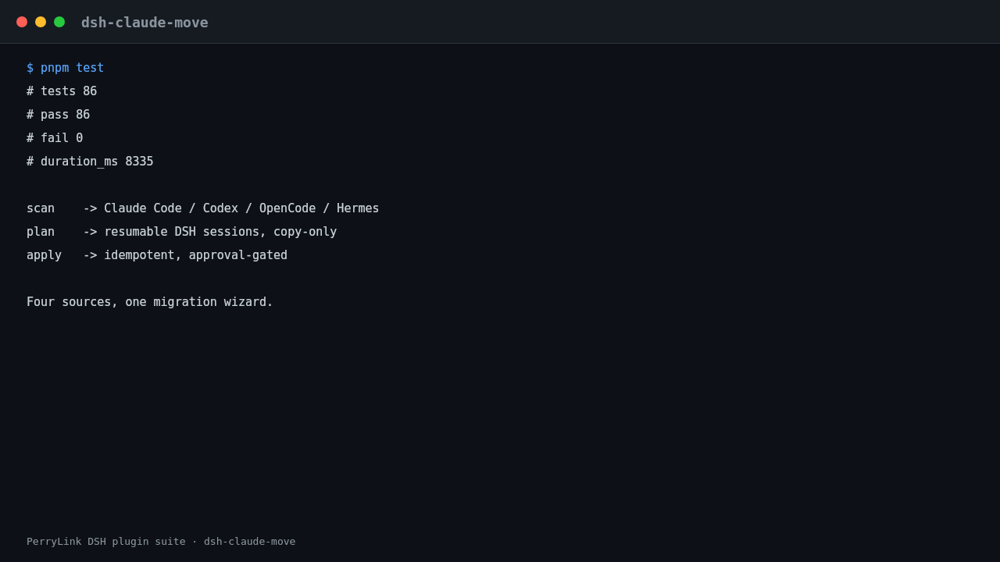

<div align="center">

# 🚚 dsh-claude-move
- **Canal 1024 store**: `npm i -g dsh1024` uma vez, depois `dsh1024 plugin --profile web add dsh-claude-move` (conta para o ranking de instalações do [deepseek1024.com](https://deepseek1024.com)).

**Migre Claude Code, Codex, OpenCode e Hermes para o DeepSeek Harness — copie sessões, memórias, habilidades, instruções e comandos de barra como sessões DSH retomáveis, somente-cópia e com aprovação.**

*Mantenha seu histórico do Claude Code ao migrar: uma única instalação, sessões retomáveis, sincronização em tempo real com um Claude Code em execução e um assistente de migração de quatro fontes.*

[](LICENSE)
[](https://gitee.com/perrylink/dsh-claude-move)
[](https://github.com/topics/dsh-plugin)
[](https://github.com/PerryLink/dsh-plugin-doctor#verified-徽章)
[](https://dsh.market/)
[](#)
[](https://github.com/PerryLink/dsh-claude-move/actions)
[](https://github.com/PerryLink/dsh-claude-move/releases)
[](https://www.npmjs.com/package/dsh-claude-move)
[](https://www.npmjs.com/package/dsh-claude-move)

[English](README.md) · [简体中文](README-zh.md) · [Español](README-es.md) · [Português](README-pt.md) · [हिन्दी](README-hi.md)

```sh
dsh plugin --profile <name> add dsh-claude-move
```


</div>

---




## Compatibilidade

- Direcionado a `dsh 0.1.6-alpha.2` (perfil web, formato de sessão V3); dependências peer exigem `>=0.1.2-rc.1 <0.2.0 || >=0.1.5-alpha.1 <0.2.0 || >=0.1.6-0 <0.2.0`. Verificado em 2026-09-18 (portão de tipos checkJs + 287 asserções, 38 suítes). O botão «abrir sessão» do painel agora é renderizado desabilitado com um título explicativo quando o host não expõe `sessions.open()`, em vez de desaparecer. Node `^22.19 || >=24`.
`0.1.2-rc.1` (adaptado em 2026-09-04): o envelope de sessão mantém seu campo ignorable apenas para compatibilidade de leitura de logs armazenados - o Session.append ainda não consegue estampá-lo, então o comportamento da porta não muda.
- A 0.4.0 inclui um shim de linha de base dupla para `sessionPersistence` em tempo de execução, detectado pela forma da API (nunca pela versão): funcionam tanto a API legada (`create`/`append`/`readFrom`, `list()` retornando cabeçalhos) quanto a costura de handle (`create` retornando um `SessionHandle`, `list()`/`stat()` retornando snapshots). A costura de handle já está publicada na linha alpha (`@deepseek-ai/dsh-session-persistence` / `-jsonl` `0.1.5-rc.2`), então o fluxo de compatibilidade a cobre. No caminho handle, todo append é seguido de `flush()` (barreira de durabilidade) e um `close()` pareado (propriedade de escritor único); os cabeçalhos são carimbados com a versão de formato atual do backend e um `isSeeded` explícito; fontes de modelo de assistente ausentes caem para o provider; e desde 0.4.5 os eventos `assistant/message` sintetizados carregam `stream: []` quando a versão de formato do backend é >= 2 — o `Session.fromRestore` do V3 exige `Array.isArray(data.stream)`, então sem isso o log era escrito e lido, mas não podia ser retomado. A limpeza da varredura de importação se recusa a executar quando o `header.id` de um elemento listado não pode ser resolvido, então `imports.json` nunca é esvaziado silenciosamente.
- Última verificação contra uma instalação nova de tarball: varredura real, importação em lote real (reimportação idempotente), anexo ao workspace e artefatos de persistência confirmados; macOS/Linux cobertos pela matriz de CI. Os logs importados usam o formato de sessão V3 e `dsh <= 0.1.2-rc.1` não consegue lê-los (a atualização é unidirecional; a alternativa é reimportar do transcript de origem).

### Matriz de compatibilidade (somente costuras públicas)

| Superfície | Uso | Fallback quando ausente |
|---|---|---|
| Serviços de host (`tools` / `sessionPersistence` / `workspaceRegistry` / `commands` / `systemPrompt` / `skills` / `webServer`) | obrigatório onde listado | serviços opcionais registram reativamente; `fs` ausente falha em voz alta |
| `sessionPersistence` linha de base dupla: legada `listSnapshots` / `readFrom` / `append` versus handle `open` / `stat` / `list()` de snapshots | detectado por recurso em tempo de execução (forma da API, nunca versão) | a guarda de resolução de `header.id` aborta a varredura em voz alta em vez de esvaziar `imports.json` silenciosamente |
| `fs` com capacidade `streamText` / `ctx.jobs` / `ctx.agents.resume` | detectado por recurso | leitura de arquivo inteiro com rejeição em voz alta / mapa de jobs próprio / injeção de handoff |
| Serviços de shell do cliente (`sessions.refresh/open`, `workspaces.refresh`) | detectado por recurso ao aplicar o painel | recarga completa da página |
| Capacidades de plataforma mais novas nunca são requisitos rígidos — o plugin continua inicializável na linha mais antiga suportada (`0.1.2-rc.1`). | | |

## O que você recebe

1. **Auto-descoberta** — `claude_scan` localiza a raiz de dados do Claude (`$CLAUDE_CONFIG_DIR`, fallback `~/.claude`) e indexa cada projeto/sessão, memória, habilidade, `CLAUDE.md` global e `settings.json`, com cache incremental e varredura paralela (`scanConcurrency`).
2. **Importação de fidelidade total** — `import_claude` converte transcrições em sessões DSH balanceadas e retomáveis (`turn/start → step/start → user/message → assistant/message → tool/call → tool/result → step/end → turn/end`), repara chamadas de ferramenta interrompidas e importa por streaming em blocos transcrições maiores que `maxTranscriptBytes`.
3. **Um único workspace `claudecode`** — cada sessão importada cai em um workspace dedicado (padrão `$DSH_HOME/claudecode`); `workspaceMode: 'per-project'` restaura o agrupamento de um workspace por projeto.
4. **Somente-cópia e incremental** — nada é movido, reescrito ou excluído em nenhum dos lados; reexecutar apenas anexa os turnos novos (`force: true` salva uma cópia completa extra sob um novo id).
5. **Contexto pessoal, sempre atualizado** — memórias injetadas como uma seção de prompt em tempo real, habilidades do Claude registradas como habilidades DSH reais (globais + de projeto), e o `CLAUDE.md` global + de projeto injetado cedo.
6. **Assistente de migração de quatro fontes** — `/move` mais `move_detect` / `move_preview` / `move_run` migram Claude Code, Codex, OpenCode e Hermes, com aprovação e idempotência (`move.json`).
7. **Painel web e comandos** — `/claude-import-all`, `/resume-claude`, `/claude-move-reset`, `/claude-export` e um painel de migração flutuante.
8. **Exportação bidirecional** — `claude_export` (ou `/claude-export <sessionId>`) grava uma sessão DSH de volta como transcript JSONL retomável do Claude Code (turnos `user`/`assistant`/`tool`, pareamento `thinking` + `tool_use`/`tool_result`, mapeamento `cwd` de melhor esforço), para que o histórico possa sair do DSH novamente.

## Assistente de migração de quatro fontes

```text
/move              # assistente de um só passo: detectar → pré-visualizar → executar → relatar (as quatro fontes)
move_detect        # varre Claude Code / Codex / OpenCode / Hermes
move_preview       # plano por item: new | unchanged | changed | conflict (com diff) | unsupported
move_run           # executa atrás da porta de aprovação; resolução de conflitos:
                   #   skip | overwrite | rename | merge  (padrão skip — nunca adivinha)
```

- **Fontes** — Claude Code (`~/.claude`), Codex (`~/.codex`), OpenCode (raízes de dados + config), Hermes (raízes de skills/memória); cada fonte tem seu próprio parser + mapper.
- **Mapeamento** — memórias/instruções → seções gerenciadas somente-anexáveis no `AGENTS.md` global do DSH (uma seção marcada por item); skills → skills DSH reais (pacotes `SKILL.md` copiados tal e qual, outros formatos convertidos); comandos de barra → comandos DSH registrados (reconstruídos a partir de `move.json` após reiniciar); sessões → sessões DSH retomáveis (os mesmos importadores da fase 1).
- **Idempotente** — cada plano aplicado é registrado em `$DSH_HOME/claude-move/move.json` (`digest` / `targetDigest` / `appliedAt`); reexecuções pulam itens inalterados e `force` os reaplica.
- **Com aprovação** — uma execução que escreveria algo pergunta primeiro a `ctx.approval`; qualquer coisa diferente de `allowed-once` significa zero escritas.

## Início rápido

```sh
# 1. instale o bundle no seu perfil
dsh plugin --profile web add "github:PerryLink/dsh-claude-move#master"

# ou pelo npm (versões publicadas)
dsh plugin --profile web add dsh-claude-move

# 2. reinicie e verifique a linha
dsh --profile web --dump-config | grep -A4 'id: claude-move'
```

Depois, em qualquer sessão DSH, execute um comando:

```sh
/claude-import-all      # varre → copia cada sessão do Claude → relata
```

Não é preciso reiniciar o DSH após importar — atualize a página web aberta uma vez e clique em qualquer sessão importada para continuar.

## Instalar e desinstalar

- **Canal git** (último `master`): `dsh plugin --profile web add "github:PerryLink/dsh-claude-move#master"` — ESM puro, sem etapa de `prepare` nem `allowBuilds`.
- **Canal npm** (versões publicadas): `dsh plugin --profile web add dsh-claude-move`.
- **Canal tarball**: `npm pack` neste repo e depois `dsh plugin --profile web add ./dsh-claude-move-<version>.tgz`.
- **Desinstalar**: remova a linha `claude-move` dos bundles do perfil e reinicie o `dsh`. As sessões importadas permanecem no diretório de dados do DSH; o plugin só grava seu cache (`$DSH_HOME/claude-move/`) e a pasta do workspace `claudecode`, e nunca toca nos dados fonte do Claude.

## O que é migrado

```
~/.claude (somente leitura)
 ├─ projects/*/*.jsonl  ──→  sessões DSH retomáveis, agrupadas em um workspace "claudecode" (padrão)
 ├─ projects/*/memory/  ──→  seção de memória do system-prompt em tempo real (relida por requisição)
 ├─ skills/**           ──→  skills DSH reais
 └─ CLAUDE.md + settings ──→  seção de prompt inicial + sugestões de configuração (nunca auto-aplicadas)
```

| No Claude Code | Chega ao DSH como |
|---|---|
| Transcrições de sessão (`projects/*/*.jsonl`) | Sessões DSH balanceadas e retomáveis — mapeamento de fidelidade total de `user`/`assistant`/`tool`/`thinking` com reparo de chamadas de ferramenta interrompidas — agrupadas em um workspace **`claudecode`** ou uma por projeto |
| Arquivos de memória (`projects/*/memory/*.md`) | Uma seção de contexto do system-prompt em tempo real, relida a cada requisição (`feedback > project > reference > user`) |
| Skills (`~/.claude/skills/**`) | Skills DSH reais (nomes kebab-case, sufixos de colisão, máximo 30 por padrão; `README.md`/`MEMORY.md` e arquivos sem descrição são pulados) |
| `CLAUDE.md` (global + por projeto) | Uma seção de prompt inicial; o arquivo do projeto vence |
| `settings.json` | Sugestões de configuração DSH com uma lista explícita de chaves não mapeáveis |
| Estado do projeto (diretório, branch git e contagem de sujeira) | Mostrado no índice de varredura, nos selos do painel web e no handoff de `/resume-claude` |

## Uso

Chame as ferramentas em qualquer sessão com o plugin montado:

```
claude_scan                          # varredura completa (cache incremental)
claude_scan { path: "~/.claude/projects/<slug>" }   # varredura parcial
claude_scan { refresh: true }        # pula o cache, revê tudo
claude_scan { projectsLimit: 10, sessionsLimit: 5, fields: "brief" }  # reduz a saída

import_claude { path: "~/.claude/projects/<slug>/<sessionId>.jsonl" }  # uma sessão
import_claude { path: "~/.claude/projects" }        # diretório (recursivo)
import_claude { path: "all" }                       # tudo
# Reexecute a qualquer momento: arquivos inalterados são pulados, transcrições crescidas anexam apenas os turnos novos.
# Arquivos acima de maxTranscriptBytes são importados por streaming em blocos (sem teto de memória).
import_claude { path: "...", force: true }          # cópia completa nova (cópia anterior mantida)

claude_export { sessionId: "<dsh-session-id>" }     # grava uma sessão DSH de volta para JSONL do Claude
claude_export { sessionId: "...", path: "~/.claude/projects/<slug>/<id>.jsonl" }  # destino explícito
```

Comandos (acionados pelo usuário, sem turno do modelo):

```
/claude-import-all                # um só passo: varre → importa tudo → relata → injeta na sessão atual
/resume-claude latest             # continua a sessão do Claude mais recente
/resume-claude <sessionId>        # por id de sessão fonte ou id import-<src>
/resume-claude <keyword>          # corresponde a títulos; múltiplas correspondências são listadas, nunca adivinhadas
/claude-move-reset                # reinicia o cache do plugin (marcadores + mapa de importação); sessões importadas são mantidas
/claude-export <sessionId> [path] # exporta uma sessão DSH para um transcript JSONL retomável do Claude
```

Painel web: um painel de migração flutuante com a árvore de projetos/sessões, selos de status (não importado / importado / importado-com-turnos-novos / fonte ausente / diretório ausente / git sujo), filtro por palavra-chave, renderização paginada, "Importar e continuar" + "Abrir sessão" + "Atualizar lista de sessões" por sessão, importação em lote com barra de progresso em tempo real e cancelar, e um botão de reinício de cache. Os textos seguem o idioma do navegador (zh/en). Servido pelas rotas JSON `/api/claude-move/*` próprias do plugin na costura pública `ctx.webServer`.

## Depois de importar

**Você não precisa reiniciar o DSH.** As importações chegam de forma durável pelo serviço público `sessionPersistence` no momento em que são concluídas:

- As listas do lado do servidor (RPCs `session.list` / `workspace.list`, a CLI, qualquer novo carregamento de página) mostram as sessões importadas sob o workspace **`claudecode`** imediatamente.
- O painel atualiza sozinho a lista de sessões da página já aberta e oferece um botão **Abrir sessão** por sessão importada.
- As sessões importadas podem ser abertas, lidas e retomadas de imediato — `/resume-claude`, ou clique na sessão na lista. Reexecutar a importação a qualquer momento sincroniza apenas os turnos novos nas mesmas sessões.

## Configuração

Tudo opcional, anulável no cordis.yml.

| Chave | Padrão | Significado |
|---|---|---|
| `claudeHome` | `$CLAUDE_CONFIG_DIR` ou `~/.claude` | Raiz de dados do Claude |
| `workspaceMode` | `claudecode` | `claudecode` (um workspace dedicado) · `per-project` (um workspace por cwd fonte) |
| `claudecodeDir` | `$DSH_HOME/claudecode` | A pasta do workspace `claudecode` (a única pasta que o plugin cria) |
| `scanGit` | `true` | Nível de sondagem do git: `true` (completo) · `'branch'` (zero chamadas git) · `false` |
| `gitTimeoutMs` | `5000` | Timeout do subprocesso git |
| `scanConcurrency` | `8` | Limite de varredura paralela de projetos |
| `maxTranscriptBytes` | `67108864` | Limiar de importação por streaming (em blocos acima) |
| `excludeProjects` | `[]` | Substrings de slug a pular |
| `enableMemory` | `true` | Injeta memórias como seção de prompt em tempo real |
| `memoryMaxBytes` | `8192` | Limite da seção de memória |
| `memoryScope` | `current-project` | `current-project` · `all` (projeto atual primeiro) |
| `enableSkills` | `true` | Registra habilidades do Claude como habilidades DSH |
| `maxSkills` | `30` | Limite de quantidade de habilidades |
| `extraSkillDirs` | `[]` | Diretórios de habilidades extras |
| `enableInstructions` | `true` | Injeta `CLAUDE.md` global + de projeto |
| `resumeMaxChars` | `2048` | Limite de caracteres do resumo de handoff |
| `resumeMode` | `inject` | `inject` (resumo de handoff) · `agents` (ctx.agents.resume) |
| `enableWebPanel` | `true` | Registra as rotas do painel `/api/claude-move/*` |
| `importConcurrency` | `4` | Leitura + conversão em paralelo por lote |
| `requireApproval` | `true` | Escritas do assistente pedem `ctx.approval` (somente allowed-once) |
| `codexHome` | `$CODEX_HOME` ou `~/.codex` | Raiz de dados do Codex |
| `opencodeDataHome` | dir de dados XDG da plataforma/opencode | Raiz de dados do OpenCode |
| `opencodeConfigHome` | dir de config XDG da plataforma/opencode | Raiz de config do OpenCode |
| `hermesHome` | `$HERMES_HOME` ou `~/.hermes` | Raiz de dados do Hermes |
| `skillsDir` | `$DSH_HOME/skills` | Destino de skills do assistente |
| `agentsMdPath` | `$DSH_HOME/AGENTS.md` | Destino de memória/instruções do assistente |
| `moveWorkspaceMode` | `per-source` | Agrupamento de workspace para importações do assistente: `per-source` · `single` |
| `enableExport` | `true` | Registra a ferramenta `claude_export` e o comando `/claude-export` |
| `exportDir` | `$DSH_HOME/claude-export` | Pasta de exportação padrão (um `path` explícito sempre vence) |

## Ferramentas e superfícies

| Superfície | Tipo | Notas |
|---|---|---|
| `claude_scan` | ferramenta | Índice estruturado de projetos/sessões/memórias/habilidades/ajustes |
| `import_claude` | ferramenta | Importa uma sessão, um diretório ou `all` (incremental; `force` para cópia nova) |
| `claude_export` | ferramenta | Exporta uma sessão DSH para um transcript JSONL retomável do Claude Code |
| `move_detect` / `move_preview` / `move_run` | ferramentas | Assistente de quatro fontes: varrer, plano por item com diffs, executar após aprovação |
| `/claude-import-all` | comando | Varre → importa tudo → relata |
| `/resume-claude` | comando | Continua uma sessão do Claude (latest, id ou palavra-chave) |
| `/claude-move-reset` | comando | Reinicia o cache do plugin (sessões importadas mantidas) |
| `/claude-export` | comando | Exporta uma sessão DSH para um transcript JSONL retomável do Claude |
| `/move` | comando | Assistente de quatro fontes de um só passo |
| Painel web de migração | cliente | Painel flutuante com progresso, cancelamento, paginação, abrir sessão |

## Permissões e dados

- **Permissões**: o manifesto do workshop declara `filesystem:read` e `filesystem:write`.
- **Lê** `~/.claude` (transcrições, memórias, habilidades, `CLAUDE.md`, `settings.json`) — estritamente somente leitura — e os diretórios de projeto para os quais importa.
- **Grava** logs de sessão DSH via o serviço público `sessionPersistence` (somente create + append, nunca exclui/reescreve/arquiva), registros do workspace-registry, seu cache sob `$DSH_HOME/claude-move/` e a pasta do workspace `claudecode`.
- **Nunca** modifica arquivos fonte do Claude, toca dados de outros aplicativos nem acessa a rede. **Nenhuma** credencial é lida ou transmitida.

## Limites de segurança

- **Arquivos fonte são somente leitura; logs DSH são somente-append** (somente `create` + `append`).
- **Transcrições externas são entrada não confiável** — nada nelas é executado; conteúdo system/developer/thinking nunca entra no handoff de retomada.
- **Somente serviços públicos** — `sessionPersistence` / `workspaceRegistry` / `tools` / `commands` / `systemPrompt` / `skills` / `webServer`; sem mudanças no motor ou na UI.
- **Segredos relatados apenas por posição** (file:line:kind); registros `permission`/`permission-mode`/`queue-operation` são contados, não importados.
- **Escritas do assistente com aprovação** — qualquer coisa diferente de `allowed-once` significa zero escritas.

## Limitações conhecidas

- Títulos vêm de `custom-title`/`ai-title`/primeiro prompt; registros `summary` do Claude são relatados mas não mapeados para nós de compactação DSH (sintetizar uma transação de compactação válida fabricaria seu intervalo de seq e sua mensagem de checkpoint).
- Blocos `thinking` são mantidos como conteúdo `reasoning`, mas nunca entram no handoff de retomada.
- Chamadas de ferramenta interrompidas são reparadas com um resultado de erro sintético (nunca descartadas), relatado como `repaired.synthesized`.
- Registros da classe de permissões são contados, não importados; sugestões de permissões predefinidas DSH são geradas nos relatórios.
- Em hosts sem uma superfície de streaming `fs.streamText`, transcrições maiores que `maxTranscriptBytes` falham em voz alta em vez de importar parcialmente.
- Em `workspaceMode: 'per-project'`, sessões cujo diretório fonte foi excluído ainda importam, mas o anexo ao workspace falha (ficam desagrupadas; `workspace.attached: false` mais um `reason`). O workspace `claudecode` padrão não depende do diretório fonte.
- Se uma transcrição foi truncada ou reiniciada no lugar (menos turnos que a importação registrada), a reimportação a pula e relata `sourceShrunk`; use `force: true` para uma cópia completa nova.
- O painel web é um painel flutuante sem build dirigido pelas próprias rotas JSON do plugin; ele não usa o sistema de slots de UI interno do shell.

## Experiência do modelo

- A superfície visível ao modelo são as descrições/esquemas das duas ferramentas e suas saídas: `claude_scan` retorna o índice estruturado, `import_claude` retorna resumos por arquivo com posições dos avisos. Os resultados das ferramentas são eles próprios registrados como eventos `tool/result`, de modo que tudo é reconstruível.
- Nenhum texto oculto visível ao modelo; as seções de memória/`CLAUDE.md` são registradas em `ctx.systemPrompt` (montagem de prompt, reconstruível a partir do log de sessão).

## Solução de problemas

- Linha sem efeito: `dsh --profile <p> --dump-config` deve imprimir `# == dsh-claude-move`; reexecute `dsh plugin --profile <p> add ...`.
- A web inicializa mas trava em silêncio: perfis novos inicializados por `dsh plugin add` contêm apenas `dsh-base` — adicione `@deepseek-ai/dsh-web-app` a `dsh.profile.bundles`. Instalar no perfil `web` existente não precisa de nada.
- Rotas do painel 404: elas são servidas apenas quando `enableWebPanel: true` e um servidor web está composto; verifique o log de inicialização em busca de fibers FAILED.
- A importação falha com "transcript 过大": aumente `maxTranscriptBytes` ou importe esse arquivo individualmente.
- A importação teve sucesso, mas a barra lateral não mostra nenhuma sessão nova: a página já estava aberta — clique uma vez no botão de atualizar do painel (ou recarregue a página). Nunca é preciso reiniciar o DSH.
- Logs: falhas de inicialização são impressas no console do `dsh`; o plugin registra erros com prefixo `[claude-move]` para problemas de workspace/mapa de importação.

## Atribuição (componentes de código aberto)

Este projeto está licenciado sob a Apache License 2.0; os seguintes componentes licenciados sob MIT mantêm suas próprias licenças (texto completo em [THIRD_PARTY_NOTICES.md](THIRD_PARTY_NOTICES.md)):

- Núcleo de conversão vendored de [Nwflower/dsh-chat-import](https://github.com/Nwflower/dsh-chat-import) (MIT).
- Convenções de descoberta e modelo de segurança de [Demogorgon314/dsh-resume-plugin](https://github.com/Demogorgon314/dsh-resume-plugin) (MIT).
- Padrões de injeção de memória/skills e análise de frontmatter de [YYTbit/dsh-plugin-claude-bridge](https://github.com/YYTbit/dsh-plugin-claude-bridge) (MIT).

## Desenvolvimento

```sh
npm install   # peer deps: @deepseek-ai/dsh-tools@>=0.1.2-rc.1 <0.2.0 || >=0.1.5-alpha.1 <0.2.0, @deepseek-ai/cordis, schemastery
npm test      # node --test test/*.test.mjs
```

A CI executa a suíte completa no Node 22 em Linux/macOS/Windows via GitHub Actions ([test.yml](.github/workflows/test.yml)).

## Tópicos

`deepseek-harness`, `dsh-plugin`, `claude-code`, `migration`, `session-import`, `resume`

## Contribuidores

- [@PerryLink](https://github.com/PerryLink) — criador e mantenedor: o pipeline de importação, o assistente de migração de quatro fontes, o painel web, a documentação, CI/CD e releases.
- [@OLDnana1](https://github.com/OLDnana1) — análise de causa raiz da corrupção de chamadas de ferramenta interrompidas que fazia as sessões importadas retornarem permanentemente HTTP 400 ao retomar.
- [@GooodWei](https://github.com/GooodWei) — identificou que `README.md` (e qualquer `.md` sem descrição) era registrado incorretamente como habilidade, o que quebrava o carregamento de habilidades do DSH.

## PerryLink DSH Plugin Family

Este projeto é um dos **87 plugins ativamente mantidos** do DeepSeek Harness da [PerryLink](https://github.com/PerryLink). O registro da família tem **95** plugins — **5 congelados**, **3 retirados** — e fica recolhido abaixo para que cada README mantenha uma primeira tela curta. Expanda para ver cada linha, com o motivo na coluna Status.

<details>
<summary>Expandir os 95 plugins</summary>

| Plugin | Uma linha | Status |
|---|---|---|
| **[dsh-aqua-input-check](https://github.com/PerryLink/dsh-aqua-input-check)** | 水产养殖投入品记录核对（按投入品用量、休药期与起捕间隔核对记录自洽，仅提示差异，不作出定性结论） |  |
| **[dsh-archive-check](https://github.com/PerryLink/dsh-archive-check)** | 档案归档完整性与保管期限核对（依据《档案法》及配套规定，仅提示差异，不作出定性结论） |  |
| **[dsh-auto-review](https://github.com/PerryLink/dsh-auto-review)** | Second-model auto-review on the approval chain, fail-closed by default |  |
| **[dsh-autotier](https://github.com/PerryLink/dsh-autotier)** | Automatic strong/cheap model-tier routing with deterministic risk guards and a `/tier` command |  |
| **[dsh-background-agents](https://github.com/PerryLink/dsh-background-agents)** | Durable background child agents with a Web UI sidebar, messaging and interrupt | 🚫 RETIRADO — ver o README do repositório |
| **[dsh-bid-ca-precheck](https://github.com/PerryLink/dsh-bid-ca-precheck)** | 投标文件符合性预检（按招标文件逐条核对响应情况，仅提示差异，不作出定性结论） |  |
| **[dsh-bid-qual-check](https://github.com/PerryLink/dsh-bid-qual-check)** | 投标人资格条件核对（按资格条件与证明材料核对逐条响应，仅提示差异，不作出定性结论） |  |
| **[dsh-budget](https://github.com/PerryLink/dsh-budget)** | Cost governance for DeepSeek Harness: budgets, carbon, and latency in one panel. | 🧊 CONGELADO — ver o README do repositório |
| **[dsh-cert-mcp](https://github.com/PerryLink/dsh-cert-mcp)** | Read-only MCP server exposing the certification registry: grades, snapshots and five-dimension evidence |  |
| **[dsh-checkpoint-rewind](https://github.com/PerryLink/dsh-checkpoint-rewind)** | Claude Code /rewind-equivalent: snapshots, session forks, one-shot restore |  |
| **[dsh-claude-move](https://github.com/PerryLink/dsh-claude-move)** | Migrate Claude Code sessions, memory, skills and CLAUDE.md into DSH | 🧊 CONGELADO — ver o README do repositório |
| **[dsh-click](https://github.com/PerryLink/dsh-click)** | Cross-platform native desktop control for DeepSeek Harness — Windows first. |  |
| **[dsh-composer-history](https://github.com/PerryLink/dsh-composer-history)** | Terminal-style input history for the web composer: arrows, Ctrl+R search |  |
| **[dsh-contract-stance](https://github.com/PerryLink/dsh-contract-stance)** | 合同条款立场台账核对（按立场、风险等级与退让底线核对台账自洽，仅提示差异，不作出定性结论） |  |
| **[dsh-customs-doc-check](https://github.com/PerryLink/dsh-customs-doc-check)** | 报关单证一致性核对（按公开的报关单填制规范核对单证间字段一致性，仅提示差异，不作出定性结论） |  |
| **[dsh-data-quality](https://github.com/PerryLink/dsh-data-quality)** | Dataset quality checks and citation cross-checks (the optional numeric bridge consumed here) |  |
| **[dsh-defend](https://github.com/PerryLink/dsh-defend)** | Prompt-injection, jailbreak, and secret-leak defense for DeepSeek Harness. | 🧊 CONGELADO — ver o README do repositório |
| **[dsh-demurrage-ledger](https://github.com/PerryLink/dsh-demurrage-ledger)** | 滞箱费台账核对（按免箱期与费率核对超期天数与金额的自洽性，仅提示差异，不作出定性结论） |  |
| **[dsh-doublecheck](https://github.com/PerryLink/dsh-doublecheck)** | Engineering-discipline guard: requirements grill, test gates, adversary review |  |
| **[dsh-draw](https://github.com/PerryLink/dsh-draw)** | Unified static-image generation routing for DeepSeek Harness. | 🧊 CONGELADO — ver o README do repositório |
| **[dsh-drill-script-check](https://github.com/PerryLink/dsh-drill-script-check)** | 应急演练脚本核对（按阶段、响应分级、指挥与资源要素核对脚本齐备，仅提示差异，不作出定性结论） |  |
| **[dsh-eia-guide-check](https://github.com/PerryLink/dsh-eia-guide-check)** | 环评导则适用性核对（按要素、导则名称与执行标准核对台账自洽，仅提示差异，不作出定性结论） |  |
| **[dsh-emergency-plan](https://github.com/PerryLink/dsh-emergency-plan)** | 应急预案要素齐备性与条款级页码定位（依据 GB/T 29639-2020 等公开文件，仅提示差异，不作出定性结论） |  |
| **[dsh-essay-rubric-check](https://github.com/PerryLink/dsh-essay-rubric-check)** | 作文量表评分核对（按评分项、原文定位与分值算术核对评分自洽，仅提示差异，不作出定性结论） |  |
| **[dsh-evidence-check](https://github.com/PerryLink/dsh-evidence-check)** | 证据清单齐备性核对（按待证事实与证据要素核对清单自洽，仅提示差异，不作出定性结论） |  |
| **[dsh-export-ctl-check](https://github.com/PerryLink/dsh-export-ctl-check)** | 出口管制物项核对（按管制清单、最终用途与许可证核对台账齐备，仅提示差异，不作出定性结论） |  |
| **[dsh-fast](https://github.com/PerryLink/dsh-fast)** | Read-only performance diagnostics for DeepSeek Harness. |  |
| **[dsh-fmea-table-check](https://github.com/PerryLink/dsh-fmea-table-check)** | FMEA 分析表要素齐备性与风险顺序数一致性核对（按公开的 FMEA 方法标准核对表内自洽，仅提示差异，不作出定性结论） |  |
| **[dsh-forecast-penalty](https://github.com/PerryLink/dsh-forecast-penalty)** | 预测准确率考核核对（按准确率、门槛与考核单价核对考核费用的算术自洽，仅提示差异，不作出定性结论） |  |
| **[dsh-fund-research](https://github.com/PerryLink/dsh-fund-research)** | Deterministic research reports for Chinese public mutual funds |  |
| **[dsh-github](https://github.com/PerryLink/dsh-github)** | GitHub PR/issues integration for DSH, every write gated by approval |  |
| **[dsh-gongwen-flow-check](https://github.com/PerryLink/dsh-gongwen-flow-check)** | 公文流转与办理时限核对（按公开的公文处理规范核对环节完整性与时限，仅提示差异，不作出定性结论） |  |
| **[dsh-gongwen-word-check](https://github.com/PerryLink/dsh-gongwen-word-check)** | 公文格式要素核对（按公开的党政机关公文格式标准核对版头与主体要素，仅提示差异，不作出定性结论） |  |
| **[dsh-guard-plan-qc](https://github.com/PerryLink/dsh-guard-plan-qc)** | 劳动保护与安全防护用品配置表核对（按公开的配备标准核对品名规格与配置数量，仅提示差异，不作出定性结论） |  |
| **[dsh-hazchem-check](https://github.com/PerryLink/dsh-hazchem-check)** | 危险化学品临界量与重大危险源辨识核对（按储存量与临界量核对台账自洽，仅提示差异，不作出定性结论） |  |
| **[dsh-hazplan-check](https://github.com/PerryLink/dsh-hazplan-check)** | HAZOP 分析表要素齐备性与偏差推导一致性核对（依据公开的危险与可操作性分析标准，仅提示差异，不作出定性结论） |  |
| **[dsh-hidden-risk-map](https://github.com/PerryLink/dsh-hidden-risk-map)** | 安全隐患台账→《工贸企业重大事故隐患判定标准》（应急管理部令第10号）条款映射提示（仅提示差异，不作出定性结论） |  |
| **[dsh-hs-classify](https://github.com/PerryLink/dsh-hs-classify)** | 商品归类层级一致性核对（按章、品目、子目与商品编号的层级关系核对自洽，仅提示差异，不作出定性结论） |  |
| **[dsh-icd-rule-check](https://github.com/PerryLink/dsh-icd-rule-check)** | ICD 合并编码与星剑号配对提示（依据 GB/T 14396-2016 与公开的 ICD 使用说明，仅提示差异，不作出定性结论） |  |
| **[dsh-industry-research](https://github.com/PerryLink/dsh-industry-research)** | Industry research orchestration that seals its deliverables through this plugin's `ctx.researchReport.assemble` |  |
| **[dsh-lawcite-adapter](https://github.com/PerryLink/dsh-lawcite-adapter)** | 法条引用与文书要素核对（按名称、条号、原文与效力状态核对引用可核验性，仅提示差异，不作出定性结论） |  |
| **[dsh-laya](https://github.com/PerryLink/dsh-laya)** | Laya typed decisions (`noul`/`choice`/`score`) as a first-class Cordis service and model-visible tools |  |
| **[dsh-lc-doc-check](https://github.com/PerryLink/dsh-lc-doc-check)** | 信用证单据条款核对（按单据种类、份数、期限与不符点核对交单自洽，仅提示差异，不作出定性结论） |  |
| **[dsh-learning-gap-check](https://github.com/PerryLink/dsh-learning-gap-check)** | 能力差距与培养计划核对（按能力等级差、培养措施与完成期限核对台账闭环，仅提示差异，不作出定性结论） |  |
| **[dsh-library](https://github.com/PerryLink/dsh-library)** | Local document knowledge base for DeepSeek Harness. |  |
| **[dsh-local-ai](https://github.com/PerryLink/dsh-local-ai)** | Local-model (Ollama) integration for DeepSeek Harness. |  |
| **[dsh-lsp-actions](https://github.com/PerryLink/dsh-lsp-actions)** | LSP diagnostics, formatting, completion, code actions and rename over language servers |  |
| **[dsh-mask](https://github.com/PerryLink/dsh-mask)** | PII masking middleware: anonymize at the model boundary, restore at the display layer |  |
| **[dsh-mcp-panel](https://github.com/PerryLink/dsh-mcp-panel)** | Read-only MCP runtime panel: /mcp command + Settings tab with status, tools and errors |  |
| **[dsh-medrec-qc](https://github.com/PerryLink/dsh-medrec-qc)** | 病案首页形式质控与逻辑矛盾提示（依据国卫办医发〔2016〕24号等公开文件，仅提示差异，不作出定性结论） |  |
| **[dsh-memento](https://github.com/PerryLink/dsh-memento)** | Approval-gated cross-session memory: ctx.memory seam + SQLite + memory tool |  |
| **[dsh-nsfc-form-check](https://github.com/PerryLink/dsh-nsfc-form-check)** | 国家自然科学基金申请书形式审查与匿名化提示（依据《国家自然科学基金条例》与申请人导入的当年指南，仅提示差异，不作出定性结论） |  |
| **[dsh-nurse-record-check](https://github.com/PerryLink/dsh-nurse-record-check)** | 护理记录时限、签名与评估表完整性校验（依据《病历书写基本规范》等公开文件，仅提示差异，不作出定性结论） |  |
| **[dsh-observe](https://github.com/PerryLink/dsh-observe)** | OpenTelemetry and Langfuse observability exporter for DeepSeek Harness. |  |
| **[dsh-origin-rvc-check](https://github.com/PerryLink/dsh-origin-rvc-check)** | 原产地区域价值成分核对（按 RVC 定义式与门槛核对原产地判定自洽，仅提示差异，不作出定性结论） |  |
| **[dsh-ota-review-check](https://github.com/PerryLink/dsh-ota-review-check)** | 在线点评回复台账核对（按回复时限、问题分类与整改状态核对台账闭环，仅提示差异，不作出定性结论） |  |
| **[dsh-output-styles](https://github.com/PerryLink/dsh-output-styles)** | Claude Code outputStyles-equivalent runtime style switching |  |
| **[dsh-paper-doc-adapter](https://github.com/PerryLink/dsh-paper-doc-adapter)** | 试卷解析结构核对（按题型、答案、分值与 yotta 标识核对试卷结构自洽，仅提示差异，不作出定性结论） |  |
| **[dsh-permission-rules](https://github.com/PerryLink/dsh-permission-rules)** | Claude Code-style declarative allow/deny/ask permission rules with audit |  |
| **[dsh-permit-report-check](https://github.com/PerryLink/dsh-permit-report-check)** | 行政许可办理核对（按申请材料、法定时限与决定记录核对台账闭环，仅提示差异，不作出定性结论） |  |
| **[dsh-pipeline-check](https://github.com/PerryLink/dsh-pipeline-check)** | 项目全流程文件链条核对（按环节先后与金额口径核对链条自洽，仅提示差异，不作出定性结论） |  |
| **[dsh-pleading-draft](https://github.com/PerryLink/dsh-pleading-draft)** | 起诉状要素齐备性核对（按诉请、事实、证据、法条四要素核对文书齐备，仅提示差异，不作出定性结论） |  |
| **[dsh-plugin-doctor](https://github.com/PerryLink/dsh-plugin-doctor)** | Zero-dependency static + sandbox smoke detector for DSH plugins |  |
| **[dsh-plugin-guide](https://github.com/PerryLink/dsh-plugin-guide)** | Plugin-development knowledge base as an on-demand agent skill |  |
| **[dsh-plugin-kit](https://github.com/PerryLink/dsh-plugin-kit)** | Shared zero-runtime-dependency toolkit for the PerryLink DSH plugins |  |
| **[dsh-plugin-upgrade](https://github.com/PerryLink/dsh-plugin-upgrade)** | One-package, one-corridor-index plugin upgrade skill: routes a repository to the matching closed corridor card |  |
| **[dsh-policy-brief-draft](https://github.com/PerryLink/dsh-policy-brief-draft)** | 政策专报要素核对（按观点、依据、出处与建议核对专报齐备，仅提示差异，不作出定性结论） |  |
| **[dsh-power-loss-split](https://github.com/PerryLink/dsh-power-loss-split)** | 线损电量拆分与考核表核对（依据公开的线损计算口径，仅提示差异，不作出定性结论） |  |
| **[dsh-power-ticket-check](https://github.com/PerryLink/dsh-power-ticket-check)** | 电力工作票要素齐备性与签发许可顺序核对（依据现行电力安全工作规程，仅提示差异，不作出定性结论） |  |
| **[dsh-ppap-check](https://github.com/PerryLink/dsh-ppap-check)** | PPAP 提交要素齐备性核对（按公开的 PPAP 手册与提交等级核对要素齐备与版本填写，仅提示差异，不作出定性结论） |  |
| **[dsh-protest-deadline](https://github.com/PerryLink/dsh-protest-deadline)** | 质疑与投诉期限核对（按公开的政府采购质疑投诉规定核对期限与台账自洽，仅提示差异，不作出定性结论） |  |
| **[dsh-railway-window](https://github.com/PerryLink/dsh-railway-window)** | 铁路施工天窗台账核对（按时间窗、时长算术与命令号核对台账自洽，仅提示差异，不作出定性结论） |  |
| **[dsh-reach](https://github.com/PerryLink/dsh-reach)** | Multi-channel approval/question bridge: WeChat/Telegram/Feishu, session console | 🧊 CONGELADO — ver o README do repositório |
| **[dsh-repair-order-qc](https://github.com/PerryLink/dsh-repair-order-qc)** | 维修工单结算核对（按项目金额、配件工时合计与结算总额核对算术自洽，仅提示差异，不作出定性结论） |  |
| **[dsh-research-report](https://github.com/PerryLink/dsh-research-report)** | Verifiable research-report engine: content-addressed evidence ledger and sealed versions |  |
| **[dsh-review-reply-check](https://github.com/PerryLink/dsh-review-reply-check)** | 审稿意见逐条回应覆盖核对（按意见与回应一一对应核对覆盖完整性，仅提示差异，不作出定性结论） |  |
| **[dsh-rulefile-check](https://github.com/PerryLink/dsh-rulefile-check)** | 规则库文件自检核对（按条款引用纪律与效力上限核对规则库自身合规，仅提示差异，不作出定性结论） |  |
| **[dsh-safety-brief-check](https://github.com/PerryLink/dsh-safety-brief-check)** | 安全技术交底记录要素齐备性与签字闭环核对（依据公开的安全生产法规与检查标准，仅提示差异，不作出定性结论） |  |
| **[dsh-score](https://github.com/PerryLink/dsh-score)** | Multi-dimensional quality scoring for DeepSeek Harness plugins. |  |
| **[dsh-session-pin](https://github.com/PerryLink/dsh-session-pin)** | Pin sessions in the Web sidebar with durable ordering | 🚫 RETIRADO — ver o README do repositório |
| **[dsh-session-sync](https://github.com/PerryLink/dsh-session-sync)** | Cross-device session sync for DeepSeek Harness — a dedicated git mirror of your session store. |  |
| **[dsh-site-log-check](https://github.com/PerryLink/dsh-site-log-check)** | 监理日志跨日连续性与旁站覆盖提示（依据 GB/T 50319-2013 等公开文件，仅提示差异，不作出定性结论） |  |
| **[dsh-skill-pack-security](https://github.com/PerryLink/dsh-skill-pack-security)** | Security-audit skill pack: secret scan, dependency and supply-chain review |  |
| **[dsh-soe-decision-check](https://github.com/PerryLink/dsh-soe-decision-check)** | 三重一大决策台账核对（按前置研究、会议审议与决议记录核对程序留痕，仅提示差异，不作出定性结论） |  |
| **[dsh-soilwater-check](https://github.com/PerryLink/dsh-soilwater-check)** | 土壤与地下水监测台账核对（按点位、监测项目、限值与超标判定核对台账自洽，仅提示差异，不作出定性结论） |  |
| **[dsh-sop-sync-check](https://github.com/PerryLink/dsh-sop-sync-check)** | 作业规程与 FMEA／控制计划一致性核对（按编号与版本核对三份文件是否同步，仅提示差异，不作出定性结论） |  |
| **[dsh-spc-gbt-adapter](https://github.com/PerryLink/dsh-spc-gbt-adapter)** | 控制图常数与过程能力指数核对（按 GB/T 4091 的常规控制图常数表核对控制限与 Cp/Cpk 的自洽性，仅提示差异，不作出定性结论） |  |
| **[dsh-talk](https://github.com/PerryLink/dsh-talk)** | Voice-first session loop for DeepSeek Harness: talk to it, hear it answer. |  |
| **[dsh-team-rooms](https://github.com/PerryLink/dsh-team-rooms)** | Cross-session team rooms: shared message bus, task board and timeline | 🚫 RETIRADO — ver o README do repositório |
| **[dsh-tender-extract](https://github.com/PerryLink/dsh-tender-extract)** | 招标文件条款摘录核对（按出处与原文逐字核对摘录完整性，仅提示差异，不作出定性结论） |  |
| **[dsh-tender-matrix](https://github.com/PerryLink/dsh-tender-matrix)** | 评标因素评分矩阵核对（按分值上限与合计核对矩阵自洽，仅提示差异，不作出定性结论） |  |
| **[dsh-test-drive](https://github.com/PerryLink/dsh-test-drive)** | Isolated install-and-smoke test drives for DeepSeek Harness plugins. |  |
| **[dsh-ticktick](https://github.com/PerryLink/dsh-ticktick)** | TickTick/Dida365 task bridge: session-header panel + 11 tools |  |
| **[dsh-translate](https://github.com/PerryLink/dsh-translate)** | Vendor parameter translation and deterministic JSON repair for DeepSeek Harness. |  |
| **[dsh-warranty-calc](https://github.com/PerryLink/dsh-warranty-calc)** | 质保期与索赔金额核对（按质保期月数与里程、索赔金额算式核对自洽，仅提示差异，不作出定性结论） |  |

</details>

</details>

## Licença

[Apache License 2.0](LICENSE) © 2026 dsh-claude-move contributors
