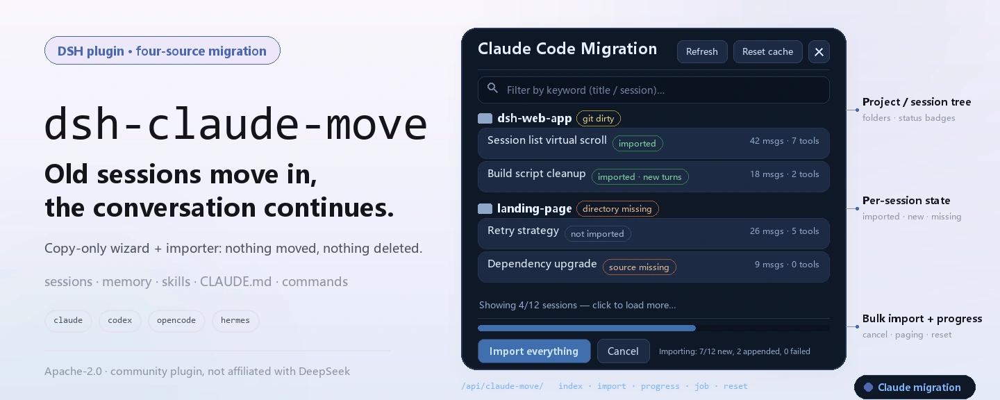
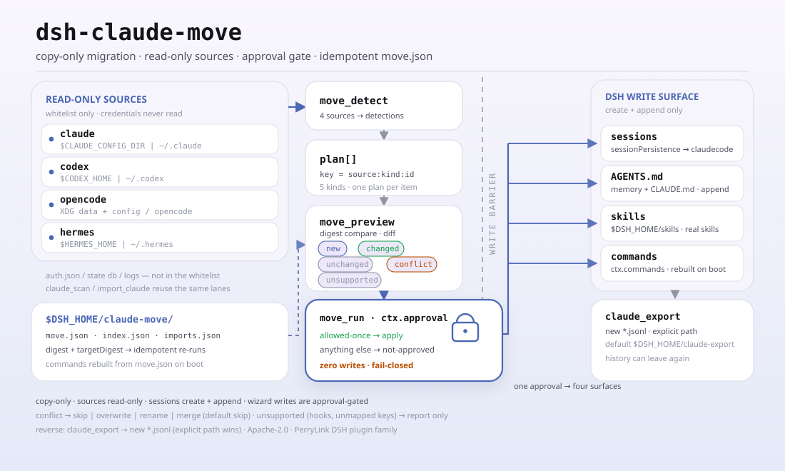

<div align="center">

<picture>
  <source media="(prefers-color-scheme: dark)" srcset="docs/assets/dsh-claude-move-hero-en-dark.webp">
  
</picture>

# dsh-claude-move

**Move your Claude Code, Codex, OpenCode and Hermes history into DeepSeek Harness — sessions stay resumable, memories come along, skills and commands keep working.**

A four-source migration wizard plus a session importer: copy-only, nothing moved or deleted, approval-gated before any write; install once and keep the old project's context going.

[Install](#three-step-setup) · [Configuration](#configuration) · [FAQ](#faq) · [简体中文](README.md) · [English](README.en.md) · [Español](README.es.md) · [Português](README.pt.md) · [हिन्दी](README.hi.md)

[](LICENSE)
[](#compatibility)
[](https://www.npmjs.com/package/dsh-claude-move)
[](https://github.com/PerryLink/dsh-claude-move/actions/workflows/test.yml)
[](#compatibility)

[](https://github.com/PerryLink/dsh-claude-move/stargazers)
[](https://www.npmjs.com/package/dsh-claude-move)
[](https://dshfind.com/plugins/PerryLink/dsh-claude-move?ref=badge)
[](https://securityscorecards.dev/viewer/?uri=github.com/PerryLink/dsh-claude-move)
[](https://dsh.market/)
[](https://gitee.com/perrylink/dsh-claude-move)

```sh
dsh plugin --profile <name> add dsh-claude-move
```

</div>

<sub>Community plugin, not affiliated with DeepSeek. Canonical repository: <https://github.com/PerryLink/dsh-claude-move> (Gitee is a mirror).</sub>

## What it is

After a while with Claude Code, the history is all in `~/.claude`: session transcripts, memories, skills, `CLAUDE.md` and `settings.json`. `dsh-claude-move` reads them and turns them into DeepSeek Harness sessions and context you can open and resume — the source directory is read-only the whole time, and the DSH side only ever does `create` + `append`, so neither side is moved, rewritten or deleted. Beyond Claude Code, Codex, OpenCode and Hermes migrate through the same `/move` wizard.

<picture>
  <source media="(prefers-color-scheme: dark)" srcset="docs/assets/dsh-claude-move-flow-v5-dark.svg">
  
</picture>

## Three-step setup

1. **Install** (pick one channel):

   ```sh
   # git channel (default branch main; equivalent to git+https://github.com/PerryLink/dsh-claude-move.git)
   dsh plugin --profile web add github:PerryLink/dsh-claude-move
   # npm channel (published releases)
   dsh plugin --profile web add dsh-claude-move
   # tarball channel: npm pack in this repo, then
   dsh plugin --profile web add ./dsh-claude-move-<version>.tgz
   ```

   No build step: pure ESM, `index.mjs` and `lib/` are the shipped artifacts — no `prepare` or `allowBuilds` needed.

2. **Minimal config** (the defaults already work; override only if needed):

   ```yaml
   - insert:
       - id: claude-move
         name: dsh-claude-move
         config:
           workspaceMode: claudecode
           requireApproval: true
   ```

3. **Verify it mounts**:

   ```sh
   dsh --profile web --dump-config | grep -A4 'id: claude-move'
   ```

   Then, in any DSH session, run one command:

   ```sh
   /claude-import-all      # scan → copy every Claude session → report
   ```

   No DSH restart is needed after importing — refresh the open Web page once and click any imported session to continue.

**Uninstall**: `dsh plugin --profile web remove dsh-claude-move` (or remove the `claude-move` row from the profile's bundles). Imported sessions stay in DSH's data directory; the plugin only writes its cache (`$DSH_HOME/claude-move/`) and the `claudecode` workspace folder, and never touches Claude source data.

## Core capabilities

`dsh-claude-move` turns "switching tools" into "moving context" — old sessions, memories, skills, instructions and slash commands come along, and the migration is re-runnable and reversible:

- **Auto-discovery** — `claude_scan` locates the Claude data root (`$CLAUDE_CONFIG_DIR`, fallback `~/.claude`) and indexes every project/session, memory, skill, global `CLAUDE.md` and `settings.json`, with incremental caching and parallel scanning (`scanConcurrency`).
- **Full-fidelity import** — `import_claude` turns transcripts into balanced, resumable DSH sessions (`turn/start → step/start → user/message → assistant/message → tool/call → tool/result → step/end → turn/end`), repairs interrupted tool calls, and stream-imports transcripts larger than `maxTranscriptBytes` in chunks.
- **One `claudecode` workspace** — every imported session lands in a dedicated workspace (default `$DSH_HOME/claudecode`); `workspaceMode: 'per-project'` restores one-workspace-per-project grouping.
- **Copy-only & incremental** — nothing on either side is moved, rewritten or deleted; re-running appends only the new turns (`force: true` saves an extra full copy under a new id, keeping the old one).
- **Personal context, always fresh** — memories injected as a live prompt section, Claude skills registered as real DSH skills (global + project-level), global and project `CLAUDE.md` injected early.
- **Four-source migration wizard** — `/move` plus `move_detect` / `move_preview` / `move_run` migrate Claude Code, Codex, OpenCode and Hermes, approval-gated and idempotent (`move.json`).
- **Web panel & commands** — `/claude-import-all`, `/resume-claude`, `/claude-move-reset`, `/claude-export`, and a floating migration panel.
- **Bidirectional export** — `claude_export` (or `/claude-export <sessionId>`) writes a DSH session back out as a resumable Claude Code JSONL transcript (`user`/`assistant`/`tool` turns, `thinking` + `tool_use`/`tool_result` pairing, best-effort `cwd` mapping), so history can leave DSH again.

### What gets migrated

```text
~/.claude (read-only)
 ├─ projects/*/*.jsonl  ──→  resumable DSH sessions, grouped in one "claudecode" workspace (default)
 ├─ projects/*/memory/  ──→  live system-prompt memory section (re-read per request)
 ├─ skills/**           ──→  real DSH skills
 └─ CLAUDE.md + settings ──→  early prompt section + config suggestions (never auto-applied)
```

| In Claude Code | Lands in DSH as |
|---|---|
| Session transcripts (`projects/*/*.jsonl`) | Balanced, resumable DSH sessions — full-fidelity `user`/`assistant`/`tool`/`thinking` mapping with interrupted-tool-call repair — grouped into one **`claudecode`** workspace or one per project |
| Memory files (`projects/*/memory/*.md`) | A live system-prompt context section, re-read on every request (`feedback > project > reference > user`) |
| Skills (`~/.claude/skills/**`) | Real DSH skills (kebab-case names, collision suffixes, max 30 by default; `README.md`/`MEMORY.md` and files without a description are skipped) |
| `CLAUDE.md` (global + per-project) | An early prompt section; the project file wins |
| `settings.json` | DSH configuration suggestions with an explicit unmappable-keys list |
| Project state (directory, git branch & dirty count) | Shown in the scan index, the Web panel badges, and the `/resume-claude` handoff |

## Four-source migration wizard

```text
/move              # one-shot wizard: detect → preview → execute → report (all four sources)
move_detect        # scan Claude Code / Codex / OpenCode / Hermes
move_preview       # per-item plan: new | unchanged | changed | conflict (with diff) | unsupported
move_run           # execute behind the approval gate; conflict resolution:
                   #   skip | overwrite | rename | merge  (default skip — never guesses)
```

- **Sources** — Claude Code (`~/.claude`), Codex (`~/.codex`), OpenCode (data + config roots), Hermes (skills/memory roots); each source has its own parser + mapper.
- **Mapping** — memories/instructions → append-only managed sections in the DSH global `AGENTS.md` (one marked section per item); skills → real DSH skills (`SKILL.md` bundles copied verbatim, other formats converted); slash commands → registered DSH commands (rebuilt from `move.json` after a restart); sessions → resumable DSH sessions (the same importers as phase 1).
- **Idempotent** — every applied plan is recorded in `$DSH_HOME/claude-move/move.json` (`digest` / `targetDigest` / `appliedAt`); re-runs skip unchanged items and `force` re-applies them.
- **Approval-gated** — a run that would write anything asks `ctx.approval` first; anything but `allowed-once` means zero writes.

## Usage

Call the tools in any session with the plugin mounted:

```text
claude_scan                          # full scan (incremental cache)
claude_scan { path: "~/.claude/projects/<slug>" }   # partial scan
claude_scan { refresh: true }        # skip cache, rescan everything
claude_scan { projectsLimit: 10, sessionsLimit: 5, fields: "brief" }  # trim output

import_claude { path: "~/.claude/projects/<slug>/<sessionId>.jsonl" }  # one session
import_claude { path: "~/.claude/projects" }        # directory (recursive)
import_claude { path: "all" }                       # everything
# Re-run any time: unchanged files are skipped, grown transcripts append only the new turns.
# Files over maxTranscriptBytes are stream-imported in chunks (no memory ceiling).
import_claude { path: "...", force: true }          # fresh full copy (previous copy kept)

claude_export { sessionId: "<dsh-session-id>" }     # write a DSH session back to Claude JSONL
claude_export { sessionId: "...", path: "~/.claude/projects/<slug>/<id>.jsonl" }  # explicit target
```

Commands (user-triggered, no model turn):

```text
/claude-import-all                # one-shot: scan → import everything → report → inject into the current session
/resume-claude latest             # continue the most recent Claude session
/resume-claude <sessionId>        # by source session id or import-<src> id
/resume-claude <keyword>          # match titles; multiple matches are listed, never guessed
/claude-move-reset                # reset the plugin cache (bookmarks + import map); imported sessions are kept
/claude-export <sessionId> [path] # export a DSH session to a resumable Claude JSONL transcript
```

### Tools & surfaces

| Surface | Kind | Notes |
|---|---|---|
| `claude_scan` | tool | Structured index of projects/sessions/memories/skills/settings |
| `import_claude` | tool | Import one session, a directory, or `all` (incremental, `force` for a fresh copy) |
| `claude_export` | tool | Export a DSH session to a resumable Claude Code JSONL transcript |
| `move_detect` / `move_preview` / `move_run` | tools | Four-source wizard: scan, per-item plan with diffs, execute behind approval |
| `/claude-import-all` | command | Scan → import everything → report |
| `/resume-claude` | command | Continue a Claude session (latest, id, or keyword) |
| `/claude-move-reset` | command | Reset the plugin cache (imported sessions kept) |
| `/claude-export` | command | Export a DSH session to a resumable Claude JSONL transcript |
| `/move` | command | One-shot four-source wizard |
| Web migration panel | client | Floating panel with progress, cancel, paging, open session |

Web panel: a floating migration panel with the project/session tree, status badges (not imported / imported / imported-with-new-turns / source missing / directory missing / git dirty), keyword filter, paged rendering, per-session "Import & continue" + "Open session" + "Refresh session list", batch import with a live progress bar and cancel, and a cache-reset button. Texts follow the browser language (zh/en). Served through the plugin's own `/api/claude-move/*` JSON routes on the public `ctx.webServer` seam.

### After importing

**You do not need to restart DSH.** Imports land durably through the public `sessionPersistence` service the moment they complete:

- The server-side lists (`session.list` / `workspace.list` RPCs, the CLI, any new page load) show the imported sessions under the **`claudecode` workspace** immediately.
- The panel refreshes the already-open page's session list itself and offers an **Open session** button per imported session.
- Imported sessions can be opened, read, and resumed right away — `/resume-claude`, or click the session in the list. Re-running the import at any time syncs only the new turns into the same sessions.

### Examples

These are the plugin's real entry points; install once, then call one.

**Detailed example** — command `import_claude`, input:

```json
{ "path": "test/fixtures/simple.jsonl" }
```

Output:

```text
已导入 1 轮对话（2 条消息、0 次工具调用）→ 会话 import-sess-simple-001。
```

*Observed from `README.md:138 (Usage); test/fixtures/simple.jsonl:1-2; index.mjs:1708 (renderImport)`*

**Failure branch** — input:

```text
resolveImportTarget('', '/home/user/.claude')  // empty path
```

Output:

```text
Error: path 必填：单个 .jsonl、目录、"~/.claude/projects" 或 "all"
```

*Observed from `plugins/dsh-claude-move/index.mjs:744-746; plugins/dsh-claude-move/test/import.test.mjs:158-161; plugins/dsh-claude-move/README.md:132-145`*

**Brief examples**: `import_claude` · `claude_export`

## Configuration

All optional, overridable in cordis.yml. An id-targeted override replaces the whole row — restate every key you need.

Most-used keys:

| Key | Default | Meaning |
|---|---|---|
| `claudeHome` | `$CLAUDE_CONFIG_DIR` or `~/.claude` | Claude data root |
| `workspaceMode` | `claudecode` | `claudecode` (one dedicated workspace) · `per-project` (one workspace per source cwd) |
| `enableMemory` | `true` | Inject memories as a live prompt section |
| `enableSkills` | `true` | Register Claude skills as DSH skills |
| `enableInstructions` | `true` | Inject global + project `CLAUDE.md` |
| `maxTranscriptBytes` | `67108864` | Stream-import threshold (chunked above) |
| `requireApproval` | `true` | Wizard writes ask `ctx.approval` (allowed-once only) |
| `enableWebPanel` | `true` | Register the `/api/claude-move/*` panel routes |

<details>
<summary>Full configuration table (31 keys)</summary>

| Key | Default | Meaning |
|---|---|---|
| `claudeHome` | `$CLAUDE_CONFIG_DIR` or `~/.claude` | Claude data root |
| `workspaceMode` | `claudecode` | `claudecode` (one dedicated workspace) · `per-project` (one workspace per source cwd) |
| `claudecodeDir` | `$DSH_HOME/claudecode` | The `claudecode` workspace folder (the only folder the plugin ever creates) |
| `scanGit` | `true` | Git probe level: `true` (full) · `'branch'` (zero git calls) · `false` |
| `gitTimeoutMs` | `5000` | Git subprocess timeout |
| `scanConcurrency` | `8` | Parallel project scan cap |
| `maxTranscriptBytes` | `67108864` | Stream-import threshold (chunked above) |
| `excludeProjects` | `[]` | Slug substrings to skip |
| `enableMemory` | `true` | Inject memories as a live prompt section |
| `memoryMaxBytes` | `8192` | Memory section cap |
| `memoryScope` | `current-project` | `current-project` · `all` (current first) |
| `enableSkills` | `true` | Register Claude skills as DSH skills |
| `maxSkills` | `30` | Skill count cap |
| `extraSkillDirs` | `[]` | Extra skill directories |
| `enableInstructions` | `true` | Inject global + project `CLAUDE.md` |
| `resumeMaxChars` | `2048` | Handoff summary char cap |
| `resumeMode` | `inject` | `inject` (handoff summary) · `agents` (ctx.agents.resume) |
| `enableWebPanel` | `true` | Register the `/api/claude-move/*` panel routes |
| `importConcurrency` | `4` | Parallel read+convert per batch |
| `enableMove` | `true` | Register the four-source wizard (`/move`, the three move tools, command rebuild) |
| `requireApproval` | `true` | Wizard writes ask `ctx.approval` (allowed-once only) |
| `sources` | `[claude, codex, opencode, hermes]` | Sources the wizard covers (all four on by default) |
| `codexHome` | `$CODEX_HOME` or `~/.codex` | Codex data root |
| `opencodeDataHome` | platform XDG data dir/opencode | OpenCode data root |
| `opencodeConfigHome` | platform XDG config dir/opencode | OpenCode config root |
| `hermesHome` | `$HERMES_HOME` or `~/.hermes` | Hermes data root |
| `skillsDir` | `$DSH_HOME/skills` | Wizard skill target (official user skill root, auto-discovered by DSH) |
| `agentsMdPath` | `$DSH_HOME/AGENTS.md` | Wizard memory/instruction target (the DSH global instruction file) |
| `moveWorkspaceMode` | `per-source` | Wizard import workspace grouping: `per-source` · `single` |
| `enableExport` | `true` | Register the `claude_export` tool and `/claude-export` command |
| `exportDir` | `$DSH_HOME/claude-export` | Default export folder (explicit `path` always wins) |

</details>

Example override in your profile patch:

```yaml
- insert:
    - id: claude-move
      name: dsh-claude-move
      config:
        workspaceMode: per-project
        memoryScope: all
        resumeMode: agents
        sources: [claude, codex]
```

## FAQ

<details>
<summary>Does it modify, move or delete source data?</summary>

No. The Claude/Codex/OpenCode/Hermes source files are strictly read-only; DSH session logs only ever `create` + `append`, never rewriting historical events. `force: true` does not overwrite either — it saves an extra full copy under a new id (`import-<src>-<n>`) and keeps the old one. The wizard only appends to or creates `AGENTS.md`, skills and commands; conflicts default to `skip`.

</details>

<details>
<summary>Do I need to restart DSH after importing?</summary>

No. Imports land durably through the public `sessionPersistence` service the moment they complete, so server-side lists (`session.list` / `workspace.list`, the CLI, a new page load) show them immediately. An already-open Web page only needs its session list refreshed once (the panel's "Refresh session list" button or F5); workspace grouping updates live via `domain/changed`. The `host/session-added` frame is emitted only for live sessions, so a cold import does not pop up by itself — that is UI behavior, not a data problem.

</details>

<details>
<summary>Can the migration wizard write files without permission?</summary>

No. Any `move_run` that would write asks `ctx.approval` first; anything but `allowed-once` means zero writes (fail-closed), and a platform without an approval seam must explicitly set `requireApproval: false` to execute. Every applied plan is recorded in `$DSH_HOME/claude-move/move.json`, and re-runs skip unchanged items.

</details>

<details>
<summary>What about large transcripts and performance overhead?</summary>

Scanning runs in parallel up to `scanConcurrency` (default 8) with an incremental cache; a single transcript over `maxTranscriptBytes` (default 64 MiB) is stream-imported in chunks with no memory ceiling. Batch import's read+convert stage is bounded by `importConcurrency` (default 4), and the write stage runs serially in filename order for determinism. To skip the git probe cost, set `scanGit` to `'branch'` (zero git calls) or `false`.

</details>

## Security boundaries

- **Source files are read-only; DSH logs are append-only** (`create` + `append` only).
- **External transcripts are untrusted input** — nothing in them is executed; system/developer/thinking content never enters the resume handoff.
- **Public services only** — `sessionPersistence` / `workspaceRegistry` / `tools` / `commands` / `systemPrompt` / `skills` / `webServer`; no engine or UI changes.
- **Secrets reported by position only** (file:line:kind); `permission`/`permission-mode`/`queue-operation` records are counted, not imported.
- **Wizard writes are approval-gated** — anything but `allowed-once` means zero writes.

## Permissions & data

- **Permissions**: the workshop manifest declares `filesystem:read` and `filesystem:write`.
- **Reads** `~/.claude` (transcripts, memories, skills, `CLAUDE.md`, `settings.json`) — strictly read-only — and the project directories it imports into.
- **Writes** DSH session logs via the public `sessionPersistence` service (create + append only, never delete/rewrite/archive), workspace-registry records, its cache under `$DSH_HOME/claude-move/`, the `claudecode` workspace folder, and exported `.jsonl` files under `$DSH_HOME/claude-export/` (or an explicit target path).
- **Never** modifies Claude source files, touches other applications' data, or accesses the network. **No credentials** are read or transmitted.

## Known limitations

- Titles come from `custom-title`/`ai-title`/first prompt; Claude `summary` records are reported but not mapped to DSH compaction nodes (synthesizing a valid compaction transaction would fabricate its seq range and checkpoint message).
- `thinking` blocks are kept as `reasoning` content but never enter the resume handoff.
- Interrupted tool calls are repaired with a synthetic error result (never dropped), reported as `repaired.synthesized`.
- Permission-class records are counted, not imported; DSH permission-preset suggestions are generated in reports.
- On hosts without a streaming `fs.streamText` surface, transcripts larger than `maxTranscriptBytes` fail loudly instead of partial import.
- In `workspaceMode: 'per-project'`, sessions whose source directory was deleted still import, but workspace attach fails (left ungrouped; `workspace.attached: false` plus a `reason`). The default `claudecode` workspace does not depend on the source directory.
- If a transcript was truncated or reset in place (fewer turns than the recorded import), re-import skips it and reports `sourceShrunk`; use `force: true` for a fresh full copy.
- The Web panel is a zero-build floating panel driven by the plugin's own JSON routes; it does not use the shell's internal UI slot system.

## Model experience

- The model-facing surface is the tools' descriptions/schemas and their outputs: `claude_scan` returns the structured index, `import_claude` returns per-file summaries with positions of warnings, and `claude_export` returns the export summary (target path + turn/message/tool counts). Tool results are themselves logged `tool/result` events, so everything is reconstructable.
- No hidden model-facing text; memory/`CLAUDE.md` sections are registered on `ctx.systemPrompt` (prompt assembly, rebuildable from the session log).

## Compatibility

- Targets `dsh 0.1.6-alpha.2` (web profile, session format V3); `engines.dsh` and the peer dependencies follow `package.json` (currently `>=0.1.6-0 <0.2.0 || >=0.2.0-0 <0.3.0 || >=0.2.2-0 <0.3.0`); the 0.2.1 line is statically compatible (no runtime verification recorded). Verified 2026-09-18 (checkJs type gate + 287 assertions, 38 suites). The panel's "open session" button now renders disabled with an explanatory title when the host exposes no `sessions.open()`, instead of disappearing. Node `^22.19 || >=24.9`.
- `0.1.2-rc.1` (adapted 2026-09-04): the session envelope keeps its ignorable field for stored-log read compatibility only - Session.append still cannot stamp it, so audit-gate behavior is unchanged.
- 0.4.0 ships a dual-baseline `sessionPersistence` runtime shim, feature-detected by API shape (never by version): the legacy API (`create`/`append`/`readFrom`, `list()` returning headers) and the handle seam (`create` returning a `SessionHandle`, `list()`/`stat()` returning snapshots) both work. The handle seam is published on the alpha line (`@deepseek-ai/dsh-session-persistence` / `-jsonl` `0.1.5-rc.2`), so the compat workflow covers it. On the handle path every append is followed by `flush()` (durability barrier) and a paired `close()` (single-writer ownership); headers are stamped with the backend's current format version plus an explicit `isSeeded`; missing assistant model sources fall back to the provider; and since 0.4.5 synthesized `assistant/message` events carry `stream: []` when the backend format version is >= 2 — V3's `Session.fromRestore` asserts `Array.isArray(data.stream)`, so without it a log was written and readable but could not be resumed. Import-scan cleanup refuses to run when a listed element's `header.id` cannot be resolved, so `imports.json` is never silently cleared.
- Last verified against a fresh tarball install: real scan, real batch import (idempotent re-import), workspace attach and persistence artifacts confirmed; macOS/Linux covered by the CI matrix. Imported logs use session format V3 and cannot be read by `dsh <= 0.1.2-rc.1` (upgrading is one-way; re-import from the source transcript is the fallback).

### Compatibility matrix (public seams only)

| Surface | Used | Fallback when absent |
|---|---|---|
| Host services (`tools` / `sessionPersistence` / `workspaceRegistry` / `commands` / `systemPrompt` / `skills` / `webServer`) | required where listed | optional services register reactively; missing `fs` fails loud |
| `sessionPersistence` dual baseline: legacy `listSnapshots` / `readFrom` / `append` vs handle `open` / `stat` / snapshot `list()` | feature-detected at runtime (API shape, never version) | the `header.id` resolution guard aborts the scan loudly instead of silently clearing `imports.json` |
| `streamText`-capable `fs` / `ctx.jobs` / `ctx.agents.resume` | feature-detected | whole-file read with loud rejection / own job map / handoff inject |
| Client shell services (`sessions.refresh/open`, `workspaces.refresh`) | feature-detected at panel apply | full-page reload |
| Newer platform capabilities are never hard requirements — the plugin stays bootable on the oldest supported line (`0.1.2-rc.1`). | | |

## Troubleshooting

- Row not effective: `dsh --profile <p> --dump-config` should print `# == dsh-claude-move`; re-run `dsh plugin --profile <p> add ...`.
- Web boots but hangs silently: new profiles initialized by `dsh plugin add` contain only `dsh-base` — add `@deepseek-ai/dsh-web-app` to `dsh.profile.bundles`. Installing into the existing `web` profile needs nothing.
- Panel routes 404: they are served only when `enableWebPanel: true` and a web server is composed; check the boot log for FAILED fibers.
- Import fails with a "transcript too large" error: raise `maxTranscriptBytes` or import that file individually.
- Import succeeded but the sidebar shows no new session: the page was already open — click the panel's refresh button (or reload the page) once. No DSH restart is ever needed.
- Logs: boot failures print to the `dsh` console; the plugin logs `[claude-move]`-prefixed errors for workspace/import-map issues.

## Ecosystem & quality

- [Gitee mirror](https://gitee.com/perrylink/dsh-claude-move) (sync mirror; GitHub is canonical)
- [dshfind plugin page](https://dshfind.com/plugins/PerryLink/dsh-claude-move) (installs and ranking)
- [OpenSSF Scorecard report](https://securityscorecards.dev/viewer/?uri=github.com/PerryLink/dsh-claude-move) (driven by [.github/workflows/scorecard.yml](.github/workflows/scorecard.yml))
- [dsh-plugin-doctor verification report](https://github.com/PerryLink/dsh-plugin-doctor#verified-徽章)
- [DSH Market](https://dsh.market/) (listed)
- **1024 store channel**: `npm i -g dsh1024` once, then `dsh1024 plugin --profile web add dsh-claude-move` (counts toward the [deepseek1024.com](https://deepseek1024.com) install ranking)
- [Ecosystem knowledge base](https://perrylink.github.io/dsh-plugin-guide/) — measured data, not marketing: plugin development guide · plugin-selection data · maintenance criteria

## Open-source attribution

This project is licensed under the Apache License 2.0; the following MIT-licensed components retain their own licenses (full text in [THIRD_PARTY_NOTICES.md](THIRD_PARTY_NOTICES.md)):

- Conversion core vendored from [Nwflower/dsh-chat-import](https://github.com/Nwflower/dsh-chat-import) (MIT).
- Discovery conventions & safety model from [Demogorgon314/dsh-resume-plugin](https://github.com/Demogorgon314/dsh-resume-plugin) (MIT).
- Memory/skills injection & frontmatter parsing patterns from [YYTbit/dsh-plugin-claude-bridge](https://github.com/YYTbit/dsh-plugin-claude-bridge) (MIT).

## Development

```sh
npm install   # peer deps: @deepseek-ai/dsh-tools, @deepseek-ai/cordis, schemastery
npm test      # node --test "test/**/*.test.mjs"
npm run typecheck      # checkJs type gate (tsconfig.check.json)
npm run check:ci       # published-line type gate (tsconfig.check.ci.json)
npm run check:readmes  # five-language README consistency
npm run verify:artifacts    # shipped files present + index.mjs importable
npm run verify:self-contained  # dependency specs resolve from the registry
npm pack      # the published tarball
```

There is no build step: pure ESM, `index.mjs` and `lib/` are the shipped artifacts. CI runs the full suite on Node 22 across Linux/macOS/Windows via GitHub Actions ([test.yml](.github/workflows/test.yml)). The README images are generated programmatically by [`scripts/gen-readme-assets.py`](scripts/gen-readme-assets.py) (Python + Pillow) and are safe to re-run.

Topics: `dsh`, `dsh-plugin`, `deepseek-harness`, `deepseek`, `cordis`, `claude-code`, `migration`, `session-import`, `resume`

## Family & thanks

This project is part of the DeepSeek Harness plugin family from [PerryLink](https://github.com/PerryLink) (all Apache-2.0). If it is useful, **a star helps the next person find it** — nothing is gated behind it.

- [@PerryLink](https://github.com/PerryLink) — creator and maintainer: the import pipeline, the four-source migration wizard, the Web panel, docs, CI/CD and releases.
- [@OLDnana1](https://github.com/OLDnana1) — root-cause analysis of the interrupted tool-call corruption that made imported sessions permanently return HTTP 400 on resume.
- [@GooodWei](https://github.com/GooodWei) — identified `README.md` (and any description-less `.md`) being misregistered as a skill, which broke DSH's skill load.

<details>
<summary>Expand all plugins</summary>

| Plugin | Status |
|---|---|
| **[dsh-aqua-input-check](https://github.com/PerryLink/dsh-aqua-input-check)** |  |
| **[dsh-archive-check](https://github.com/PerryLink/dsh-archive-check)** |  |
| **[dsh-auto-review](https://github.com/PerryLink/dsh-auto-review)** |  |
| **[dsh-autotier](https://github.com/PerryLink/dsh-autotier)** | 🧊 FROZEN — see the repo README |
| **[dsh-bid-ca-precheck](https://github.com/PerryLink/dsh-bid-ca-precheck)** |  |
| **[dsh-bid-qual-check](https://github.com/PerryLink/dsh-bid-qual-check)** |  |
| **[dsh-cert-mcp](https://github.com/PerryLink/dsh-cert-mcp)** | 🧊 FROZEN — see the repo README |
| **[dsh-checkpoint-rewind](https://github.com/PerryLink/dsh-checkpoint-rewind)** |  |
| **[dsh-click](https://github.com/PerryLink/dsh-click)** |  |
| **[dsh-composer-history](https://github.com/PerryLink/dsh-composer-history)** |  |
| **[dsh-contract-stance](https://github.com/PerryLink/dsh-contract-stance)** |  |
| **[dsh-customs-doc-check](https://github.com/PerryLink/dsh-customs-doc-check)** |  |
| **[dsh-data-quality](https://github.com/PerryLink/dsh-data-quality)** | 🧊 FROZEN — see the repo README |
| **[dsh-demurrage-ledger](https://github.com/PerryLink/dsh-demurrage-ledger)** |  |
| **[dsh-doublecheck](https://github.com/PerryLink/dsh-doublecheck)** |  |
| **[dsh-drill-script-check](https://github.com/PerryLink/dsh-drill-script-check)** |  |
| **[dsh-eia-guide-check](https://github.com/PerryLink/dsh-eia-guide-check)** |  |
| **[dsh-emergency-plan](https://github.com/PerryLink/dsh-emergency-plan)** |  |
| **[dsh-essay-rubric-check](https://github.com/PerryLink/dsh-essay-rubric-check)** |  |
| **[dsh-evidence-check](https://github.com/PerryLink/dsh-evidence-check)** |  |
| **[dsh-export-ctl-check](https://github.com/PerryLink/dsh-export-ctl-check)** |  |
| **[dsh-fast](https://github.com/PerryLink/dsh-fast)** |  |
| **[dsh-fmea-table-check](https://github.com/PerryLink/dsh-fmea-table-check)** |  |
| **[dsh-forecast-penalty](https://github.com/PerryLink/dsh-forecast-penalty)** |  |
| **[dsh-fund-research](https://github.com/PerryLink/dsh-fund-research)** |  |
| **[dsh-github](https://github.com/PerryLink/dsh-github)** |  |
| **[dsh-gongwen-flow-check](https://github.com/PerryLink/dsh-gongwen-flow-check)** |  |
| **[dsh-gongwen-word-check](https://github.com/PerryLink/dsh-gongwen-word-check)** |  |
| **[dsh-guard-plan-qc](https://github.com/PerryLink/dsh-guard-plan-qc)** |  |
| **[dsh-hazchem-check](https://github.com/PerryLink/dsh-hazchem-check)** |  |
| **[dsh-hazplan-check](https://github.com/PerryLink/dsh-hazplan-check)** |  |
| **[dsh-hidden-risk-map](https://github.com/PerryLink/dsh-hidden-risk-map)** |  |
| **[dsh-hs-classify](https://github.com/PerryLink/dsh-hs-classify)** |  |
| **[dsh-icd-rule-check](https://github.com/PerryLink/dsh-icd-rule-check)** |  |
| **[dsh-industry-research](https://github.com/PerryLink/dsh-industry-research)** |  |
| **[dsh-lawcite-adapter](https://github.com/PerryLink/dsh-lawcite-adapter)** |  |
| **[dsh-laya](https://github.com/PerryLink/dsh-laya)** |  |
| **[dsh-lc-doc-check](https://github.com/PerryLink/dsh-lc-doc-check)** |  |
| **[dsh-learning-gap-check](https://github.com/PerryLink/dsh-learning-gap-check)** |  |
| **[dsh-library](https://github.com/PerryLink/dsh-library)** |  |
| **[dsh-local-ai](https://github.com/PerryLink/dsh-local-ai)** |  |
| **[dsh-lsp-actions](https://github.com/PerryLink/dsh-lsp-actions)** |  |
| **[dsh-mask](https://github.com/PerryLink/dsh-mask)** |  |
| **[dsh-mcp-panel](https://github.com/PerryLink/dsh-mcp-panel)** |  |
| **[dsh-medrec-qc](https://github.com/PerryLink/dsh-medrec-qc)** |  |
| **[dsh-memento](https://github.com/PerryLink/dsh-memento)** | 🧊 FROZEN — see the repo README |
| **[dsh-nsfc-form-check](https://github.com/PerryLink/dsh-nsfc-form-check)** |  |
| **[dsh-nurse-record-check](https://github.com/PerryLink/dsh-nurse-record-check)** |  |
| **[dsh-observe](https://github.com/PerryLink/dsh-observe)** |  |
| **[dsh-origin-rvc-check](https://github.com/PerryLink/dsh-origin-rvc-check)** |  |
| **[dsh-ota-review-check](https://github.com/PerryLink/dsh-ota-review-check)** |  |
| **[dsh-output-styles](https://github.com/PerryLink/dsh-output-styles)** |  |
| **[dsh-paper-doc-adapter](https://github.com/PerryLink/dsh-paper-doc-adapter)** |  |
| **[dsh-permission-rules](https://github.com/PerryLink/dsh-permission-rules)** |  |
| **[dsh-permit-report-check](https://github.com/PerryLink/dsh-permit-report-check)** |  |
| **[dsh-pipeline-check](https://github.com/PerryLink/dsh-pipeline-check)** |  |
| **[dsh-pleading-draft](https://github.com/PerryLink/dsh-pleading-draft)** |  |
| **[dsh-plugin-doctor](https://github.com/PerryLink/dsh-plugin-doctor)** | 🚫 RETIRED (repo archived) |
| **[dsh-plugin-guide](https://github.com/PerryLink/dsh-plugin-guide)** |  |
| **[dsh-plugin-kit](https://github.com/PerryLink/dsh-plugin-kit)** | 🚫 RETIRED (repo archived) |
| **[dsh-plugin-upgrade](https://github.com/PerryLink/dsh-plugin-upgrade)** | 🚫 RETIRED (repo archived) |
| **[dsh-policy-brief-draft](https://github.com/PerryLink/dsh-policy-brief-draft)** |  |
| **[dsh-power-loss-split](https://github.com/PerryLink/dsh-power-loss-split)** |  |
| **[dsh-power-ticket-check](https://github.com/PerryLink/dsh-power-ticket-check)** |  |
| **[dsh-ppap-check](https://github.com/PerryLink/dsh-ppap-check)** |  |
| **[dsh-protest-deadline](https://github.com/PerryLink/dsh-protest-deadline)** |  |
| **[dsh-railway-window](https://github.com/PerryLink/dsh-railway-window)** |  |
| **[dsh-repair-order-qc](https://github.com/PerryLink/dsh-repair-order-qc)** |  |
| **[dsh-research-report](https://github.com/PerryLink/dsh-research-report)** |  |
| **[dsh-review-reply-check](https://github.com/PerryLink/dsh-review-reply-check)** |  |
| **[dsh-rulefile-check](https://github.com/PerryLink/dsh-rulefile-check)** |  |
| **[dsh-safety-brief-check](https://github.com/PerryLink/dsh-safety-brief-check)** |  |
| **[dsh-score](https://github.com/PerryLink/dsh-score)** | 🧊 FROZEN — see the repo README |
| **[dsh-session-sync](https://github.com/PerryLink/dsh-session-sync)** |  |
| **[dsh-site-log-check](https://github.com/PerryLink/dsh-site-log-check)** |  |
| **[dsh-skill-pack-security](https://github.com/PerryLink/dsh-skill-pack-security)** |  |
| **[dsh-soe-decision-check](https://github.com/PerryLink/dsh-soe-decision-check)** |  |
| **[dsh-soilwater-check](https://github.com/PerryLink/dsh-soilwater-check)** |  |
| **[dsh-sop-sync-check](https://github.com/PerryLink/dsh-sop-sync-check)** |  |
| **[dsh-spc-gbt-adapter](https://github.com/PerryLink/dsh-spc-gbt-adapter)** |  |
| **[dsh-talk](https://github.com/PerryLink/dsh-talk)** |  |
| **[dsh-tender-extract](https://github.com/PerryLink/dsh-tender-extract)** |  |
| **[dsh-tender-matrix](https://github.com/PerryLink/dsh-tender-matrix)** |  |
| **[dsh-test-drive](https://github.com/PerryLink/dsh-test-drive)** |  |
| **[dsh-ticktick](https://github.com/PerryLink/dsh-ticktick)** | 🚫 RETIRED (repo archived) |
| **[dsh-translate](https://github.com/PerryLink/dsh-translate)** |  |
| **[dsh-warranty-calc](https://github.com/PerryLink/dsh-warranty-calc)** |  |
| **[dsh-budget](https://github.com/PerryLink/dsh-budget)** | 🧊 FROZEN — see the repo README |
| **[dsh-claude-move](https://github.com/PerryLink/dsh-claude-move)** | 🧊 FROZEN — see the repo README |
| **[dsh-defend](https://github.com/PerryLink/dsh-defend)** | 🧊 FROZEN — see the repo README |
| **[dsh-draw](https://github.com/PerryLink/dsh-draw)** | 🧊 FROZEN — see the repo README |
| **[dsh-reach](https://github.com/PerryLink/dsh-reach)** | 🧊 FROZEN — see the repo README |
| **[dsh-background-agents](https://github.com/PerryLink/dsh-background-agents)** | 🚫 RETIRED (repo archived) |
| **[dsh-session-pin](https://github.com/PerryLink/dsh-session-pin)** | 🚫 RETIRED (repo archived) |
| **[dsh-team-rooms](https://github.com/PerryLink/dsh-team-rooms)** | 🚫 RETIRED (repo archived) |

</details>

## License

[LICENSE](LICENSE) (Apache License 2.0) © 2026 dsh-claude-move contributors

<p align="center"><sub>Apache-2.0 · Community plugin, not affiliated with DeepSeek.</sub></p>
