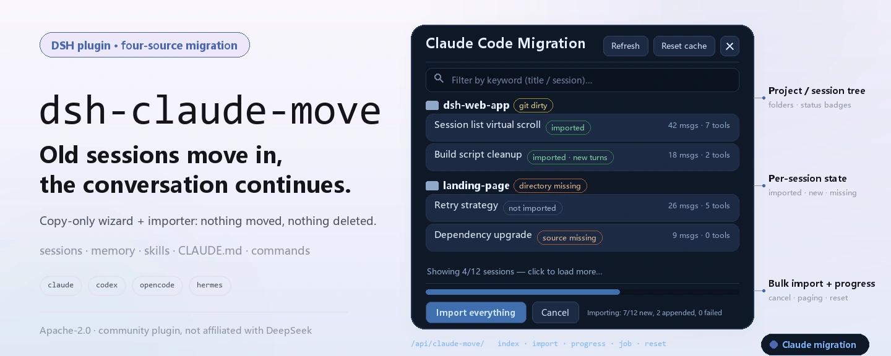
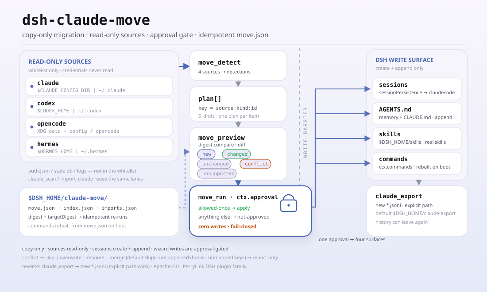

<div align="center">

<picture>
  <source media="(prefers-color-scheme: dark)" srcset="docs/assets/dsh-claude-move-hero-en-dark.webp">
  
</picture>

# dsh-claude-move

**Lleva tu historial de Claude Code, Codex, OpenCode y Hermes a DeepSeek Harness: las sesiones siguen siendo reanudables, las memorias vienen contigo, las habilidades y los comandos siguen funcionando.**

Un asistente de migración de cuatro fuentes más un importador de sesiones: solo copia, nada se mueve ni se borra, y toda escritura pasa antes por aprobación; instálalo una vez y continúa el contexto del proyecto antiguo.

[Instalar](#instalación-en-tres-pasos) · [Configuración](#configuración) · [FAQ](#faq) · [简体中文](README.md) · [English](README.en.md) · [Español](README.es.md) · [Português](README.pt.md) · [हिन्दी](README.hi.md)

[](LICENSE)
[](#compatibilidad)
[](https://www.npmjs.com/package/dsh-claude-move)
[](https://github.com/PerryLink/dsh-claude-move/actions/workflows/test.yml)
[](#compatibilidad)

[](https://github.com/PerryLink/dsh-claude-move/stargazers)
[](https://www.npmjs.com/package/dsh-claude-move)
[](https://dshfind.com/plugins/PerryLink/dsh-claude-move?ref=badge)
[](https://securityscorecards.dev/viewer/?uri=github.com/PerryLink/dsh-claude-move)
[](https://dsh.market/)
[](https://gitee.com/perrylink/dsh-claude-move)

```sh
dsh plugin --profile <name> add dsh-claude-move
```

</div>

<sub>Plugin de la comunidad, no afiliado a DeepSeek. Repositorio canónico: <https://github.com/PerryLink/dsh-claude-move> (Gitee es un espejo).</sub>

## Qué es

Tras un tiempo con Claude Code, el historial está todo en `~/.claude`: transcripciones de sesión, memorias, habilidades, `CLAUDE.md` y `settings.json`. `dsh-claude-move` los lee y los convierte en sesiones y contexto de DeepSeek Harness que puedes abrir y reanudar: el directorio de origen es de solo lectura todo el tiempo y el lado DSH solo hace `create` + `append`, así que ningún lado se mueve, se reescribe ni se borra. Además de Claude Code, Codex, OpenCode y Hermes migran con el mismo asistente `/move`.

<picture>
  <source media="(prefers-color-scheme: dark)" srcset="docs/assets/dsh-claude-move-flow-v5-dark.svg">
  
</picture>

## Instalación en tres pasos

1. **Instala** (elige un canal):

   ```sh
   # canal git (rama por defecto main; equivalente a git+https://github.com/PerryLink/dsh-claude-move.git)
   dsh plugin --profile web add github:PerryLink/dsh-claude-move
   # canal npm (versiones publicadas)
   dsh plugin --profile web add dsh-claude-move
   # canal tarball: npm pack en este repo y luego
   dsh plugin --profile web add ./dsh-claude-move-<version>.tgz
   ```

   Sin paso de build: ESM puro, `index.mjs` y `lib/` son los artefactos enviados; no hace falta `prepare` ni `allowBuilds`.

2. **Configuración mínima** (los valores por defecto ya funcionan; sobrescribe solo si lo necesitas):

   ```yaml
   - insert:
       - id: claude-move
         name: dsh-claude-move
         config:
           workspaceMode: claudecode
           requireApproval: true
   ```

3. **Verifica que se monta**:

   ```sh
   dsh --profile web --dump-config | grep -A4 'id: claude-move'
   ```

   Después, en cualquier sesión de DSH, ejecuta un comando:

   ```sh
   /claude-import-all      # escanear → copiar todas las sesiones de Claude → informar
   ```

   No hace falta reiniciar DSH tras importar: refresca una vez la página Web abierta y haz clic en cualquier sesión importada para continuar.

**Desinstalar**: `dsh plugin --profile web remove dsh-claude-move` (o elimina la fila `claude-move` de los bundles del perfil). Las sesiones importadas se quedan en el directorio de datos de DSH; el plugin solo escribe su caché (`$DSH_HOME/claude-move/`) y la carpeta del espacio de trabajo `claudecode`, y nunca toca los datos de origen de Claude.

## Capacidades clave

`dsh-claude-move` convierte «cambiar de herramienta» en «mover el contexto»: las sesiones, memorias, habilidades, instrucciones y comandos de barra antiguos vienen contigo, y la migración se puede repetir y revertir:

- **Descubrimiento automático** — `claude_scan` localiza la raíz de datos de Claude (`$CLAUDE_CONFIG_DIR`, si no `~/.claude`) e indexa cada proyecto/sesión, memoria, habilidad, `CLAUDE.md` global y `settings.json`, con caché incremental y escaneo en paralelo (`scanConcurrency`).
- **Importación de fidelidad completa** — `import_claude` convierte las transcripciones en sesiones DSH equilibradas y reanudables (`turn/start → step/start → user/message → assistant/message → tool/call → tool/result → step/end → turn/end`), repara las llamadas a herramientas interrumpidas e importa por streaming, en trozos, las transcripciones mayores que `maxTranscriptBytes`.
- **Un único espacio `claudecode`** — cada sesión importada aterriza en un espacio de trabajo dedicado (por defecto `$DSH_HOME/claudecode`); `workspaceMode: 'per-project'` recupera la agrupación de un espacio por proyecto.
- **Solo copia e incremental** — nada se mueve, se reescribe ni se borra en ninguno de los dos lados; volver a ejecutar añade solo los turnos nuevos (`force: true` guarda una copia completa extra con un id nuevo, conservando la anterior).
- **Contexto personal siempre fresco** — las memorias se inyectan como sección de prompt en vivo, las habilidades de Claude se registran como habilidades DSH reales (globales + de proyecto) y los `CLAUDE.md` global y de proyecto se inyectan pronto.
- **Asistente de migración de cuatro fuentes** — `/move` más `move_detect` / `move_preview` / `move_run` migran Claude Code, Codex, OpenCode y Hermes, con compuerta de aprobación e idempotencia (`move.json`).
- **Panel Web y comandos** — `/claude-import-all`, `/resume-claude`, `/claude-move-reset`, `/claude-export`, y un panel flotante de migración.
- **Exportación bidireccional** — `claude_export` (o `/claude-export <sessionId>`) escribe una sesión DSH de vuelta como transcripción JSONL de Claude Code reanudable (turnos `user`/`assistant`/`tool`, emparejamiento `thinking` + `tool_use`/`tool_result`, mapeo de `cwd` en la medida de lo posible), para que el historial pueda volver a salir de DSH.

### Qué se migra

```text
~/.claude (solo lectura)
 ├─ projects/*/*.jsonl  ──→  sesiones DSH reanudables, agrupadas en un espacio "claudecode" (por defecto)
 ├─ projects/*/memory/  ──→  sección de memoria en vivo del system-prompt (releída en cada petición)
 ├─ skills/**           ──→  habilidades DSH reales
 └─ CLAUDE.md + settings ──→  sección de prompt temprana + sugerencias de configuración (nunca aplicadas solas)
```

| En Claude Code | Llega a DSH como |
|---|---|
| Transcripciones de sesión (`projects/*/*.jsonl`) | Sesiones DSH equilibradas y reanudables — mapeo de fidelidad completa `user`/`assistant`/`tool`/`thinking` con reparación de llamadas interrumpidas — agrupadas en un espacio **`claudecode`** o uno por proyecto |
| Archivos de memoria (`projects/*/memory/*.md`) | Una sección de contexto en vivo del system-prompt, releída en cada petición (`feedback > project > reference > user`) |
| Habilidades (`~/.claude/skills/**`) | Habilidades DSH reales (nombres kebab-case, sufijos ante colisión, máximo 30 por defecto; `README.md`/`MEMORY.md` y los archivos sin descripción se omiten) |
| `CLAUDE.md` (global + por proyecto) | Una sección de prompt temprana; gana el archivo de proyecto |
| `settings.json` | Sugerencias de configuración de DSH con una lista explícita de claves no mapeables |
| Estado del proyecto (directorio, rama git y recuento de cambios) | Se muestra en el índice del escaneo, en las insignias del panel Web y en el traspaso de `/resume-claude` |

## Asistente de migración de cuatro fuentes

```text
/move              # asistente de una pasada: detectar → previsualizar → ejecutar → informar (las cuatro fuentes)
move_detect        # escanear Claude Code / Codex / OpenCode / Hermes
move_preview       # plan por elemento: new | unchanged | changed | conflict (con diff) | unsupported
move_run           # ejecutar tras la compuerta de aprobación; resolución de conflictos:
                   #   skip | overwrite | rename | merge  (por defecto skip — nunca adivina)
```

- **Fuentes** — Claude Code (`~/.claude`), Codex (`~/.codex`), OpenCode (raíces de datos + configuración), Hermes (raíces de habilidades/memoria); cada fuente tiene su parser y su mapper.
- **Mapeo** — memorias/instrucciones → secciones gestionadas de solo adición en el `AGENTS.md` global de DSH (una sección marcada por elemento); habilidades → habilidades DSH reales (los paquetes `SKILL.md` se copian tal cual, otros formatos se convierten); comandos de barra → comandos DSH registrados (reconstruidos desde `move.json` tras un reinicio); sesiones → sesiones DSH reanudables (los mismos importadores de la fase 1).
- **Idempotente** — cada plan aplicado se registra en `$DSH_HOME/claude-move/move.json` (`digest` / `targetDigest` / `appliedAt`); las reejecuciones omiten los elementos sin cambios y `force` los vuelve a aplicar.
- **Con compuerta de aprobación** — cualquier ejecución que fuera a escribir pregunta antes a `ctx.approval`; cualquier cosa que no sea `allowed-once` significa cero escrituras.

## Uso

Llama a las herramientas en cualquier sesión con el plugin montado:

```text
claude_scan                          # escaneo completo (caché incremental)
claude_scan { path: "~/.claude/projects/<slug>" }   # escaneo parcial
claude_scan { refresh: true }        # omitir caché y reescanear todo
claude_scan { projectsLimit: 10, sessionsLimit: 5, fields: "brief" }  # salida reducida

import_claude { path: "~/.claude/projects/<slug>/<sessionId>.jsonl" }  # una sesión
import_claude { path: "~/.claude/projects" }        # directorio (recursivo)
import_claude { path: "all" }                       # todo
# Repite cuando quieras: los archivos sin cambios se omiten y las transcripciones que crecen solo añaden los turnos nuevos.
# Los archivos que superan maxTranscriptBytes se importan por streaming en trozos (sin techo de memoria).
import_claude { path: "...", force: true }          # copia completa nueva (se conserva la anterior)

claude_export { sessionId: "<dsh-session-id>" }     # escribir una sesión DSH de vuelta a JSONL de Claude
claude_export { sessionId: "...", path: "~/.claude/projects/<slug>/<id>.jsonl" }  # destino explícito
```

Comandos (los activa el usuario, sin turno de modelo):

```text
/claude-import-all                # de una pasada: escanear → importar todo → informar → inyectar en la sesión actual
/resume-claude latest             # continuar la sesión de Claude más reciente
/resume-claude <sessionId>        # por id de sesión de origen o id import-<src>
/resume-claude <keyword>          # coincidir títulos; varias coincidencias se listan, nunca se adivina
/claude-move-reset                # reiniciar la caché del plugin (marcadores + mapa de importación); las sesiones importadas se conservan
/claude-export <sessionId> [path] # exportar una sesión DSH como transcripción JSONL de Claude reanudable
```

### Herramientas y superficies

| Superficie | Tipo | Notas |
|---|---|---|
| `claude_scan` | herramienta | Índice estructurado de proyectos/sesiones/memorias/habilidades/ajustes |
| `import_claude` | herramienta | Importa una sesión, un directorio o `all` (incremental; `force` para una copia nueva) |
| `claude_export` | herramienta | Exporta una sesión DSH a una transcripción JSONL de Claude reanudable |
| `move_detect` / `move_preview` / `move_run` | herramientas | Asistente de cuatro fuentes: escaneo, plan por elemento con diffs, ejecución tras aprobación |
| `/claude-import-all` | comando | Escanear → importar todo → informar |
| `/resume-claude` | comando | Continuar una sesión de Claude (latest, id o palabra clave) |
| `/claude-move-reset` | comando | Reiniciar la caché del plugin (las sesiones importadas se conservan) |
| `/claude-export` | comando | Exportar una sesión DSH a una transcripción JSONL de Claude reanudable |
| `/move` | comando | Asistente de cuatro fuentes de una pasada |
| Panel Web de migración | cliente | Panel flotante con progreso, cancelación, paginación y apertura de sesión |

Panel Web: un panel flotante de migración con el árbol de proyectos/sesiones, insignias de estado (no importada / importada / importada con turnos nuevos / falta la fuente / falta el directorio / git con cambios), filtro por palabra clave, renderizado paginado, «Importar y continuar» + «Abrir sesión» + «Refrescar lista de sesiones» por sesión, importación por lotes con barra de progreso en vivo y cancelación, y un botón de reinicio de caché. Los textos siguen el idioma del navegador (zh/en). Se sirve mediante las rutas JSON propias del plugin `/api/claude-move/*` sobre la costura pública `ctx.webServer`.

### Después de importar

**No necesitas reiniciar DSH.** Las importaciones se persisten de forma duradera mediante el servicio público `sessionPersistence` en el momento en que terminan:

- Las listas del lado servidor (RPC `session.list` / `workspace.list`, la CLI, cualquier carga de página nueva) muestran las sesiones importadas bajo el **espacio de trabajo `claudecode`** de inmediato.
- El panel refresca por sí mismo la lista de sesiones de la página ya abierta y ofrece un botón **Abrir sesión** por sesión importada.
- Las sesiones importadas se pueden abrir, leer y reanudar al instante: `/resume-claude`, o haz clic en la sesión de la lista. Volver a ejecutar la importación en cualquier momento sincroniza solo los turnos nuevos en las mismas sesiones.

### Ejemplos

Son los puntos de entrada reales del plugin; instala una vez y llama a uno.

**Ejemplo detallado** — comando `import_claude`, entrada:

```json
{ "path": "test/fixtures/simple.jsonl" }
```

Salida:

```text
已导入 1 轮对话（2 条消息、0 次工具调用）→ 会话 import-sess-simple-001。
```

*Observed from `README.md:138 (Usage); test/fixtures/simple.jsonl:1-2; index.mjs:1708 (renderImport)`*

**Rama de fallo** — entrada:

```text
resolveImportTarget('', '/home/user/.claude')  // empty path
```

Salida:

```text
Error: path 必填：单个 .jsonl、目录、"~/.claude/projects" 或 "all"
```

*Observed from `plugins/dsh-claude-move/index.mjs:744-746; plugins/dsh-claude-move/test/import.test.mjs:158-161; plugins/dsh-claude-move/README.md:132-145`*

**Ejemplos breves**: `import_claude` · `claude_export`

## Configuración

Todo opcional y sobrescribible en cordis.yml. Una sobrescritura dirigida por id reemplaza la fila entera: repite todas las claves que necesites.

Claves más usadas:

| Clave | Valor por defecto | Significado |
|---|---|---|
| `claudeHome` | `$CLAUDE_CONFIG_DIR` o `~/.claude` | Raíz de datos de Claude |
| `workspaceMode` | `claudecode` | `claudecode` (un espacio dedicado) · `per-project` (uno por cwd de origen) |
| `enableMemory` | `true` | Inyectar memorias como sección de prompt en vivo |
| `enableSkills` | `true` | Registrar las habilidades de Claude como habilidades DSH |
| `enableInstructions` | `true` | Inyectar `CLAUDE.md` global + de proyecto |
| `maxTranscriptBytes` | `67108864` | Umbral de importación por streaming (en trozos por encima) |
| `requireApproval` | `true` | Las escrituras del asistente piden `ctx.approval` (solo allowed-once) |
| `enableWebPanel` | `true` | Registrar las rutas del panel `/api/claude-move/*` |

<details>
<summary>Tabla de configuración completa (31 claves)</summary>

| Clave | Valor por defecto | Significado |
|---|---|---|
| `claudeHome` | `$CLAUDE_CONFIG_DIR` o `~/.claude` | Raíz de datos de Claude |
| `workspaceMode` | `claudecode` | `claudecode` (un espacio dedicado) · `per-project` (uno por cwd de origen) |
| `claudecodeDir` | `$DSH_HOME/claudecode` | La carpeta del espacio `claudecode` (la única carpeta que el plugin crea) |
| `scanGit` | `true` | Nivel de sondeo git: `true` (completo) · `'branch'` (cero llamadas a git) · `false` |
| `gitTimeoutMs` | `5000` | Tiempo máximo del subproceso git |
| `scanConcurrency` | `8` | Tope de escaneo de proyectos en paralelo |
| `maxTranscriptBytes` | `67108864` | Umbral de importación por streaming (en trozos por encima) |
| `excludeProjects` | `[]` | Subcadenas de slug a omitir |
| `enableMemory` | `true` | Inyectar memorias como sección de prompt en vivo |
| `memoryMaxBytes` | `8192` | Tope de la sección de memoria |
| `memoryScope` | `current-project` | `current-project` · `all` (el actual primero) |
| `enableSkills` | `true` | Registrar las habilidades de Claude como habilidades DSH |
| `maxSkills` | `30` | Tope de número de habilidades |
| `extraSkillDirs` | `[]` | Directorios de habilidades adicionales |
| `enableInstructions` | `true` | Inyectar `CLAUDE.md` global + de proyecto |
| `resumeMaxChars` | `2048` | Tope de caracteres del resumen de traspaso |
| `resumeMode` | `inject` | `inject` (resumen de traspaso) · `agents` (ctx.agents.resume) |
| `enableWebPanel` | `true` | Registrar las rutas del panel `/api/claude-move/*` |
| `importConcurrency` | `4` | Lectura + conversión en paralelo por lote |
| `enableMove` | `true` | Registrar el asistente de cuatro fuentes (`/move`, las tres herramientas move, reconstrucción de comandos) |
| `requireApproval` | `true` | Las escrituras del asistente piden `ctx.approval` (solo allowed-once) |
| `sources` | `[claude, codex, opencode, hermes]` | Fuentes que cubre el asistente (las cuatro activas por defecto) |
| `codexHome` | `$CODEX_HOME` o `~/.codex` | Raíz de datos de Codex |
| `opencodeDataHome` | directorio de datos XDG de la plataforma/opencode | Raíz de datos de OpenCode |
| `opencodeConfigHome` | directorio de configuración XDG de la plataforma/opencode | Raíz de configuración de OpenCode |
| `hermesHome` | `$HERMES_HOME` o `~/.hermes` | Raíz de datos de Hermes |
| `skillsDir` | `$DSH_HOME/skills` | Destino de habilidades del asistente (raíz oficial de habilidades de usuario, descubierta por DSH) |
| `agentsMdPath` | `$DSH_HOME/AGENTS.md` | Destino de memorias/instrucciones del asistente (archivo de instrucciones global de DSH) |
| `moveWorkspaceMode` | `per-source` | Agrupación de espacios de las importaciones del asistente: `per-source` · `single` |
| `enableExport` | `true` | Registrar la herramienta `claude_export` y el comando `/claude-export` |
| `exportDir` | `$DSH_HOME/claude-export` | Carpeta de exportación por defecto (el `path` explícito siempre gana) |

</details>

Ejemplo de sobrescritura en el patch de tu perfil:

```yaml
- insert:
    - id: claude-move
      name: dsh-claude-move
      config:
        workspaceMode: per-project
        memoryScope: all
        resumeMode: agents
        sources: [claude, codex]
```

## FAQ

<details>
<summary>¿Modifica, mueve o borra los datos de origen?</summary>

No. Los archivos de origen de Claude/Codex/OpenCode/Hermes son estrictamente de solo lectura; los registros de sesión de DSH solo hacen `create` + `append`, nunca reescriben eventos históricos. `force: true` tampoco sobrescribe: guarda una copia completa extra con un id nuevo (`import-<src>-<n>`) y conserva la anterior. El asistente solo añade a, o crea, `AGENTS.md`, habilidades y comandos; los conflictos usan `skip` por defecto.

</details>

<details>
<summary>¿Hay que reiniciar DSH después de importar?</summary>

No. Las importaciones se persisten de forma duradera mediante el servicio público `sessionPersistence` en el momento en que terminan, así que las listas del lado servidor (`session.list` / `workspace.list`, la CLI, una carga de página nueva) las muestran de inmediato. Una página Web ya abierta solo necesita que se refresque una vez su lista de sesiones (el botón «Refrescar lista de sesiones» del panel o F5); la agrupación de espacios se actualiza en vivo vía `domain/changed`. El frame `host/session-added` solo se emite para sesiones live, así que una importación en frío no aparece sola: es comportamiento de la UI, no un problema de datos.

</details>

<details>
<summary>¿El asistente de migración puede escribir archivos sin permiso?</summary>

No. Cualquier `move_run` que fuera a escribir pregunta antes a `ctx.approval`; cualquier cosa que no sea `allowed-once` significa cero escrituras (fail-closed), y una plataforma sin costura de aprobación debe poner explícitamente `requireApproval: false` para ejecutar. Cada plan aplicado se registra en `$DSH_HOME/claude-move/move.json`, y las reejecuciones omiten los elementos sin cambios.

</details>

<details>
<summary>¿Y las transcripciones grandes y el coste de rendimiento?</summary>

El escaneo corre en paralelo hasta `scanConcurrency` (por defecto 8) con caché incremental; una transcripción que supera `maxTranscriptBytes` (por defecto 64 MiB) se importa por streaming en trozos sin techo de memoria. La fase de lectura + conversión de la importación por lotes está acotada por `importConcurrency` (por defecto 4), y la fase de escritura es serial en orden de nombre de archivo por determinismo. Para ahorrarte el coste del sondeo git, pon `scanGit` en `'branch'` (cero llamadas a git) o `false`.

</details>

## Límites de seguridad

- **Los archivos de origen son de solo lectura; los registros de DSH son de solo adición** (solo `create` + `append`).
- **Las transcripciones externas son entrada no confiable** — nada de lo que contienen se ejecuta; el contenido system/developer/thinking nunca entra en el traspaso de reanudación.
- **Solo servicios públicos** — `sessionPersistence` / `workspaceRegistry` / `tools` / `commands` / `systemPrompt` / `skills` / `webServer`; sin cambios en el motor ni en la UI.
- **Los secretos se reportan solo por posición** (file:line:kind); los registros `permission`/`permission-mode`/`queue-operation` se cuentan, no se importan.
- **Las escrituras del asistente tienen compuerta de aprobación** — cualquier cosa que no sea `allowed-once` significa cero escrituras.

## Permisos y datos

- **Permisos**: el manifest de workshop declara `filesystem:read` y `filesystem:write`.
- **Lee** `~/.claude` (transcripciones, memorias, habilidades, `CLAUDE.md`, `settings.json`) — estrictamente de solo lectura — y los directorios de proyecto a los que importa.
- **Escribe** registros de sesión de DSH mediante el servicio público `sessionPersistence` (solo create + append, nunca delete/rewrite/archive), registros del registro de espacios de trabajo, su caché bajo `$DSH_HOME/claude-move/`, la carpeta del espacio `claudecode`, y archivos `.jsonl` exportados bajo `$DSH_HOME/claude-export/` (o una ruta de destino explícita).
- **Nunca** modifica los archivos de origen de Claude, toca datos de otras aplicaciones ni accede a la red. **No lee ni transmite credenciales**.

## Limitaciones conocidas

- Los títulos vienen de `custom-title`/`ai-title`/primer prompt; los registros `summary` de Claude se reportan pero no se mapean a nodos de compactación de DSH (sintetizar una transacción de compactación válida falsificaría su rango de seq y su mensaje de checkpoint).
- Los bloques `thinking` se conservan como contenido `reasoning`, pero nunca entran en el traspaso de reanudación.
- Las llamadas a herramientas interrumpidas se reparan con un resultado de error sintético (nunca se descartan) y se reportan como `repaired.synthesized`.
- Los registros de clase permiso se cuentan, no se importan; las sugerencias de presets de permisos de DSH se generan en los informes.
- En hosts sin superficie de streaming `fs.streamText`, las transcripciones mayores que `maxTranscriptBytes` fallan en voz alta en lugar de importar parcialmente.
- En `workspaceMode: 'per-project'`, las sesiones cuyo directorio de origen se borró se importan igual, pero el attach al espacio falla (quedan sin agrupar; `workspace.attached: false` más un `reason`). El espacio por defecto `claudecode` no depende del directorio de origen.
- Si una transcripción se truncó o se reinició en el sitio (menos turnos que la importación registrada), la reimportación la omite y reporta `sourceShrunk`; usa `force: true` para una copia completa nueva.
- El panel Web es un panel flotante sin build, movido por las rutas JSON propias del plugin; no usa el sistema interno de slots de UI del shell.

## Experiencia del modelo

- La superficie de cara al modelo son las descripciones/schemas de las herramientas y sus salidas: `claude_scan` devuelve el índice estructurado, `import_claude` devuelve resúmenes por archivo con las posiciones de los avisos, y `claude_export` devuelve el resumen de exportación (ruta de destino + recuentos de turnos/mensajes/herramientas). Los resultados de herramientas se registran como eventos `tool/result`, así que todo es reconstruible.
- Sin texto oculto de cara al modelo; las secciones de memoria/`CLAUDE.md` se registran en `ctx.systemPrompt` (ensamblado de prompt, reconstruible desde el registro de sesión).

## Compatibilidad

- Apunta a `dsh 0.1.6-alpha.2` (perfil web, formato de sesión V3); `engines.dsh` y las dependencias peer siguen `package.json` (actualmente `>=0.1.6-0 <0.2.0 || >=0.2.0-0 <0.3.0 || >=0.2.2-0 <0.3.0`); la línea 0.2.1 es estáticamente compatible (sin verificación en tiempo de ejecución registrada). Verificado el 2026-09-18 (puerta de tipos checkJs + 287 aserciones, 38 suites). El botón «abrir sesión» del panel ahora se renderiza deshabilitado con un title explicativo cuando el host no expone `sessions.open()`, en lugar de desaparecer. Node `^22.19 || >=24.9`.
- `0.1.2-rc.1` (adaptado el 2026-09-04): el sobre de sesión conserva su campo ignorable solo para compatibilidad de lectura de logs almacenados - Session.append aún no puede estamparlo, por lo que el comportamiento de la compuerta no cambia.
- 0.4.0 trae un shim de tiempo de ejecución `sessionPersistence` de doble línea base, detectado por forma de API (nunca por versión): la API antigua (`create`/`append`/`readFrom`, `list()` devolviendo cabeceras) y la costura handle (`create` devolviendo un `SessionHandle`, `list()`/`stat()` devolviendo instantáneas) funcionan ambas. La costura handle se publica en la línea alpha (`@deepseek-ai/dsh-session-persistence` / `-jsonl` `0.1.5-rc.2`), así que el workflow de compat la cubre. En la ruta handle cada append va seguido de `flush()` (barrera de durabilidad) y un `close()` emparejado (propiedad de escritor único); las cabeceras se estampan con la versión de formato actual del backend más un `isSeeded` explícito; las fuentes de modelo assistant ausentes caen al provider; y desde 0.4.5 los eventos `assistant/message` sintetizados llevan `stream: []` cuando la versión de formato del backend es >= 2 — el `Session.fromRestore` de V3 afirma `Array.isArray(data.stream)`, así que sin eso un log se escribía y era legible pero no se podía reanudar. La limpieza del escaneo de importaciones se niega a ejecutarse cuando no se puede resolver el `header.id` de un elemento listado, así que `imports.json` nunca se vacía en silencio.
- Última verificación con una instalación tarball nueva: escaneo real, importación por lotes real (reimportación idempotente), attach al espacio de trabajo y artefactos de persistencia confirmados; macOS/Linux cubiertos por la matriz de CI. Los logs importados usan formato de sesión V3 y no pueden leerlos `dsh <= 0.1.2-rc.1` (actualizar es unidireccional; reimportar desde la transcripción de origen es el plan B).

### Matriz de compatibilidad (solo costuras públicas)

| Superficie | Uso | Respaldo cuando falta |
|---|---|---|
| Servicios host (`tools` / `sessionPersistence` / `workspaceRegistry` / `commands` / `systemPrompt` / `skills` / `webServer`) | requeridos donde se indica | los servicios opcionales se registran de forma reactiva; la falta de `fs` falla en voz alta |
| `sessionPersistence` doble línea base: antigua `listSnapshots` / `readFrom` / `append` vs handle `open` / `stat` / `list()` de instantáneas | detectado en tiempo de ejecución (forma de API, nunca versión) | la guarda de resolución de `header.id` aborta el escaneo en voz alta en vez de vaciar `imports.json` en silencio |
| `fs` con `streamText` / `ctx.jobs` / `ctx.agents.resume` | detectados por característica | lectura de archivo entero con rechazo en voz alta / mapa de jobs propio / inyección de traspaso |
| Servicios del shell cliente (`sessions.refresh/open`, `workspaces.refresh`) | detectados por característica al aplicar el panel | recarga de página completa |
| Las capacidades más nuevas de la plataforma nunca son requisitos duros — el plugin sigue siendo arrancable en la línea admitida más antigua (`0.1.2-rc.1`). | | |

## Solución de problemas

- La fila no surte efecto: `dsh --profile <p> --dump-config` debería imprimir `# == dsh-claude-move`; vuelve a ejecutar `dsh plugin --profile <p> add ...`.
- La Web arranca pero se queda colgada en silencio: los perfiles nuevos inicializados por `dsh plugin add` solo contienen `dsh-base` — añade `@deepseek-ai/dsh-web-app` a `dsh.profile.bundles`. Instalar en el perfil `web` existente no necesita nada.
- Las rutas del panel dan 404: solo se sirven cuando `enableWebPanel: true` y hay un servidor web compuesto; revisa el log de arranque por fibers FAILED.
- La importación falla con "transcript 过大": sube `maxTranscriptBytes` o importa ese archivo por separado.
- La importación tuvo éxito pero la barra lateral no muestra ninguna sesión nueva: la página ya estaba abierta — pulsa una vez el botón de refrescar del panel (o recarga la página). Nunca hace falta reiniciar DSH.
- Logs: los fallos de arranque se imprimen en la consola de `dsh`; el plugin registra errores con prefijo `[claude-move]` para problemas de espacio de trabajo/mapa de importación.

## Ecosistema y calidad

- [Espejo de Gitee](https://gitee.com/perrylink/dsh-claude-move) (espejo sincronizado; GitHub es el canónico)
- [Página del plugin en dshfind](https://dshfind.com/plugins/PerryLink/dsh-claude-move) (instalaciones y ranking)
- [Informe de OpenSSF Scorecard](https://securityscorecards.dev/viewer/?uri=github.com/PerryLink/dsh-claude-move) (impulsado por [.github/workflows/scorecard.yml](.github/workflows/scorecard.yml))
- [Informe de verificación de dsh-plugin-doctor](https://github.com/PerryLink/dsh-plugin-doctor#verified-徽章)
- [DSH Market](https://dsh.market/) (listado)
- **Canal de la tienda 1024**: `npm i -g dsh1024` una vez y luego `dsh1024 plugin --profile web add dsh-claude-move` (cuenta para el ranking de instalaciones de [deepseek1024.com](https://deepseek1024.com))
- [Base de conocimiento del ecosistema](https://perrylink.github.io/dsh-plugin-guide/) — datos medidos, no marketing: guía de desarrollo de plugins · datos de selección · criterios de mantenimiento

## Atribución de código abierto

Este proyecto se licencia bajo Apache License 2.0; los siguientes componentes con licencia MIT conservan sus propias licencias (texto completo en [THIRD_PARTY_NOTICES.md](THIRD_PARTY_NOTICES.md)):

- Núcleo de conversión vendorizado desde [Nwflower/dsh-chat-import](https://github.com/Nwflower/dsh-chat-import) (MIT).
- Convenciones de descubrimiento y modelo de seguridad desde [Demogorgon314/dsh-resume-plugin](https://github.com/Demogorgon314/dsh-resume-plugin) (MIT).
- Patrones de inyección de memoria/habilidades y de análisis de frontmatter desde [YYTbit/dsh-plugin-claude-bridge](https://github.com/YYTbit/dsh-plugin-claude-bridge) (MIT).

## Desarrollo

```sh
npm install   # dependencias peer: @deepseek-ai/dsh-tools, @deepseek-ai/cordis, schemastery
npm test      # node --test "test/**/*.test.mjs"
npm run typecheck      # puerta de tipos checkJs (tsconfig.check.json)
npm run check:ci       # puerta de tipos de la línea publicada (tsconfig.check.ci.json)
npm run check:readmes  # consistencia de los README en cinco idiomas
npm run verify:artifacts    # archivos enviados presentes + index.mjs importable
npm run verify:self-contained  # las specs de dependencias se resuelven desde el registry
npm pack      # el tarball publicado
```

Sin paso de build: ESM puro, `index.mjs` y `lib/` son los artefactos enviados. CI ejecuta la suite completa en Node 22 sobre Linux/macOS/Windows vía GitHub Actions ([test.yml](.github/workflows/test.yml)). Las imágenes del README se generan programáticamente con [`scripts/gen-readme-assets.py`](scripts/gen-readme-assets.py) (Python + Pillow) y se pueden reejecutar sin riesgo.

Topics: `dsh`, `dsh-plugin`, `deepseek-harness`, `deepseek`, `cordis`, `claude-code`, `migration`, `session-import`, `resume`

## Familia y agradecimientos

Este proyecto forma parte de la familia de plugins de DeepSeek Harness de [PerryLink](https://github.com/PerryLink) (todos Apache-2.0). Si te resulta útil, **una estrella ayuda a que la siguiente persona lo encuentre** — no hay nada bloqueado tras ella.

- [@PerryLink](https://github.com/PerryLink) — creador y mantenedor: el pipeline de importación, el asistente de migración de cuatro fuentes, el panel Web, la documentación, CI/CD y las releases.
- [@OLDnana1](https://github.com/OLDnana1) — análisis de causa raíz de la corrupción de llamadas a herramientas interrumpidas que hacía que las sesiones importadas devolvieran HTTP 400 de forma permanente al reanudar.
- [@GooodWei](https://github.com/GooodWei) — identificó que `README.md` (y cualquier `.md` sin descripción) se registraba por error como habilidad, lo que rompía la carga de habilidades de DSH.

<details>
<summary>Expandir todos los plugins</summary>

| Plugin | Estado |
|---|---|
| **[dsh-aqua-input-check](https://github.com/PerryLink/dsh-aqua-input-check)** |  |
| **[dsh-archive-check](https://github.com/PerryLink/dsh-archive-check)** |  |
| **[dsh-auto-review](https://github.com/PerryLink/dsh-auto-review)** |  |
| **[dsh-autotier](https://github.com/PerryLink/dsh-autotier)** | 🧊 CONGELADO — ver el README del repo |
| **[dsh-bid-ca-precheck](https://github.com/PerryLink/dsh-bid-ca-precheck)** |  |
| **[dsh-bid-qual-check](https://github.com/PerryLink/dsh-bid-qual-check)** |  |
| **[dsh-cert-mcp](https://github.com/PerryLink/dsh-cert-mcp)** | 🧊 CONGELADO — ver el README del repo |
| **[dsh-checkpoint-rewind](https://github.com/PerryLink/dsh-checkpoint-rewind)** |  |
| **[dsh-click](https://github.com/PerryLink/dsh-click)** |  |
| **[dsh-composer-history](https://github.com/PerryLink/dsh-composer-history)** |  |
| **[dsh-contract-stance](https://github.com/PerryLink/dsh-contract-stance)** |  |
| **[dsh-customs-doc-check](https://github.com/PerryLink/dsh-customs-doc-check)** |  |
| **[dsh-data-quality](https://github.com/PerryLink/dsh-data-quality)** | 🧊 CONGELADO — ver el README del repo |
| **[dsh-demurrage-ledger](https://github.com/PerryLink/dsh-demurrage-ledger)** |  |
| **[dsh-doublecheck](https://github.com/PerryLink/dsh-doublecheck)** |  |
| **[dsh-drill-script-check](https://github.com/PerryLink/dsh-drill-script-check)** |  |
| **[dsh-eia-guide-check](https://github.com/PerryLink/dsh-eia-guide-check)** |  |
| **[dsh-emergency-plan](https://github.com/PerryLink/dsh-emergency-plan)** |  |
| **[dsh-essay-rubric-check](https://github.com/PerryLink/dsh-essay-rubric-check)** |  |
| **[dsh-evidence-check](https://github.com/PerryLink/dsh-evidence-check)** |  |
| **[dsh-export-ctl-check](https://github.com/PerryLink/dsh-export-ctl-check)** |  |
| **[dsh-fast](https://github.com/PerryLink/dsh-fast)** |  |
| **[dsh-fmea-table-check](https://github.com/PerryLink/dsh-fmea-table-check)** |  |
| **[dsh-forecast-penalty](https://github.com/PerryLink/dsh-forecast-penalty)** |  |
| **[dsh-fund-research](https://github.com/PerryLink/dsh-fund-research)** |  |
| **[dsh-github](https://github.com/PerryLink/dsh-github)** |  |
| **[dsh-gongwen-flow-check](https://github.com/PerryLink/dsh-gongwen-flow-check)** |  |
| **[dsh-gongwen-word-check](https://github.com/PerryLink/dsh-gongwen-word-check)** |  |
| **[dsh-guard-plan-qc](https://github.com/PerryLink/dsh-guard-plan-qc)** |  |
| **[dsh-hazchem-check](https://github.com/PerryLink/dsh-hazchem-check)** |  |
| **[dsh-hazplan-check](https://github.com/PerryLink/dsh-hazplan-check)** |  |
| **[dsh-hidden-risk-map](https://github.com/PerryLink/dsh-hidden-risk-map)** |  |
| **[dsh-hs-classify](https://github.com/PerryLink/dsh-hs-classify)** |  |
| **[dsh-icd-rule-check](https://github.com/PerryLink/dsh-icd-rule-check)** |  |
| **[dsh-industry-research](https://github.com/PerryLink/dsh-industry-research)** |  |
| **[dsh-lawcite-adapter](https://github.com/PerryLink/dsh-lawcite-adapter)** |  |
| **[dsh-laya](https://github.com/PerryLink/dsh-laya)** |  |
| **[dsh-lc-doc-check](https://github.com/PerryLink/dsh-lc-doc-check)** |  |
| **[dsh-learning-gap-check](https://github.com/PerryLink/dsh-learning-gap-check)** |  |
| **[dsh-library](https://github.com/PerryLink/dsh-library)** |  |
| **[dsh-local-ai](https://github.com/PerryLink/dsh-local-ai)** |  |
| **[dsh-lsp-actions](https://github.com/PerryLink/dsh-lsp-actions)** |  |
| **[dsh-mask](https://github.com/PerryLink/dsh-mask)** |  |
| **[dsh-mcp-panel](https://github.com/PerryLink/dsh-mcp-panel)** |  |
| **[dsh-medrec-qc](https://github.com/PerryLink/dsh-medrec-qc)** |  |
| **[dsh-memento](https://github.com/PerryLink/dsh-memento)** | 🧊 CONGELADO — ver el README del repo |
| **[dsh-nsfc-form-check](https://github.com/PerryLink/dsh-nsfc-form-check)** |  |
| **[dsh-nurse-record-check](https://github.com/PerryLink/dsh-nurse-record-check)** |  |
| **[dsh-observe](https://github.com/PerryLink/dsh-observe)** |  |
| **[dsh-origin-rvc-check](https://github.com/PerryLink/dsh-origin-rvc-check)** |  |
| **[dsh-ota-review-check](https://github.com/PerryLink/dsh-ota-review-check)** |  |
| **[dsh-output-styles](https://github.com/PerryLink/dsh-output-styles)** |  |
| **[dsh-paper-doc-adapter](https://github.com/PerryLink/dsh-paper-doc-adapter)** |  |
| **[dsh-permission-rules](https://github.com/PerryLink/dsh-permission-rules)** |  |
| **[dsh-permit-report-check](https://github.com/PerryLink/dsh-permit-report-check)** |  |
| **[dsh-pipeline-check](https://github.com/PerryLink/dsh-pipeline-check)** |  |
| **[dsh-pleading-draft](https://github.com/PerryLink/dsh-pleading-draft)** |  |
| **[dsh-plugin-doctor](https://github.com/PerryLink/dsh-plugin-doctor)** | 🚫 RETIRADO (repo archivado) |
| **[dsh-plugin-guide](https://github.com/PerryLink/dsh-plugin-guide)** |  |
| **[dsh-plugin-kit](https://github.com/PerryLink/dsh-plugin-kit)** | 🚫 RETIRADO (repo archivado) |
| **[dsh-plugin-upgrade](https://github.com/PerryLink/dsh-plugin-upgrade)** | 🚫 RETIRADO (repo archivado) |
| **[dsh-policy-brief-draft](https://github.com/PerryLink/dsh-policy-brief-draft)** |  |
| **[dsh-power-loss-split](https://github.com/PerryLink/dsh-power-loss-split)** |  |
| **[dsh-power-ticket-check](https://github.com/PerryLink/dsh-power-ticket-check)** |  |
| **[dsh-ppap-check](https://github.com/PerryLink/dsh-ppap-check)** |  |
| **[dsh-protest-deadline](https://github.com/PerryLink/dsh-protest-deadline)** |  |
| **[dsh-railway-window](https://github.com/PerryLink/dsh-railway-window)** |  |
| **[dsh-repair-order-qc](https://github.com/PerryLink/dsh-repair-order-qc)** |  |
| **[dsh-research-report](https://github.com/PerryLink/dsh-research-report)** |  |
| **[dsh-review-reply-check](https://github.com/PerryLink/dsh-review-reply-check)** |  |
| **[dsh-rulefile-check](https://github.com/PerryLink/dsh-rulefile-check)** |  |
| **[dsh-safety-brief-check](https://github.com/PerryLink/dsh-safety-brief-check)** |  |
| **[dsh-score](https://github.com/PerryLink/dsh-score)** | 🧊 CONGELADO — ver el README del repo |
| **[dsh-session-sync](https://github.com/PerryLink/dsh-session-sync)** |  |
| **[dsh-site-log-check](https://github.com/PerryLink/dsh-site-log-check)** |  |
| **[dsh-skill-pack-security](https://github.com/PerryLink/dsh-skill-pack-security)** |  |
| **[dsh-soe-decision-check](https://github.com/PerryLink/dsh-soe-decision-check)** |  |
| **[dsh-soilwater-check](https://github.com/PerryLink/dsh-soilwater-check)** |  |
| **[dsh-sop-sync-check](https://github.com/PerryLink/dsh-sop-sync-check)** |  |
| **[dsh-spc-gbt-adapter](https://github.com/PerryLink/dsh-spc-gbt-adapter)** |  |
| **[dsh-talk](https://github.com/PerryLink/dsh-talk)** |  |
| **[dsh-tender-extract](https://github.com/PerryLink/dsh-tender-extract)** |  |
| **[dsh-tender-matrix](https://github.com/PerryLink/dsh-tender-matrix)** |  |
| **[dsh-test-drive](https://github.com/PerryLink/dsh-test-drive)** |  |
| **[dsh-ticktick](https://github.com/PerryLink/dsh-ticktick)** | 🚫 RETIRADO (repo archivado) |
| **[dsh-translate](https://github.com/PerryLink/dsh-translate)** |  |
| **[dsh-warranty-calc](https://github.com/PerryLink/dsh-warranty-calc)** |  |
| **[dsh-budget](https://github.com/PerryLink/dsh-budget)** | 🧊 CONGELADO — ver el README del repo |
| **[dsh-claude-move](https://github.com/PerryLink/dsh-claude-move)** | 🧊 CONGELADO — ver el README del repo |
| **[dsh-defend](https://github.com/PerryLink/dsh-defend)** | 🧊 CONGELADO — ver el README del repo |
| **[dsh-draw](https://github.com/PerryLink/dsh-draw)** | 🧊 CONGELADO — ver el README del repo |
| **[dsh-reach](https://github.com/PerryLink/dsh-reach)** | 🧊 CONGELADO — ver el README del repo |
| **[dsh-background-agents](https://github.com/PerryLink/dsh-background-agents)** | 🚫 RETIRADO (repo archivado) |
| **[dsh-session-pin](https://github.com/PerryLink/dsh-session-pin)** | 🚫 RETIRADO (repo archivado) |
| **[dsh-team-rooms](https://github.com/PerryLink/dsh-team-rooms)** | 🚫 RETIRADO (repo archivado) |

</details>

## Licencia

[LICENSE](LICENSE) (Apache License 2.0) © 2026 dsh-claude-move contributors

<p align="center"><sub>Apache-2.0 · Plugin de la comunidad, no afiliado a DeepSeek.</sub></p>
