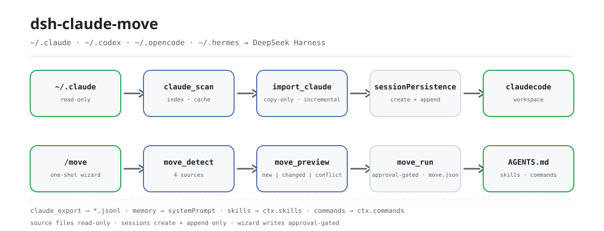

<div align="center">

<picture>
  <source media="(prefers-color-scheme: dark)" srcset="docs/assets/dsh-claude-move-flow-dark.svg">
  
</picture>

# dsh-claude-move

**अपना Claude Code, Codex, OpenCode और Hermes इतिहास DeepSeek Harness में ले जाएँ — सत्र फिर से जारी करने योग्य रहते हैं, यादें साथ आती हैं, skills और कमांड काम करते रहते हैं।**

चार-स्रोत माइग्रेशन विज़ार्ड और सत्र आयातक: केवल प्रतिलिपि, कुछ भी हटाया या बदला नहीं जाता, हर लेखन से पहले स्वीकृति; एक बार इंस्टॉल करें और पुराने प्रोजेक्ट का संदर्भ आगे बढ़ाएँ।

[इंस्टॉल](#तीन-चरणों-में-शुरुआत) · [कॉन्फ़िगरेशन](#कॉन्फ़िगरेशन) · [FAQ](#faq) · [简体中文](README.md) · [English](README.en.md) · [Español](README.es.md) · [Português](README.pt.md) · [हिन्दी](README.hi.md)

[](LICENSE)
[](#संगतता)
[](https://www.npmjs.com/package/dsh-claude-move)
[](https://github.com/PerryLink/dsh-claude-move/actions/workflows/test.yml)
[](#संगतता)

[](https://github.com/PerryLink/dsh-claude-move/stargazers)
[](https://www.npmjs.com/package/dsh-claude-move)
[](https://dshfind.com/plugins/PerryLink/dsh-claude-move?ref=badge)
[](https://securityscorecards.dev/viewer/?uri=github.com/PerryLink/dsh-claude-move)
[](https://dsh.market/)
[](https://gitee.com/perrylink/dsh-claude-move)

```sh
dsh plugin --profile <name> add dsh-claude-move
```

</div>

<sub>सामुदायिक प्लगइन, DeepSeek से असंबद्ध। कैनोनिकल रिपॉज़िटरी: <https://github.com/PerryLink/dsh-claude-move> (Gitee एक मिरर है)।</sub>

## यह क्या है

Claude Code का लंबा इस्तेमाल करने पर पूरा इतिहास `~/.claude` में जमा हो जाता है: सत्र transcript, memory, skills, `CLAUDE.md` और `settings.json`। `dsh-claude-move` इन्हें पढ़कर DeepSeek Harness में ऐसे सत्र और संदर्भ बनाता है जिन्हें खोला और फिर से जारी रखा जा सके — स्रोत डायरेक्टरी हमेशा केवल-पठन रहती है, और DSH पक्ष केवल `create` + `append` करता है, इसलिए किसी भी पक्ष को हटाया, बदला या मिटाया नहीं जाता। Claude Code के अलावा Codex, OpenCode और Hermes भी उसी `/move` विज़ार्ड से माइग्रेट होते हैं।

## तीन चरणों में शुरुआत

1. **इंस्टॉल करें** (एक चैनल चुनें):

   ```sh
   # git चैनल (डिफ़ॉल्ट ब्रांच main; git+https://github.com/PerryLink/dsh-claude-move.git के बराबर)
   dsh plugin --profile web add github:PerryLink/dsh-claude-move
   # npm चैनल (प्रकाशित रिलीज़)
   dsh plugin --profile web add dsh-claude-move
   # tarball चैनल: इस रेपो में npm pack करके
   dsh plugin --profile web add ./dsh-claude-move-<version>.tgz
   ```

   कोई build चरण नहीं: शुद्ध ESM, `index.mjs` और `lib/` ही भेजे गए आर्टिफ़ैक्ट हैं; `prepare` या `allowBuilds` की ज़रूरत नहीं।

2. **न्यूनतम कॉन्फ़िग** (डिफ़ॉल्ट से ही चलता है; ज़रूरत हो तभी बदलें):

   ```yaml
   - insert:
       - id: claude-move
         name: dsh-claude-move
         config:
           workspaceMode: claudecode
           requireApproval: true
   ```

3. **माउंट सत्यापित करें**:

   ```sh
   dsh --profile web --dump-config | grep -A4 'id: claude-move'
   ```

   फिर किसी भी DSH सत्र में एक कमांड चलाएँ:

   ```sh
   /claude-import-all      # स्कैन → हर Claude सत्र की प्रतिलिपि → रिपोर्ट
   ```

   आयात के बाद DSH को रीस्टार्ट करने की ज़रूरत नहीं — खुला Web पेज एक बार रीफ़्रेश करें और किसी भी आयातित सत्र पर क्लिक करके आगे बढ़ें।

**अनइंस्टॉल**: `dsh plugin --profile web remove dsh-claude-move` (या प्रोफ़ाइल के bundles से `claude-move` पंक्ति हटाएँ)। आयातित सत्र DSH के डेटा डायरेक्टरी में रहते हैं; प्लगइन केवल अपना कैश (`$DSH_HOME/claude-move/`) और `claudecode` कार्यस्थान फ़ोल्डर लिखता है, Claude के स्रोत डेटा को कभी नहीं छूता।

## मुख्य क्षमताएँ

`dsh-claude-move` «टूल बदलना» को «संदर्भ ले जाना» बना देता है — पुराने सत्र, यादें, skills, निर्देश और स्लैश कमांड साथ आते हैं, और माइग्रेशन दोबारा चलाया और वापस लिया जा सकता है:

- **स्वतः खोज** — `claude_scan` Claude डेटा रूट (`$CLAUDE_CONFIG_DIR`, वरना `~/.claude`) खोजता है और हर प्रोजेक्ट/सत्र, memory, skill, वैश्विक `CLAUDE.md` और `settings.json` को इंडेक्स करता है, इन्क्रीमेंटल कैश और समानांतर स्कैन (`scanConcurrency`) के साथ।
- **पूर्ण-निष्ठा आयात** — `import_claude` transcript को संतुलित, फिर से जारी करने योग्य DSH सत्रों में बदलता है (`turn/start → step/start → user/message → assistant/message → tool/call → tool/result → step/end → turn/end`), बाधित tool कॉल ठीक करता है, और `maxTranscriptBytes` से बड़े transcript को टुकड़ों में स्ट्रीम-आयात करता है।
- **एक `claudecode` कार्यस्थान** — हर आयातित सत्र एक समर्पित कार्यस्थान में जाता है (डिफ़ॉल्ट `$DSH_HOME/claudecode`); `workspaceMode: 'per-project'` प्रति-प्रोजेक्ट समूहन बहाल करता है।
- **केवल प्रतिलिपि और इन्क्रीमेंटल** — किसी भी पक्ष में कुछ हटाया, बदला या मिटाया नहीं जाता; दोबारा चलाने पर केवल नए टर्न जुड़ते हैं (`force: true` नए id के साथ एक अतिरिक्त पूर्ण प्रतिलिपि बचाता है, पुरानी बनी रहती है)।
- **व्यक्तिगत संदर्भ हमेशा ताज़ा** — यादें लाइव prompt अनुभाग के रूप में इंजेक्ट होती हैं, Claude skills वास्तविक DSH skills के रूप में पंजीकृत होती हैं (वैश्विक + प्रोजेक्ट-स्तर), वैश्विक और प्रोजेक्ट `CLAUDE.md` जल्दी इंजेक्ट होते हैं।
- **चार-स्रोत माइग्रेशन विज़ार्ड** — `/move` और `move_detect` / `move_preview` / `move_run` Claude Code, Codex, OpenCode और Hermes को माइग्रेट करते हैं, स्वीकृति-नियंत्रित और idempotent (`move.json`)।
- **Web पैनल और कमांड** — `/claude-import-all`, `/resume-claude`, `/claude-move-reset`, `/claude-export`, और एक फ़्लोटिंग माइग्रेशन पैनल।
- **द्विदिश निर्यात** — `claude_export` (या `/claude-export <sessionId>`) DSH सत्र को वापस फिर से जारी करने योग्य Claude Code JSONL transcript के रूप में लिखता है (`user`/`assistant`/`tool` टर्न, `thinking` + `tool_use`/`tool_result` युग्मन, यथासंभव `cwd` मैपिंग), ताकि इतिहास DSH से फिर बाहर जा सके।

### क्या माइग्रेट होता है

```text
~/.claude (केवल-पठन)
 ├─ projects/*/*.jsonl  ──→  फिर से जारी करने योग्य DSH सत्र, एक "claudecode" कार्यस्थान में समूहित (डिफ़ॉल्ट)
 ├─ projects/*/memory/  ──→  लाइव system-prompt memory अनुभाग (हर अनुरोध पर फिर पढ़ा जाता है)
 ├─ skills/**           ──→  वास्तविक DSH skills
 └─ CLAUDE.md + settings ──→  शुरुआती prompt अनुभाग + कॉन्फ़िग सुझाव (कभी अपने आप लागू नहीं)
```

| Claude Code में | DSH में बनता है |
|---|---|
| सत्र transcript (`projects/*/*.jsonl`) | संतुलित, फिर से जारी करने योग्य DSH सत्र — `user`/`assistant`/`tool`/`thinking` की पूर्ण-निष्ठा मैपिंग और बाधित tool कॉल की मरम्मत — एक **`claudecode`** कार्यस्थान या प्रति-प्रोजेक्ट एक में समूहित |
| Memory फ़ाइलें (`projects/*/memory/*.md`) | एक लाइव system-prompt संदर्भ अनुभाग, हर अनुरोध पर फिर पढ़ा जाता है (`feedback > project > reference > user`) |
| Skills (`~/.claude/skills/**`) | वास्तविक DSH skills (kebab-case नाम, टकराव पर प्रत्यय, डिफ़ॉल्ट रूप से अधिकतम 30; `README.md`/`MEMORY.md` और बिना विवरण वाली फ़ाइलें छोड़ दी जाती हैं) |
| `CLAUDE.md` (वैश्विक + प्रति-प्रोजेक्ट) | एक शुरुआती prompt अनुभाग; प्रोजेक्ट फ़ाइल जीतती है |
| `settings.json` | DSH कॉन्फ़िग सुझाव, साथ में मैप न हो सकने वाली कुंजियों की स्पष्ट सूची |
| प्रोजेक्ट स्थिति (डायरेक्टरी, git ब्रांच और गंदी गिनती) | स्कैन इंडेक्स, Web पैनल बैज और `/resume-claude` हैंडऑफ़ में दिखती है |

## चार-स्रोत माइग्रेशन विज़ार्ड

```text
/move              # एक-बार का विज़ार्ड: पहचान → पूर्वावलोकन → निष्पादन → रिपोर्ट (चारों स्रोत)
move_detect        # Claude Code / Codex / OpenCode / Hermes स्कैन करें
move_preview       # प्रति-आइटम योजना: new | unchanged | changed | conflict (diff सहित) | unsupported
move_run           # स्वीकृति द्वार के पीछे निष्पादन; टकराव समाधान:
                   #   skip | overwrite | rename | merge  (डिफ़ॉल्ट skip — कभी अनुमान नहीं)
```

- **स्रोत** — Claude Code (`~/.claude`), Codex (`~/.codex`), OpenCode (डेटा + कॉन्फ़िग रूट), Hermes (skills/memory रूट); हर स्रोत का अपना parser + mapper है।
- **मैपिंग** — यादें/निर्देश → DSH वैश्विक `AGENTS.md` में केवल-जोड़ने वाले प्रबंधित अनुभाग (प्रति आइटम एक चिह्नित अनुभाग); skills → वास्तविक DSH skills (`SKILL.md` बंडल जैसे-के-तैसे कॉपी, अन्य फ़ॉर्मैट बदले जाते हैं); स्लैश कमांड → पंजीकृत DSH कमांड (रीस्टार्ट के बाद `move.json` से पुनर्निर्मित); सत्र → फिर से जारी करने योग्य DSH सत्र (फ़ेज़ 1 के वही आयातक)।
- **Idempotent** — हर लागू योजना `$DSH_HOME/claude-move/move.json` में दर्ज होती है (`digest` / `targetDigest` / `appliedAt`); दोबारा चलाने पर अपरिवर्तित आइटम छूट जाते हैं और `force` उन्हें फिर लागू करता है।
- **स्वीकृति-नियंत्रित** — जो भी रन कुछ लिखेगा, पहले `ctx.approval` से पूछता है; `allowed-once` के अलावा कोई भी परिणाम शून्य लेखन है।

## उपयोग

प्लगइन माउंट होने पर किसी भी सत्र में इन टूल को कॉल करें:

```text
claude_scan                          # पूरा स्कैन (इन्क्रीमेंटल कैश)
claude_scan { path: "~/.claude/projects/<slug>" }   # आंशिक स्कैन
claude_scan { refresh: true }        # कैश छोड़कर सब फिर स्कैन करें
claude_scan { projectsLimit: 10, sessionsLimit: 5, fields: "brief" }  # संक्षिप्त आउटपुट

import_claude { path: "~/.claude/projects/<slug>/<sessionId>.jsonl" }  # एक सत्र
import_claude { path: "~/.claude/projects" }        # डायरेक्टरी (रिकर्सिव)
import_claude { path: "all" }                       # सब कुछ
# कभी भी दोबारा चलाएँ: अपरिवर्तित फ़ाइलें छूट जाती हैं, बढ़े transcript केवल नए टर्न जोड़ते हैं।
# maxTranscriptBytes से बड़ी फ़ाइलें टुकड़ों में स्ट्रीम-आयात होती हैं (कोई मेमोरी सीमा नहीं)।
import_claude { path: "...", force: true }          # नई पूर्ण प्रतिलिपि (पिछली प्रतिलिपि बनी रहती है)

claude_export { sessionId: "<dsh-session-id>" }     # DSH सत्र वापस Claude JSONL में लिखें
claude_export { sessionId: "...", path: "~/.claude/projects/<slug>/<id>.jsonl" }  # स्पष्ट लक्ष्य
```

कमांड (उपयोगकर्ता-ट्रिगर, कोई मॉडल टर्न नहीं):

```text
/claude-import-all                # एक-बार: स्कैन → सब आयात → रिपोर्ट → वर्तमान सत्र में इंजेक्ट
/resume-claude latest             # सबसे हाल का Claude सत्र जारी रखें
/resume-claude <sessionId>        # स्रोत सत्र id या import-<src> id से
/resume-claude <keyword>          # शीर्षक मिलाएँ; कई मिलान सूचीबद्ध होते हैं, अनुमान कभी नहीं
/claude-move-reset                # प्लगइन कैश रीसेट करें (बुकमार्क + आयात मैप); आयातित सत्र बने रहते हैं
/claude-export <sessionId> [path] # DSH सत्र को फिर से जारी करने योग्य Claude JSONL transcript में निर्यात करें
```

### टूल और सतहें

| सतह | प्रकार | नोट्स |
|---|---|---|
| `claude_scan` | टूल | प्रोजेक्ट/सत्र/यादें/skills/सेटिंग्स का संरचित इंडेक्स |
| `import_claude` | टूल | एक सत्र, एक डायरेक्टरी या `all` आयात करें (इन्क्रीमेंटल; नई प्रतिलिपि के लिए `force`) |
| `claude_export` | टूल | DSH सत्र को फिर से जारी करने योग्य Claude Code JSONL transcript में निर्यात करें |
| `move_detect` / `move_preview` / `move_run` | टूल | चार-स्रोत विज़ार्ड: स्कैन, diff सहित प्रति-आइटम योजना, स्वीकृति के बाद निष्पादन |
| `/claude-import-all` | कमांड | स्कैन → सब आयात → रिपोर्ट |
| `/resume-claude` | कमांड | एक Claude सत्र जारी रखें (latest, id या कीवर्ड) |
| `/claude-move-reset` | कमांड | प्लगइन कैश रीसेट करें (आयातित सत्र बने रहते हैं) |
| `/claude-export` | कमांड | DSH सत्र को फिर से जारी करने योग्य Claude JSONL transcript में निर्यात करें |
| `/move` | कमांड | एक-बार का चार-स्रोत विज़ार्ड |
| Web माइग्रेशन पैनल | क्लाइंट | प्रगति, रद्द, पेजिंग और सत्र खोलने वाला फ़्लोटिंग पैनल |

Web पैनल: एक फ़्लोटिंग माइग्रेशन पैनल, जिसमें प्रोजेक्ट/सत्र वृक्ष, स्थिति बैज (आयात नहीं हुआ / आयातित / नए टर्न सहित आयातित / स्रोत अनुपलब्ध / डायरेक्टरी अनुपलब्ध / git गंदा), कीवर्ड फ़िल्टर, पेजित रेंडरिंग, प्रति-सत्र «आयात करें और जारी रखें» + «सत्र खोलें» + «सत्र सूची रीफ़्रेश करें», लाइव प्रगति बार और रद्द करने वाला बैच आयात, और कैश-रीसेट बटन है। टेक्स्ट ब्राउज़र भाषा (zh/en) का पालन करते हैं। यह प्लगइन के अपने `/api/claude-move/*` JSON रूट्स से सार्वजनिक `ctx.webServer` seam पर परोसा जाता है।

### आयात के बाद

**आपको DSH रीस्टार्ट करने की ज़रूरत नहीं।** आयात पूरा होते ही सार्वजनिक `sessionPersistence` सेवा से टिकाऊ रूप से सहेजे जाते हैं:

- सर्वर-साइड सूचियाँ (`session.list` / `workspace.list` RPC, CLI, कोई भी नया पेज लोड) आयातित सत्रों को तुरंत **`claudecode` कार्यस्थान** के अंतर्गत दिखाती हैं।
- पैनल खुद खुले पेज की सत्र सूची रीफ़्रेश करता है और हर आयातित सत्र के लिए **सत्र खोलें** बटन देता है।
- आयातित सत्र तुरंत खोले, पढ़े और जारी रखे जा सकते हैं — `/resume-claude`, या सूची में सत्र पर क्लिक करें। कभी भी दोबारा आयात चलाने पर केवल नए टर्न उन्हीं सत्रों में सिंक होते हैं।

### उदाहरण

ये प्लगइन के वास्तविक प्रवेश बिंदु हैं; एक बार इंस्टॉल करके एक चलाएँ।

**विस्तृत उदाहरण** — कमांड `import_claude`, इनपुट:

```json
{ "path": "test/fixtures/simple.jsonl" }
```

आउटपुट:

```text
已导入 1 轮对话（2 条消息、0 次工具调用）→ 会话 import-sess-simple-001。
```

*Observed from `README.md:138 (Usage); test/fixtures/simple.jsonl:1-2; index.mjs:1708 (renderImport)`*

**विफलता शाखा** — इनपुट:

```text
resolveImportTarget('', '/home/user/.claude')  // empty path
```

आउटपुट:

```text
Error: path 必填：单个 .jsonl、目录、"~/.claude/projects" 或 "all"
```

*Observed from `plugins/dsh-claude-move/index.mjs:744-746; plugins/dsh-claude-move/test/import.test.mjs:158-161; plugins/dsh-claude-move/README.md:132-145`*

**संक्षिप्त उदाहरण**: `import_claude` · `claude_export`

## कॉन्फ़िगरेशन

सब वैकल्पिक, cordis.yml में ओवरराइड करने योग्य। id-लक्षित ओवरराइड पूरी पंक्ति बदल देता है — ज़रूरी सभी कुंजियाँ दोबारा लिखें।

सबसे अधिक इस्तेमाल होने वाली कुंजियाँ:

| कुंजी | डिफ़ॉल्ट | अर्थ |
|---|---|---|
| `claudeHome` | `$CLAUDE_CONFIG_DIR` या `~/.claude` | Claude डेटा रूट |
| `workspaceMode` | `claudecode` | `claudecode` (एक समर्पित कार्यस्थान) · `per-project` (प्रति स्रोत cwd एक) |
| `enableMemory` | `true` | यादें लाइव prompt अनुभाग के रूप में इंजेक्ट करें |
| `enableSkills` | `true` | Claude skills को DSH skills के रूप में पंजीकृत करें |
| `enableInstructions` | `true` | वैश्विक + प्रोजेक्ट `CLAUDE.md` इंजेक्ट करें |
| `maxTranscriptBytes` | `67108864` | स्ट्रीम-आयात सीमा (इससे ऊपर टुकड़ों में) |
| `requireApproval` | `true` | विज़ार्ड लेखन `ctx.approval` से पूछता है (केवल allowed-once) |
| `enableWebPanel` | `true` | `/api/claude-move/*` पैनल रूट पंजीकृत करें |

<details>
<summary>पूर्ण कॉन्फ़िग तालिका (31 कुंजियाँ)</summary>

| कुंजी | डिफ़ॉल्ट | अर्थ |
|---|---|---|
| `claudeHome` | `$CLAUDE_CONFIG_DIR` या `~/.claude` | Claude डेटा रूट |
| `workspaceMode` | `claudecode` | `claudecode` (एक समर्पित कार्यस्थान) · `per-project` (प्रति स्रोत cwd एक) |
| `claudecodeDir` | `$DSH_HOME/claudecode` | `claudecode` कार्यस्थान फ़ोल्डर (प्लगइन का बनाया एकमात्र फ़ोल्डर) |
| `scanGit` | `true` | Git जाँच स्तर: `true` (पूर्ण) · `'branch'` (शून्य git कॉल) · `false` |
| `gitTimeoutMs` | `5000` | Git सबप्रोसेस टाइमआउट |
| `scanConcurrency` | `8` | समानांतर प्रोजेक्ट स्कैन सीमा |
| `maxTranscriptBytes` | `67108864` | स्ट्रीम-आयात सीमा (इससे ऊपर टुकड़ों में) |
| `excludeProjects` | `[]` | छोड़ने योग्य slug उपस्ट्रिंग |
| `enableMemory` | `true` | यादें लाइव prompt अनुभाग के रूप में इंजेक्ट करें |
| `memoryMaxBytes` | `8192` | memory अनुभाग सीमा |
| `memoryScope` | `current-project` | `current-project` · `all` (वर्तमान पहले) |
| `enableSkills` | `true` | Claude skills को DSH skills के रूप में पंजीकृत करें |
| `maxSkills` | `30` | skills संख्या सीमा |
| `extraSkillDirs` | `[]` | अतिरिक्त skill डायरेक्टरियाँ |
| `enableInstructions` | `true` | वैश्विक + प्रोजेक्ट `CLAUDE.md` इंजेक्ट करें |
| `resumeMaxChars` | `2048` | हैंडऑफ़ सारांश वर्ण सीमा |
| `resumeMode` | `inject` | `inject` (हैंडऑफ़ सारांश) · `agents` (ctx.agents.resume) |
| `enableWebPanel` | `true` | `/api/claude-move/*` पैनल रूट पंजीकृत करें |
| `importConcurrency` | `4` | प्रति बैच समानांतर पढ़ना + बदलना |
| `enableMove` | `true` | चार-स्रोत विज़ार्ड पंजीकृत करें (`/move`, तीन move टूल, कमांड पुनर्निर्माण) |
| `requireApproval` | `true` | विज़ार्ड लेखन `ctx.approval` से पूछता है (केवल allowed-once) |
| `sources` | `[claude, codex, opencode, hermes]` | विज़ार्ड के स्रोत (डिफ़ॉल्ट रूप से चारों चालू) |
| `codexHome` | `$CODEX_HOME` या `~/.codex` | Codex डेटा रूट |
| `opencodeDataHome` | प्लेटफ़ॉर्म XDG डेटा डायरेक्टरी/opencode | OpenCode डेटा रूट |
| `opencodeConfigHome` | प्लेटफ़ॉर्म XDG कॉन्फ़िग डायरेक्टरी/opencode | OpenCode कॉन्फ़िग रूट |
| `hermesHome` | `$HERMES_HOME` या `~/.hermes` | Hermes डेटा रूट |
| `skillsDir` | `$DSH_HOME/skills` | विज़ार्ड skill लक्ष्य (आधिकारिक उपयोगकर्ता skill रूट, DSH स्वतः खोजता है) |
| `agentsMdPath` | `$DSH_HOME/AGENTS.md` | विज़ार्ड memory/निर्देश लक्ष्य (DSH वैश्विक निर्देश फ़ाइल) |
| `moveWorkspaceMode` | `per-source` | विज़ार्ड आयात का कार्यस्थान समूहन: `per-source` · `single` |
| `enableExport` | `true` | `claude_export` टूल और `/claude-export` कमांड पंजीकृत करें |
| `exportDir` | `$DSH_HOME/claude-export` | डिफ़ॉल्ट निर्यात फ़ोल्डर (स्पष्ट `path` हमेशा जीतता है) |

</details>

अपने प्रोफ़ाइल पैच में ओवरराइड का उदाहरण:

```yaml
- insert:
    - id: claude-move
      name: dsh-claude-move
      config:
        workspaceMode: per-project
        memoryScope: all
        resumeMode: agents
        sources: [claude, codex]
```

## FAQ

<details>
<summary>क्या यह स्रोत डेटा को बदलता, हटाता या मिटाता है?</summary>

नहीं। Claude/Codex/OpenCode/Hermes की स्रोत फ़ाइलें पूरी तरह केवल-पठन हैं; DSH सत्र लॉग केवल `create` + `append` करते हैं, ऐतिहासिक इवेंट कभी नहीं बदलते। `force: true` भी ओवरराइट नहीं करता — वह नए id (`import-<src>-<n>`) के साथ एक अतिरिक्त पूर्ण प्रतिलिपि बचाता है और पुरानी रखता है। विज़ार्ड `AGENTS.md`, skills और कमांड में केवल जोड़ता या नया बनाता है; टकराव डिफ़ॉल्ट रूप से `skip` हैं।

</details>

<details>
<summary>आयात के बाद DSH रीस्टार्ट करना पड़ता है क्या?</summary>

नहीं। आयात पूरा होते ही सार्वजनिक `sessionPersistence` सेवा से टिकाऊ रूप से सहेजे जाते हैं, इसलिए सर्वर-साइड सूचियाँ (`session.list` / `workspace.list`, CLI, नया पेज लोड) उन्हें तुरंत दिखाती हैं। पहले से खुले Web पेज को केवल एक बार अपनी सत्र सूची रीफ़्रेश करनी होती है (पैनल का «सत्र सूची रीफ़्रेश करें» बटन या F5); कार्यस्थान समूहन `domain/changed` से लाइव अपडेट होता है। `host/session-added` फ़्रेम केवल live सत्रों के लिए निकलता है, इसलिए ठंडा आयात अपने आप नहीं दिखता — यह UI व्यवहार है, डेटा समस्या नहीं।

</details>

<details>
<summary>क्या माइग्रेशन विज़ार्ड बिना अनुमति फ़ाइलें लिख सकता है?</summary>

नहीं। जो भी `move_run` कुछ लिखेगा, पहले `ctx.approval` से पूछता है; `allowed-once` के अलावा कोई भी परिणाम शून्य लेखन है (fail-closed), और बिना approval seam वाले प्लेटफ़ॉर्म को चलाने के लिए स्पष्ट रूप से `requireApproval: false` सेट करना होगा। हर लागू योजना `$DSH_HOME/claude-move/move.json` में दर्ज होती है, और दोबारा चलाने पर अपरिवर्तित आइटम छूट जाते हैं।

</details>

<details>
<summary>बड़े transcript और प्रदर्शन लागत का क्या?</summary>

स्कैन `scanConcurrency` (डिफ़ॉल्ट 8) तक समानांतर चलता है और इन्क्रीमेंटल कैश रखता है; `maxTranscriptBytes` (डिफ़ॉल्ट 64 MiB) से बड़ा एक transcript बिना मेमोरी सीमा के टुकड़ों में स्ट्रीम-आयात होता है। बैच आयात का पढ़ना + बदलना चरण `importConcurrency` (डिफ़ॉल्ट 4) से सीमित है, और लेखन चरण नियतता के लिए फ़ाइल-नाम क्रम में क्रमिक है। git जाँच की लागत बचाने के लिए `scanGit` को `'branch'` (शून्य git कॉल) या `false` करें।

</details>

## सुरक्षा सीमाएँ

- **स्रोत फ़ाइलें केवल-पठन हैं; DSH लॉग केवल-जोड़ने वाले हैं** (केवल `create` + `append`)।
- **बाहरी transcript अविश्वसनीय इनपुट हैं** — उनमें से कुछ भी निष्पादित नहीं होता; system/developer/thinking सामग्री कभी resume हैंडऑफ़ में नहीं जाती।
- **केवल सार्वजनिक सेवाएँ** — `sessionPersistence` / `workspaceRegistry` / `tools` / `commands` / `systemPrompt` / `skills` / `webServer`; इंजन या UI में कोई बदलाव नहीं।
- **रहस्य केवल स्थिति से रिपोर्ट होते हैं** (file:line:kind); `permission`/`permission-mode`/`queue-operation` रिकॉर्ड गिने जाते हैं, आयात नहीं।
- **विज़ार्ड लेखन स्वीकृति-नियंत्रित है** — `allowed-once` के अलावा कोई भी परिणाम शून्य लेखन है।

## अनुमतियाँ और डेटा

- **अनुमतियाँ**: workshop manifest `filesystem:read` और `filesystem:write` घोषित करता है।
- **पढ़ता है** `~/.claude` (transcript, memory, skills, `CLAUDE.md`, `settings.json`) — पूरी तरह केवल-पठन — और वे प्रोजेक्ट डायरेक्टरियाँ जिनमें आयात करता है।
- **लिखता है** सार्वजनिक `sessionPersistence` सेवा से DSH सत्र लॉग (केवल create + append, कभी delete/rewrite/archive नहीं), कार्यस्थान-रजिस्ट्री रिकॉर्ड, `$DSH_HOME/claude-move/` के नीचे अपना कैश, `claudecode` कार्यस्थान फ़ोल्डर, और `$DSH_HOME/claude-export/` (या स्पष्ट लक्ष्य पथ) के नीचे निर्यातित `.jsonl` फ़ाइलें।
- **कभी नहीं** Claude स्रोत फ़ाइलें बदलता, अन्य ऐप्स का डेटा छूता या नेटवर्क एक्सेस करता। **कोई क्रेडेंशियल नहीं** पढ़े या भेजे जाते।

## ज्ञात सीमाएँ

- शीर्षक `custom-title`/`ai-title`/पहले prompt से आते हैं; Claude `summary` रिकॉर्ड रिपोर्ट होते हैं पर DSH compaction नोड्स में मैप नहीं होते (वैध compaction ट्रांज़ैक्शन गढ़ना उसकी seq रेंज और checkpoint संदेश को नकली बना देता)।
- `thinking` ब्लॉक `reasoning` सामग्री के रूप में रखे जाते हैं, पर कभी resume हैंडऑफ़ में नहीं जाते।
- बाधित tool कॉल एक संश्लेषित त्रुटि परिणाम से ठीक होते हैं (कभी छोड़े नहीं जाते), `repaired.synthesized` के रूप में रिपोर्ट।
- अनुमति-श्रेणी के रिकॉर्ड गिने जाते हैं, आयात नहीं; DSH अनुमति-प्रीसेट सुझाव रिपोर्ट में बनते हैं।
- बिना स्ट्रीमिंग `fs.streamText` सतह वाले होस्ट पर, `maxTranscriptBytes` से बड़े transcript आंशिक आयात के बजाय ज़ोर से विफल होते हैं।
- `workspaceMode: 'per-project'` में जिन सत्रों की स्रोत डायरेक्टरी मिट गई, वे फिर भी आयात होते हैं, पर कार्यस्थान attach विफल होता है (बिना समूह के रहते हैं; `workspace.attached: false` और एक `reason`)। डिफ़ॉल्ट `claudecode` कार्यस्थान स्रोत डायरेक्टरी पर निर्भर नहीं।
- यदि कोई transcript जगह पर काटा या रीसेट हुआ (दर्ज आयात से कम टर्न), तो दोबारा आयात उसे छोड़कर `sourceShrunk` रिपोर्ट करता है; नई पूर्ण प्रतिलिपि के लिए `force: true` इस्तेमाल करें।
- Web पैनल प्लगइन के अपने JSON रूट्स से चलने वाला ज़ीरो-बिल्ड फ़्लोटिंग पैनल है; यह shell के आंतरिक UI slot सिस्टम का उपयोग नहीं करता।

## मॉडल अनुभव

- मॉडल-उन्मुख सतह टूल के विवरण/schema और उनके आउटपुट हैं: `claude_scan` संरचित इंडेक्स लौटाता है, `import_claude` प्रति-फ़ाइल सारांश और चेतावनियों की स्थिति लौटाता है, और `claude_export` निर्यात सारांश (लक्ष्य पथ + टर्न/संदेश/टूल गिनती) लौटाता है। टूल परिणाम स्वयं `tool/result` इवेंट के रूप में लॉग होते हैं, इसलिए सब कुछ पुनर्निर्माण योग्य है।
- कोई छिपा मॉडल-उन्मुख टेक्स्ट नहीं; memory/`CLAUDE.md` अनुभाग `ctx.systemPrompt` पर पंजीकृत होते हैं (prompt संयोजन, सत्र लॉग से पुनर्निर्माण योग्य)।

## संगतता

- लक्ष्य `dsh 0.1.6-alpha.2` (web प्रोफ़ाइल, सत्र प्रारूप V3); `engines.dsh` और peer निर्भरताएँ `package.json` के अनुसार (वर्तमान में `>=0.1.6-0 <0.2.0 || >=0.2.0-0 <0.3.0 || >=0.2.2-0 <0.3.0`); 0.2.1 लाइन स्थिर रूप से संगत है (कोई रनटाइम सत्यापन दर्ज नहीं)। 2026-09-18 को सत्यापित (checkJs टाइप गेट + 287 दावे, 38 सूट)। होस्ट में `sessions.open()` न होने पर पैनल का «सत्र खोलें» बटन गायब होने के बजाय स्पष्टीकरण title के साथ अक्षम रेंडर होता है। Node `^22.19 || >=24.9`।
- `0.1.2-rc.1` (2026-09-04 को अनुकूलित): सत्र envelope अपना ignorable फ़ील्ड केवल संग्रहीत लॉग पढ़ने की संगतता के लिए रखता है - Session.append अभी भी उसे स्टाम्प नहीं कर सकता, इसलिए gate व्यवहार अपरिवर्तित है।
- 0.4.0 में दोहरी-आधार रेखा वाला `sessionPersistence` रनटाइम shim है, जो API आकार से पहचाना जाता है (संस्करण से कभी नहीं): पुराना API (`create`/`append`/`readFrom`, `list()` हेडर लौटाता है) और handle seam (`create` एक `SessionHandle` लौटाता है, `list()`/`stat()` स्नैपशॉट लौटाते हैं) दोनों काम करते हैं। handle seam alpha लाइन पर प्रकाशित है (`@deepseek-ai/dsh-session-persistence` / `-jsonl` `0.1.5-rc.2`), इसलिए compat workflow उसे कवर करता है। handle पथ पर हर append के बाद `flush()` (टिकाऊपन बैरियर) और जोड़ी में `close()` (एकल-लेखक स्वामित्व) होता है; header पर backend का वर्तमान प्रारूप संस्करण और स्पष्ट `isSeeded` लगता है; अनुपस्थित assistant model स्रोत provider पर लौटते हैं; और 0.4.5 से जब backend प्रारूप संस्करण >= 2 हो तो संश्लेषित `assistant/message` इवेंट `stream: []` लेकर आते हैं — V3 का `Session.fromRestore` `Array.isArray(data.stream)` का दावा करता है, इसलिए इसके बिना लॉग लिखा और पढ़ा जा सकता था पर फिर से जारी नहीं किया जा सकता था। आयात-स्कैन की सफ़ाई तब चलने से मना कर देती है जब किसी सूचीबद्ध तत्व का `header.id` हल न हो सके, इसलिए `imports.json` कभी चुपचाप खाली नहीं होता।
- नई tarball इंस्टॉल पर अंतिम सत्यापन: वास्तविक स्कैन, वास्तविक बैच आयात (idempotent पुनः-आयात), कार्यस्थान attach और persistence आर्टिफ़ैक्ट पुष्ट; macOS/Linux CI मैट्रिक्स से कवर। आयातित लॉग सत्र प्रारूप V3 हैं और `dsh <= 0.1.2-rc.1` उन्हें नहीं पढ़ सकता (अपग्रेड एकतरफ़ा है; स्रोत transcript से दोबारा आयात विकल्प है)।

### संगतता मैट्रिक्स (केवल सार्वजनिक seams)

| सतह | उपयोग | अनुपस्थित होने पर fallback |
|---|---|---|
| होस्ट सेवाएँ (`tools` / `sessionPersistence` / `workspaceRegistry` / `commands` / `systemPrompt` / `skills` / `webServer`) | जहाँ बताया है वहाँ आवश्यक | वैकल्पिक सेवाएँ प्रतिक्रियाशील रूप से पंजीकृत होती हैं; `fs` न होना ज़ोर से विफल होता है |
| `sessionPersistence` दोहरी आधार रेखा: पुराना `listSnapshots` / `readFrom` / `append` बनाम handle `open` / `stat` / स्नैपशॉट `list()` | रनटाइम पर API आकार से पहचान (संस्करण से कभी नहीं) | `header.id` रिज़ॉल्यूशन गार्ड स्कैन को ज़ोर से रोक देता है, `imports.json` चुपचाप खाली नहीं करता |
| `streamText` वाला `fs` / `ctx.jobs` / `ctx.agents.resume` | फ़ीचर से पहचान | पूरी फ़ाइल पढ़ना और ज़ोर से अस्वीकार / अपना job map / हैंडऑफ़ इंजेक्ट |
| Client shell सेवाएँ (`sessions.refresh/open`, `workspaces.refresh`) | पैनल apply पर फ़ीचर से पहचान | पूरा पेज रीलोड |
| नई प्लेटफ़ॉर्म क्षमताएँ कभी कठोर आवश्यकता नहीं — प्लगइन सबसे पुरानी समर्थित लाइन (`0.1.2-rc.1`) पर बूट करने योग्य रहता है। | | |

## समस्या निवारण

- पंक्ति प्रभावी नहीं: `dsh --profile <p> --dump-config` को `# == dsh-claude-move` प्रिंट करना चाहिए; `dsh plugin --profile <p> add ...` फिर चलाएँ।
- Web बूट होता है पर चुपचाप अटक जाता है: `dsh plugin add` से बने नए प्रोफ़ाइल में केवल `dsh-base` होता है — `dsh.profile.bundles` में `@deepseek-ai/dsh-web-app` जोड़ें। मौजूदा `web` प्रोफ़ाइल में इंस्टॉल करने पर कुछ नहीं चाहिए।
- पैनल रूट 404: वे केवल तब परोसे जाते हैं जब `enableWebPanel: true` हो और web सर्वर संयोजित हो; बूट लॉग में FAILED fibers देखें।
- आयात "transcript 过大" से विफल: `maxTranscriptBytes` बढ़ाएँ या उस फ़ाइल को अलग से आयात करें।
- आयात सफल पर साइडबार में नया सत्र नहीं: पेज पहले से खुला था — पैनल का रीफ़्रेश बटन एक बार दबाएँ (या पेज रीलोड करें)। DSH रीस्टार्ट कभी ज़रूरी नहीं।
- लॉग: बूट विफलताएँ `dsh` कंसोल पर प्रिंट होती हैं; प्लगइन कार्यस्थान/आयात-मैप समस्याओं के लिए `[claude-move]` उपसर्ग वाली त्रुटियाँ लॉग करता है।

## इकोसिस्टम और गुणवत्ता

- [Gitee मिरर](https://gitee.com/perrylink/dsh-claude-move) (सिंक मिरर; GitHub कैनोनिकल है)
- [dshfind प्लगइन पेज](https://dshfind.com/plugins/PerryLink/dsh-claude-move) (इंस्टॉल और रैंकिंग)
- [OpenSSF Scorecard रिपोर्ट](https://securityscorecards.dev/viewer/?uri=github.com/PerryLink/dsh-claude-move) ([.github/workflows/scorecard.yml](.github/workflows/scorecard.yml) से संचालित)
- [dsh-plugin-doctor सत्यापन रिपोर्ट](https://github.com/PerryLink/dsh-plugin-doctor#verified-徽章)
- [DSH Market](https://dsh.market/) (सूचीबद्ध)
- **1024 स्टोर चैनल**: एक बार `npm i -g dsh1024`, फिर `dsh1024 plugin --profile web add dsh-claude-move` ([deepseek1024.com](https://deepseek1024.com) की इंस्टॉल रैंकिंग में गिना जाता है)
- [इकोसिस्टम ज्ञान आधार](https://perrylink.github.io/dsh-plugin-guide/) — मापा गया डेटा, मार्केटिंग नहीं: प्लगइन डेवलपमेंट गाइड · चयन डेटा · रखरखाव मानदंड

## ओपन-सोर्स श्रेय

यह प्रोजेक्ट Apache License 2.0 के अंतर्गत लाइसेंस प्राप्त है; निम्नलिखित MIT-लाइसेंस वाले घटक अपने स्वयं के लाइसेंस बनाए रखते हैं (पूरा पाठ [THIRD_PARTY_NOTICES.md](THIRD_PARTY_NOTICES.md) में):

- रूपांतरण कोर [Nwflower/dsh-chat-import](https://github.com/Nwflower/dsh-chat-import) से vendor किया गया (MIT)।
- खोज परंपराएँ और सुरक्षा मॉडल [Demogorgon314/dsh-resume-plugin](https://github.com/Demogorgon314/dsh-resume-plugin) से (MIT)।
- memory/skills इंजेक्शन और frontmatter पार्सिंग पैटर्न [YYTbit/dsh-plugin-claude-bridge](https://github.com/YYTbit/dsh-plugin-claude-bridge) से (MIT)।

## डेवलपमेंट

```sh
npm install   # peer निर्भरताएँ: @deepseek-ai/dsh-tools, @deepseek-ai/cordis, schemastery
npm test      # node --test "test/**/*.test.mjs"
npm run typecheck      # checkJs टाइप गेट (tsconfig.check.json)
npm run check:ci       # प्रकाशित-लाइन टाइप गेट (tsconfig.check.ci.json)
npm run check:readmes  # पाँच-भाषा README संगति
npm run verify:artifacts    # भेजी गई फ़ाइलें मौजूद + index.mjs आयात योग्य
npm run verify:self-contained  # निर्भरता spec registry से हल होती हैं
npm pack      # प्रकाशित tarball
```

कोई build चरण नहीं: शुद्ध ESM, `index.mjs` और `lib/` ही भेजे गए आर्टिफ़ैक्ट हैं। CI GitHub Actions ([test.yml](.github/workflows/test.yml)) से Linux/macOS/Windows पर Node 22 में पूरा सूट चलाता है। README चित्र [`scripts/gen-readme-assets.py`](scripts/gen-readme-assets.py) (Python + Pillow) से प्रोग्रामेटिक रूप से बनते हैं और सुरक्षित रूप से दोबारा चलाए जा सकते हैं।

Topics: `dsh`, `dsh-plugin`, `deepseek-harness`, `deepseek`, `cordis`, `claude-code`, `migration`, `session-import`, `resume`

## परिवार और आभार

यह प्रोजेक्ट [PerryLink](https://github.com/PerryLink) के DeepSeek Harness प्लगइन परिवार का सदस्य है (सभी Apache-2.0)। अगर यह उपयोगी लगे, **एक star अगले व्यक्ति को इसे खोजने में मदद करता है** — इसके पीछे कुछ भी बंद नहीं है।

- [@PerryLink](https://github.com/PerryLink) — निर्माता और अनुरक्षक: आयात पाइपलाइन, चार-स्रोत माइग्रेशन विज़ार्ड, Web पैनल, दस्तावेज़, CI/CD और रिलीज़।
- [@OLDnana1](https://github.com/OLDnana1) — बाधित tool-कॉल भ्रष्टाचार का मूल-कारण विश्लेषण, जिसके कारण आयातित सत्र resume पर स्थायी रूप से HTTP 400 लौटाते थे।
- [@GooodWei](https://github.com/GooodWei) — पहचाना कि `README.md` (और कोई भी बिना विवरण वाली `.md`) गलती से skill के रूप में पंजीकृत हो रही थी, जिससे DSH का skill लोड टूटता था।

<details>
<summary>सभी प्लगइन विस्तारित करें</summary>

| प्लगइन | स्थिति |
|---|---|
| **[dsh-aqua-input-check](https://github.com/PerryLink/dsh-aqua-input-check)** |  |
| **[dsh-archive-check](https://github.com/PerryLink/dsh-archive-check)** |  |
| **[dsh-auto-review](https://github.com/PerryLink/dsh-auto-review)** |  |
| **[dsh-autotier](https://github.com/PerryLink/dsh-autotier)** | 🧊 फ़्रोज़न — रेपो README देखें |
| **[dsh-bid-ca-precheck](https://github.com/PerryLink/dsh-bid-ca-precheck)** |  |
| **[dsh-bid-qual-check](https://github.com/PerryLink/dsh-bid-qual-check)** |  |
| **[dsh-cert-mcp](https://github.com/PerryLink/dsh-cert-mcp)** | 🧊 फ़्रोज़न — रेपो README देखें |
| **[dsh-checkpoint-rewind](https://github.com/PerryLink/dsh-checkpoint-rewind)** |  |
| **[dsh-click](https://github.com/PerryLink/dsh-click)** |  |
| **[dsh-composer-history](https://github.com/PerryLink/dsh-composer-history)** |  |
| **[dsh-contract-stance](https://github.com/PerryLink/dsh-contract-stance)** |  |
| **[dsh-customs-doc-check](https://github.com/PerryLink/dsh-customs-doc-check)** |  |
| **[dsh-data-quality](https://github.com/PerryLink/dsh-data-quality)** | 🧊 फ़्रोज़न — रेपो README देखें |
| **[dsh-demurrage-ledger](https://github.com/PerryLink/dsh-demurrage-ledger)** |  |
| **[dsh-doublecheck](https://github.com/PerryLink/dsh-doublecheck)** |  |
| **[dsh-drill-script-check](https://github.com/PerryLink/dsh-drill-script-check)** |  |
| **[dsh-eia-guide-check](https://github.com/PerryLink/dsh-eia-guide-check)** |  |
| **[dsh-emergency-plan](https://github.com/PerryLink/dsh-emergency-plan)** |  |
| **[dsh-essay-rubric-check](https://github.com/PerryLink/dsh-essay-rubric-check)** |  |
| **[dsh-evidence-check](https://github.com/PerryLink/dsh-evidence-check)** |  |
| **[dsh-export-ctl-check](https://github.com/PerryLink/dsh-export-ctl-check)** |  |
| **[dsh-fast](https://github.com/PerryLink/dsh-fast)** |  |
| **[dsh-fmea-table-check](https://github.com/PerryLink/dsh-fmea-table-check)** |  |
| **[dsh-forecast-penalty](https://github.com/PerryLink/dsh-forecast-penalty)** |  |
| **[dsh-fund-research](https://github.com/PerryLink/dsh-fund-research)** |  |
| **[dsh-github](https://github.com/PerryLink/dsh-github)** |  |
| **[dsh-gongwen-flow-check](https://github.com/PerryLink/dsh-gongwen-flow-check)** |  |
| **[dsh-gongwen-word-check](https://github.com/PerryLink/dsh-gongwen-word-check)** |  |
| **[dsh-guard-plan-qc](https://github.com/PerryLink/dsh-guard-plan-qc)** |  |
| **[dsh-hazchem-check](https://github.com/PerryLink/dsh-hazchem-check)** |  |
| **[dsh-hazplan-check](https://github.com/PerryLink/dsh-hazplan-check)** |  |
| **[dsh-hidden-risk-map](https://github.com/PerryLink/dsh-hidden-risk-map)** |  |
| **[dsh-hs-classify](https://github.com/PerryLink/dsh-hs-classify)** |  |
| **[dsh-icd-rule-check](https://github.com/PerryLink/dsh-icd-rule-check)** |  |
| **[dsh-industry-research](https://github.com/PerryLink/dsh-industry-research)** |  |
| **[dsh-lawcite-adapter](https://github.com/PerryLink/dsh-lawcite-adapter)** |  |
| **[dsh-laya](https://github.com/PerryLink/dsh-laya)** |  |
| **[dsh-lc-doc-check](https://github.com/PerryLink/dsh-lc-doc-check)** |  |
| **[dsh-learning-gap-check](https://github.com/PerryLink/dsh-learning-gap-check)** |  |
| **[dsh-library](https://github.com/PerryLink/dsh-library)** |  |
| **[dsh-local-ai](https://github.com/PerryLink/dsh-local-ai)** |  |
| **[dsh-lsp-actions](https://github.com/PerryLink/dsh-lsp-actions)** |  |
| **[dsh-mask](https://github.com/PerryLink/dsh-mask)** |  |
| **[dsh-mcp-panel](https://github.com/PerryLink/dsh-mcp-panel)** |  |
| **[dsh-medrec-qc](https://github.com/PerryLink/dsh-medrec-qc)** |  |
| **[dsh-memento](https://github.com/PerryLink/dsh-memento)** | 🧊 फ़्रोज़न — रेपो README देखें |
| **[dsh-nsfc-form-check](https://github.com/PerryLink/dsh-nsfc-form-check)** |  |
| **[dsh-nurse-record-check](https://github.com/PerryLink/dsh-nurse-record-check)** |  |
| **[dsh-observe](https://github.com/PerryLink/dsh-observe)** |  |
| **[dsh-origin-rvc-check](https://github.com/PerryLink/dsh-origin-rvc-check)** |  |
| **[dsh-ota-review-check](https://github.com/PerryLink/dsh-ota-review-check)** |  |
| **[dsh-output-styles](https://github.com/PerryLink/dsh-output-styles)** |  |
| **[dsh-paper-doc-adapter](https://github.com/PerryLink/dsh-paper-doc-adapter)** |  |
| **[dsh-permission-rules](https://github.com/PerryLink/dsh-permission-rules)** |  |
| **[dsh-permit-report-check](https://github.com/PerryLink/dsh-permit-report-check)** |  |
| **[dsh-pipeline-check](https://github.com/PerryLink/dsh-pipeline-check)** |  |
| **[dsh-pleading-draft](https://github.com/PerryLink/dsh-pleading-draft)** |  |
| **[dsh-plugin-doctor](https://github.com/PerryLink/dsh-plugin-doctor)** | 🚫 रिटायर्ड (रेपो संग्रहीत) |
| **[dsh-plugin-guide](https://github.com/PerryLink/dsh-plugin-guide)** |  |
| **[dsh-plugin-kit](https://github.com/PerryLink/dsh-plugin-kit)** | 🚫 रिटायर्ड (रेपो संग्रहीत) |
| **[dsh-plugin-upgrade](https://github.com/PerryLink/dsh-plugin-upgrade)** | 🚫 रिटायर्ड (रेपो संग्रहीत) |
| **[dsh-policy-brief-draft](https://github.com/PerryLink/dsh-policy-brief-draft)** |  |
| **[dsh-power-loss-split](https://github.com/PerryLink/dsh-power-loss-split)** |  |
| **[dsh-power-ticket-check](https://github.com/PerryLink/dsh-power-ticket-check)** |  |
| **[dsh-ppap-check](https://github.com/PerryLink/dsh-ppap-check)** |  |
| **[dsh-protest-deadline](https://github.com/PerryLink/dsh-protest-deadline)** |  |
| **[dsh-railway-window](https://github.com/PerryLink/dsh-railway-window)** |  |
| **[dsh-repair-order-qc](https://github.com/PerryLink/dsh-repair-order-qc)** |  |
| **[dsh-research-report](https://github.com/PerryLink/dsh-research-report)** |  |
| **[dsh-review-reply-check](https://github.com/PerryLink/dsh-review-reply-check)** |  |
| **[dsh-rulefile-check](https://github.com/PerryLink/dsh-rulefile-check)** |  |
| **[dsh-safety-brief-check](https://github.com/PerryLink/dsh-safety-brief-check)** |  |
| **[dsh-score](https://github.com/PerryLink/dsh-score)** | 🧊 फ़्रोज़न — रेपो README देखें |
| **[dsh-session-sync](https://github.com/PerryLink/dsh-session-sync)** |  |
| **[dsh-site-log-check](https://github.com/PerryLink/dsh-site-log-check)** |  |
| **[dsh-skill-pack-security](https://github.com/PerryLink/dsh-skill-pack-security)** |  |
| **[dsh-soe-decision-check](https://github.com/PerryLink/dsh-soe-decision-check)** |  |
| **[dsh-soilwater-check](https://github.com/PerryLink/dsh-soilwater-check)** |  |
| **[dsh-sop-sync-check](https://github.com/PerryLink/dsh-sop-sync-check)** |  |
| **[dsh-spc-gbt-adapter](https://github.com/PerryLink/dsh-spc-gbt-adapter)** |  |
| **[dsh-talk](https://github.com/PerryLink/dsh-talk)** |  |
| **[dsh-tender-extract](https://github.com/PerryLink/dsh-tender-extract)** |  |
| **[dsh-tender-matrix](https://github.com/PerryLink/dsh-tender-matrix)** |  |
| **[dsh-test-drive](https://github.com/PerryLink/dsh-test-drive)** |  |
| **[dsh-ticktick](https://github.com/PerryLink/dsh-ticktick)** | 🚫 रिटायर्ड (रेपो संग्रहीत) |
| **[dsh-translate](https://github.com/PerryLink/dsh-translate)** |  |
| **[dsh-warranty-calc](https://github.com/PerryLink/dsh-warranty-calc)** |  |
| **[dsh-budget](https://github.com/PerryLink/dsh-budget)** | 🧊 फ़्रोज़न — रेपो README देखें |
| **[dsh-claude-move](https://github.com/PerryLink/dsh-claude-move)** | 🧊 फ़्रोज़न — रेपो README देखें |
| **[dsh-defend](https://github.com/PerryLink/dsh-defend)** | 🧊 फ़्रोज़न — रेपो README देखें |
| **[dsh-draw](https://github.com/PerryLink/dsh-draw)** | 🧊 फ़्रोज़न — रेपो README देखें |
| **[dsh-reach](https://github.com/PerryLink/dsh-reach)** | 🧊 फ़्रोज़न — रेपो README देखें |
| **[dsh-background-agents](https://github.com/PerryLink/dsh-background-agents)** | 🚫 रिटायर्ड (रेपो संग्रहीत) |
| **[dsh-session-pin](https://github.com/PerryLink/dsh-session-pin)** | 🚫 रिटायर्ड (रेपो संग्रहीत) |
| **[dsh-team-rooms](https://github.com/PerryLink/dsh-team-rooms)** | 🚫 रिटायर्ड (रेपो संग्रहीत) |

</details>

## लाइसेंस

[LICENSE](LICENSE) (Apache License 2.0) © 2026 dsh-claude-move contributors

<p align="center"><sub>Apache-2.0 · सामुदायिक प्लगइन, DeepSeek से असंबद्ध।</sub></p>
