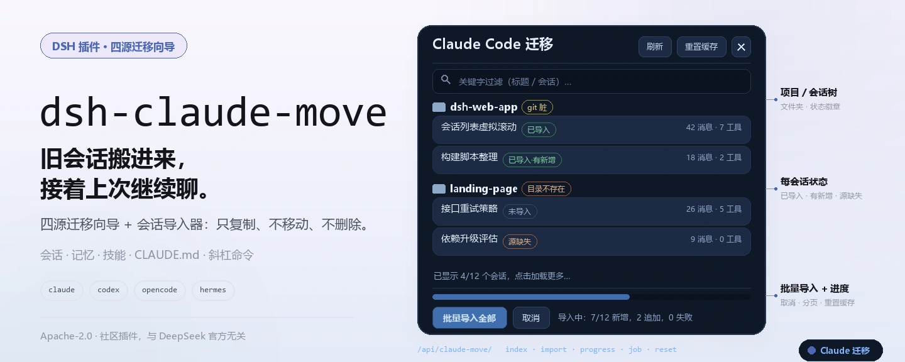
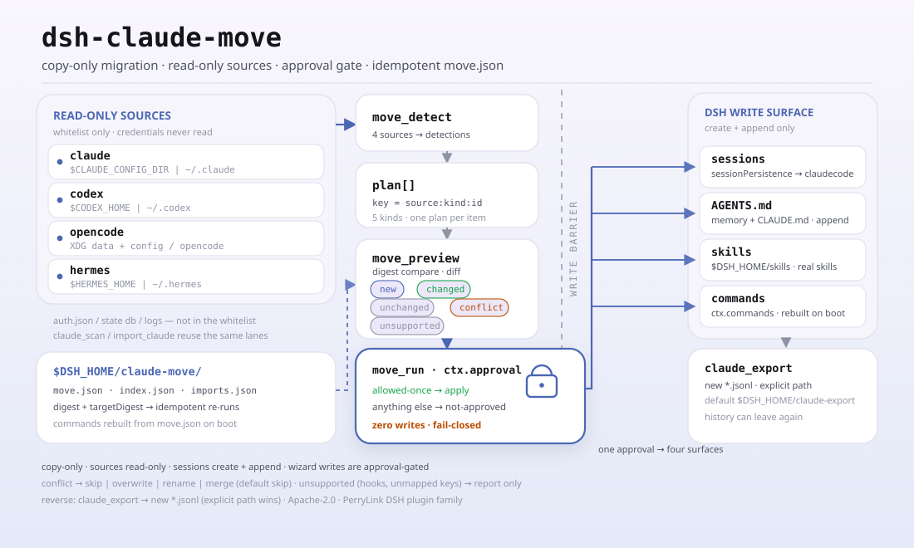

<div align="center">

<picture>
  <source media="(prefers-color-scheme: dark)" srcset="docs/assets/dsh-claude-move-hero-zh-dark.webp">
  
</picture>

# dsh-claude-move

**把 Claude Code、Codex、OpenCode 和 Hermes 的历史迁进 DeepSeek Harness——会话可续聊、记忆自动带上、技能与命令照常可用。**

四来源迁移向导加会话导入器：只复制、不移动、不删除源文件，写入前先过审批；装一次就能把旧项目的上下文接着聊下去。

[安装](#三步上手) · [配置](#配置) · [FAQ](#faq) · [简体中文](README.md) · [English](README.en.md) · [Español](README.es.md) · [Português](README.pt.md) · [हिन्दी](README.hi.md)

[](LICENSE)
[](#兼容性)
[](https://www.npmjs.com/package/dsh-claude-move)
[](https://github.com/PerryLink/dsh-claude-move/actions/workflows/test.yml)
[](#兼容性)

[](https://github.com/PerryLink/dsh-claude-move/stargazers)
[](https://www.npmjs.com/package/dsh-claude-move)
[](https://dshfind.com/plugins/PerryLink/dsh-claude-move?ref=badge)
[](https://securityscorecards.dev/viewer/?uri=github.com/PerryLink/dsh-claude-move)
[](https://dsh.market/)
[](https://gitee.com/perrylink/dsh-claude-move)

```sh
dsh plugin --profile <name> add dsh-claude-move
```

</div>

<sub>社区插件，与 DeepSeek 官方无关。唯一仓库：<https://github.com/PerryLink/dsh-claude-move>（Gitee 为镜像）。</sub>

## 它是什么

Claude Code 用久了，历史都沉在 `~/.claude` 里：会话 transcript、memory、技能、`CLAUDE.md` 和 `settings.json`。`dsh-claude-move` 把这些读出来，转换成 DeepSeek Harness 里能打开、能续聊的会话与上下文——源目录全程只读，DSH 这边只 `create` + `append`，两侧都不会被移动、改写或删除。除 Claude Code 之外，Codex、OpenCode、Hermes 也能通过同一个 `/move` 向导迁移。

<picture>
  <source media="(prefers-color-scheme: dark)" srcset="docs/assets/dsh-claude-move-flow-v5-dark.svg">
  
</picture>

## 三步上手

1. **安装**（三选一）：

   ```sh
   # git 通道（默认分支 main；等价于 git+https://github.com/PerryLink/dsh-claude-move.git）
   dsh plugin --profile web add github:PerryLink/dsh-claude-move
   # npm 通道（已发布版本）
   dsh plugin --profile web add dsh-claude-move
   # tarball 通道：本仓库 npm pack 后
   dsh plugin --profile web add ./dsh-claude-move-<version>.tgz
   ```

   无构建步骤：纯 ESM，`index.mjs` 与 `lib/` 即发布产物，不需要 `prepare` 或 `allowBuilds`。

2. **最小配置**（默认即可用；只在需要时覆盖）：

   ```yaml
   - insert:
       - id: claude-move
         name: dsh-claude-move
         config:
           workspaceMode: claudecode
           requireApproval: true
   ```

3. **验证已挂载**：

   ```sh
   dsh --profile web --dump-config | grep -A4 'id: claude-move'
   ```

   然后在任意 DSH 会话里跑一条命令：

   ```sh
   /claude-import-all      # 扫描 → 复制每个 Claude 会话 → 报告
   ```

   导入后无需重启 DSH——刷新一次已打开的 Web 页面，点任意导入会话即可继续。

**卸载**：`dsh plugin --profile web remove dsh-claude-move`（或从 profile 的 bundles 中删掉 `claude-move` 行）。导入的会话保留在 DSH 数据目录；插件只写自己的缓存（`$DSH_HOME/claude-move/`）和 `claudecode` 工作区文件夹，绝不触碰 Claude 源数据。

## 核心能力

`dsh-claude-move` 把「换工具」变成「搬上下文」——旧项目的会话、记忆、技能、指令与斜杠命令一起过来，且迁移过程可重入、可回退：

- **自动发现** —— `claude_scan` 定位 Claude 数据根（`$CLAUDE_CONFIG_DIR`，回退 `~/.claude`）并索引每个项目/会话、记忆、技能、全局 `CLAUDE.md` 和 `settings.json`，带增量缓存与并行扫描（`scanConcurrency`）。
- **全保真导入** —— `import_claude` 把 transcript 转成均衡、可续聊的 DSH 会话（`turn/start → step/start → user/message → assistant/message → tool/call → tool/result → step/end → turn/end`），修复被中断的工具调用，并对超过 `maxTranscriptBytes` 的 transcript 分块流式导入。
- **一个 `claudecode` 工作区** —— 每个导入会话都落进专用工作区（默认 `$DSH_HOME/claudecode`）；`workspaceMode: 'per-project'` 恢复「每个项目一个工作区」的分组方式。
- **只复制且增量** —— 两侧都不移动、不改写、不删除；重跑只追加新的轮次（`force: true` 以新 id 另存一份完整副本，旧副本保留）。
- **个人上下文始终新鲜** —— 记忆作为实时提示词段落注入，Claude 技能注册为真正的 DSH 技能（全局 + 项目级），全局与项目 `CLAUDE.md` 提前注入。
- **四来源迁移向导** —— `/move` 加 `move_detect` / `move_preview` / `move_run` 迁移 Claude Code、Codex、OpenCode 和 Hermes，审批门控且幂等（`move.json`）。
- **Web 面板与命令** —— `/claude-import-all`、`/resume-claude`、`/claude-move-reset`、`/claude-export`，以及一个浮动迁移面板。
- **双向导出** —— `claude_export`（或 `/claude-export <sessionId>`）把 DSH 会话回写成可 resume 的 Claude Code JSONL transcript（`user`/`assistant`/`tool` 轮次、`thinking` + `tool_use`/`tool_result` 配对、尽力映射 `cwd`），历史可以再次离开 DSH。

### 迁移映射

```text
~/.claude（只读）
 ├─ projects/*/*.jsonl  ──→  可续聊的 DSH 会话，默认分组到一个 "claudecode" 工作区
 ├─ projects/*/memory/  ──→  实时 system-prompt 记忆段落（每次请求重新读取）
 ├─ skills/**           ──→  真正的 DSH 技能
 └─ CLAUDE.md + settings ──→  早期提示词段落 + 配置建议（绝不自动应用）
```

| 在 Claude Code 中 | 在 DSH 中变为 |
|---|---|
| 会话 transcript（`projects/*/*.jsonl`） | 均衡、可续聊的 DSH 会话——`user`/`assistant`/`tool`/`thinking` 全保真映射并修复被中断的工具调用——分组到一个 **`claudecode`** 工作区，或每个项目一个 |
| 记忆文件（`projects/*/memory/*.md`） | 一个实时 system-prompt 上下文段落，每次请求重新读取（`feedback > project > reference > user`） |
| 技能（`~/.claude/skills/**`） | 真正的 DSH 技能（kebab-case 命名、冲突后缀、默认最多 30 个；`README.md`/`MEMORY.md` 及无描述的文件被跳过） |
| `CLAUDE.md`（全局 + 每个项目） | 一个早期提示词段落；项目文件优先 |
| `settings.json` | DSH 配置建议，附带明确的无法映射键列表 |
| 项目状态（目录、git 分支与脏计数） | 显示在扫描索引、Web 面板徽章和 `/resume-claude` 交接中 |

## 四来源迁移向导

```text
/move              # 一次性向导：检测 → 预览 → 执行 → 报告（全部四个来源）
move_detect        # 扫描 Claude Code / Codex / OpenCode / Hermes
move_preview       # 逐项计划：new | unchanged | changed | conflict（含 diff）| unsupported
move_run           # 在审批门控之后执行；冲突解决：
                   #   skip | overwrite | rename | merge  （默认 skip——绝不猜测）
```

- **来源** —— Claude Code（`~/.claude`）、Codex（`~/.codex`）、OpenCode（数据 + 配置根）、Hermes（技能/记忆根）；每个来源都有自己的 parser + mapper。
- **映射** —— 记忆/指令 → 追加到 DSH 全局 `AGENTS.md` 的仅追加受管段落（每项一个标记段落）；技能 → 真正的 DSH 技能（`SKILL.md` 包原样复制，其他格式转换）；斜杠命令 → 已注册的 DSH 命令（重启后从 `move.json` 重建）；会话 → 可续聊的 DSH 会话（与阶段 1 相同的导入器）。
- **幂等** —— 每个已应用的计划都记录在 `$DSH_HOME/claude-move/move.json`（`digest` / `targetDigest` / `appliedAt`）；重跑跳过未变更项，`force` 重新应用它们。
- **审批门控** —— 任何会写入内容的运行都先询问 `ctx.approval`；除 `allowed-once` 之外的任何结果都意味着零写入。

## 用法

在挂载了插件的任意会话中调用这些工具：

```text
claude_scan                          # 完整扫描（增量缓存）
claude_scan { path: "~/.claude/projects/<slug>" }   # 部分扫描
claude_scan { refresh: true }        # 跳过缓存，重新扫描全部
claude_scan { projectsLimit: 10, sessionsLimit: 5, fields: "brief" }  # 精简输出

import_claude { path: "~/.claude/projects/<slug>/<sessionId>.jsonl" }  # 单个会话
import_claude { path: "~/.claude/projects" }        # 目录（递归）
import_claude { path: "all" }                       # 全部
# 随时重跑：未变更的文件被跳过，增长的 transcript 只追加新的轮次。
# 超过 maxTranscriptBytes 的文件以分块流式导入（无内存上限）。
import_claude { path: "...", force: true }          # 全新的完整副本（保留之前的副本）

claude_export { sessionId: "<dsh-session-id>" }     # 把 DSH 会话回写为 Claude JSONL
claude_export { sessionId: "...", path: "~/.claude/projects/<slug>/<id>.jsonl" }  # 指定目标
```

命令（用户触发，不占模型轮次）：

```text
/claude-import-all                # 一次性：扫描 → 导入全部 → 报告 → 注入当前会话
/resume-claude latest             # 继续最近的 Claude 会话
/resume-claude <sessionId>        # 按源会话 id 或 import-<src> id
/resume-claude <keyword>          # 匹配标题；多个匹配会列出，绝不猜测
/claude-move-reset                # 重置插件缓存（书签 + 导入映射）；导入的会话保留
/claude-export <sessionId> [path] # 导出 DSH 会话为可 resume 的 Claude JSONL transcript
```

### 工具与界面

| 界面 | 类型 | 说明 |
|---|---|---|
| `claude_scan` | 工具 | 项目/会话/记忆/技能/设置的结构化索引 |
| `import_claude` | 工具 | 导入单个会话、一个目录或 `all`（增量；`force` 生成全新副本） |
| `claude_export` | 工具 | 把 DSH 会话导出为可 resume 的 Claude Code JSONL transcript |
| `move_detect` / `move_preview` / `move_run` | 工具 | 四来源向导：扫描、带 diff 的逐项计划、在审批之后执行 |
| `/claude-import-all` | 命令 | 扫描 → 导入全部 → 报告 |
| `/resume-claude` | 命令 | 继续一个 Claude 会话（latest、id 或关键字） |
| `/claude-move-reset` | 命令 | 重置插件缓存（导入的会话保留） |
| `/claude-export` | 命令 | 导出 DSH 会话为可 resume 的 Claude JSONL transcript |
| `/move` | 命令 | 一次性四来源向导 |
| Web 迁移面板 | 客户端 | 带进度、取消、分页、打开会话的浮动面板 |

Web 面板：一个浮动迁移面板，包含项目/会话树、状态徽章（未导入 / 已导入 / 已导入并有新轮次 / 源缺失 / 目录缺失 / git 脏）、关键字过滤、分页渲染、每个会话的「导入并继续」+「打开会话」+「刷新会话列表」、带实时进度条和取消的批量导入，以及一个缓存重置按钮。文本跟随浏览器语言（zh/en）。通过插件自身的 `/api/claude-move/*` JSON 路由在公开 `ctx.webServer` 接缝上提供。

### 导入之后

**你无需重启 DSH。** 导入在完成的那一刻即通过公开的 `sessionPersistence` 服务持久化落地：

- 服务器端列表（`session.list` / `workspace.list` RPC、CLI、任何新的页面加载）会立即在 **`claudecode` 工作区**下显示导入的会话。
- 面板会自行刷新已打开页面的会话列表，并为每个导入的会话提供 **打开会话** 按钮。
- 导入的会话可以立即打开、读取和继续——`/resume-claude`，或点击列表中的会话。随时重跑导入只会把新轮次同步到相同的会话中。

### 示例

以下为插件真实入口；安装后调用一个即可。

**详细示例** —— 命令 `import_claude`，输入：

```json
{ "path": "test/fixtures/simple.jsonl" }
```

输出：

```text
已导入 1 轮对话（2 条消息、0 次工具调用）→ 会话 import-sess-simple-001。
```

*Observed from `README.md:138 (Usage); test/fixtures/simple.jsonl:1-2; index.mjs:1708 (renderImport)`*

**失败分支** —— 输入：

```text
resolveImportTarget('', '/home/user/.claude')  // empty path
```

输出：

```text
Error: path 必填：单个 .jsonl、目录、"~/.claude/projects" 或 "all"
```

*Observed from `plugins/dsh-claude-move/index.mjs:744-746; plugins/dsh-claude-move/test/import.test.mjs:158-161; plugins/dsh-claude-move/README.md:132-145`*

**简短示例**：`import_claude` · `claude_export`

## 配置

全部可选，可在 cordis.yml 中覆盖。按 id 覆盖会替换整行——请重述所有需要的键。

最常用键：

| 键 | 默认值 | 含义 |
|---|---|---|
| `claudeHome` | `$CLAUDE_CONFIG_DIR` 或 `~/.claude` | Claude 数据根 |
| `workspaceMode` | `claudecode` | `claudecode`（一个专用工作区）· `per-project`（每个源 cwd 一个工作区） |
| `enableMemory` | `true` | 将记忆作为实时提示词段落注入 |
| `enableSkills` | `true` | 将 Claude 技能注册为 DSH 技能 |
| `enableInstructions` | `true` | 注入全局 + 项目 `CLAUDE.md` |
| `maxTranscriptBytes` | `67108864` | 流式导入阈值（超过则分块） |
| `requireApproval` | `true` | 向导写入询问 `ctx.approval`（仅 allowed-once） |
| `enableWebPanel` | `true` | 注册 `/api/claude-move/*` 面板路由 |

<details>
<summary>完整配置表（31 个键）</summary>

| 键 | 默认值 | 含义 |
|---|---|---|
| `claudeHome` | `$CLAUDE_CONFIG_DIR` 或 `~/.claude` | Claude 数据根 |
| `workspaceMode` | `claudecode` | `claudecode`（一个专用工作区）· `per-project`（每个源 cwd 一个工作区） |
| `claudecodeDir` | `$DSH_HOME/claudecode` | `claudecode` 工作区文件夹（插件唯一会创建的文件夹） |
| `scanGit` | `true` | Git 探测级别：`true`（完整）· `'branch'`（零 git 调用）· `false` |
| `gitTimeoutMs` | `5000` | Git 子进程超时 |
| `scanConcurrency` | `8` | 并行项目扫描上限 |
| `maxTranscriptBytes` | `67108864` | 流式导入阈值（超过则分块） |
| `excludeProjects` | `[]` | 要跳过的 slug 子串 |
| `enableMemory` | `true` | 将记忆作为实时提示词段落注入 |
| `memoryMaxBytes` | `8192` | 记忆段落上限 |
| `memoryScope` | `current-project` | `current-project` · `all`（当前项目优先） |
| `enableSkills` | `true` | 将 Claude 技能注册为 DSH 技能 |
| `maxSkills` | `30` | 技能数量上限 |
| `extraSkillDirs` | `[]` | 额外的技能目录 |
| `enableInstructions` | `true` | 注入全局 + 项目 `CLAUDE.md` |
| `resumeMaxChars` | `2048` | 交接摘要字符上限 |
| `resumeMode` | `inject` | `inject`（交接摘要）· `agents`（ctx.agents.resume） |
| `enableWebPanel` | `true` | 注册 `/api/claude-move/*` 面板路由 |
| `importConcurrency` | `4` | 每批并行读取 + 转换 |
| `enableMove` | `true` | 注册四来源迁移向导（`/move`、三个 move 工具与命令重建） |
| `requireApproval` | `true` | 向导写入询问 `ctx.approval`（仅 allowed-once） |
| `sources` | `[claude, codex, opencode, hermes]` | 向导覆盖的源（默认四源全开） |
| `codexHome` | `$CODEX_HOME` 或 `~/.codex` | Codex 数据根 |
| `opencodeDataHome` | 平台 XDG 数据目录/opencode | OpenCode 数据根 |
| `opencodeConfigHome` | 平台 XDG 配置目录/opencode | OpenCode 配置根 |
| `hermesHome` | `$HERMES_HOME` 或 `~/.hermes` | Hermes 数据根 |
| `skillsDir` | `$DSH_HOME/skills` | 向导技能落点（官方用户技能根，DSH 自动发现） |
| `agentsMdPath` | `$DSH_HOME/AGENTS.md` | 向导记忆/指令落点（DSH 全局指令文件） |
| `moveWorkspaceMode` | `per-source` | 向导会话归组：`per-source` · `single` |
| `enableExport` | `true` | 注册 `claude_export` 工具与 `/claude-export` 命令 |
| `exportDir` | `$DSH_HOME/claude-export` | 默认导出目录（显式 `path` 始终优先） |

</details>

profile patch 覆盖示例：

```yaml
- insert:
    - id: claude-move
      name: dsh-claude-move
      config:
        workspaceMode: per-project
        memoryScope: all
        resumeMode: agents
        sources: [claude, codex]
```

## FAQ

<details>
<summary>源数据会被改动、移动或删除吗？</summary>

不会。Claude/Codex/OpenCode/Hermes 的源文件严格只读；DSH 会话日志只 `create` + `append`，绝不改写历史事件。`force: true` 也不是覆盖，而是以新 id（`import-<src>-<n>`）另存一份完整副本，旧副本原样保留。迁移向导对 `AGENTS.md`、技能与命令只做追加或新建，冲突默认 `skip`。

</details>

<details>
<summary>导入后需要重启 DSH 吗？</summary>

不需要。导入在完成时经公开 `sessionPersistence` 服务即时落盘，服务端列表（`session.list` / `workspace.list`、CLI、新页面加载）立即可见。已打开的 Web 页面只需刷新一次会话列表（面板的「刷新会话列表」按钮或 F5）；工作区分组经 `domain/changed` 实时更新。`host/session-added` 帧只对 live 会话发射，所以 cold 导入不会自动弹出——这是 UI 行为，不是数据问题。

</details>

<details>
<summary>迁移向导会不会未经允许就写文件？</summary>

不会。任何会写入的 `move_run` 都先询问 `ctx.approval`，除 `allowed-once` 之外的任何结果都意味着零写入（fail-closed）；无审批 seam 的平台需要显式设置 `requireApproval: false` 才可执行。每次应用的计划记在 `$DSH_HOME/claude-move/move.json`，重跑跳过未变更项。

</details>

<details>
<summary>大 transcript 和性能开销怎么处理？</summary>

扫描按 `scanConcurrency`（默认 8）并行，且带增量缓存；单个 transcript 超过 `maxTranscriptBytes`（默认 64 MiB）时分块流式导入，不设内存上限。批量导入的「读取 + 转换」并发由 `importConcurrency`（默认 4）控制，落盘阶段按文件名序串行以保证确定性。不想付 git 探测成本时，把 `scanGit` 设为 `'branch'`（零 git 调用）或 `false`。

</details>

## 安全边界

- **源文件只读；DSH 日志只追加**（仅 `create` + `append`）。
- **外部 transcript 是不可信输入**——其中的任何内容都不会被执行；system/developer/thinking 内容绝不进入续聊交接。
- **仅公开服务**——`sessionPersistence` / `workspaceRegistry` / `tools` / `commands` / `systemPrompt` / `skills` / `webServer`；不改引擎或 UI。
- **密钥仅按位置报告**（file:line:kind）；`permission`/`permission-mode`/`queue-operation` 记录只计数、不导入。
- **向导写入审批门控**——除 `allowed-once` 之外的任何结果都意味着零写入。

## 权限与数据

- **权限**：workshop 清单声明 `filesystem:read` 和 `filesystem:write`。
- **读取** `~/.claude`（transcript、记忆、技能、`CLAUDE.md`、`settings.json`）——严格只读——以及它导入到的项目目录。
- **写入** 通过公开 `sessionPersistence` 服务写 DSH 会话日志（仅 create + append，绝不删除/改写/归档）、工作区注册表记录、`$DSH_HOME/claude-move/` 下的缓存、`claudecode` 工作区文件夹，以及 `$DSH_HOME/claude-export/`（或显式目标路径）下的导出 `.jsonl` 文件。
- **绝不** 修改 Claude 源文件、触碰其他应用的数据或访问网络。**不读取或传输任何凭据**。

## 已知限制

- 标题来自 `custom-title`/`ai-title`/首条提示；Claude `summary` 记录会被报告，但不映射为 DSH 压缩节点（合成一个有效的压缩事务会伪造其 seq 范围和检查点消息）。
- `thinking` 块作为 `reasoning` 内容保留，但绝不进入续聊交接。
- 被中断的工具调用会以合成的错误结果修复（绝不丢弃），报告为 `repaired.synthesized`。
- 权限类记录只计数、不导入；DSH 权限预设建议在报告中生成。
- 在没有流式 `fs.streamText` 接口的宿主上，超过 `maxTranscriptBytes` 的 transcript 会大声失败，而不是部分导入。
- 在 `workspaceMode: 'per-project'` 下，源目录已删除的会话仍会导入，但工作区挂载失败（保持未分组；`workspace.attached: false` 加上一个 `reason`）。默认的 `claudecode` 工作区不依赖源目录。
- 如果 transcript 被就地截断或重置（轮次少于记录的导入），重新导入会跳过它并报告 `sourceShrunk`；用 `force: true` 生成全新的完整副本。
- Web 面板是由插件自身 JSON 路由驱动的零构建浮动面板；它不使用 shell 内部的 UI 插槽系统。

## 模型体验

- 面向模型的面是这些工具的描述/schema 及其输出：`claude_scan` 返回结构化索引，`import_claude` 返回逐文件摘要以及警告的位置，`claude_export` 返回导出摘要（目标路径 + 轮次/消息/工具计数）。工具结果本身被记录为 `tool/result` 事件，因此一切都可以重建。
- 没有隐藏的面向模型的文本；记忆/`CLAUDE.md` 段落注册在 `ctx.systemPrompt` 上（提示词组装，可从会话日志重建）。

## 兼容性

- 面向 `dsh 0.1.6-alpha.2`（web profile，会话格式 V3）；`engines.dsh` 与 peer 依赖按 `package.json` 声明（当前为 `>=0.1.6-0 <0.2.0 || >=0.2.0-0 <0.3.0 || >=0.2.2-0 <0.3.0`）；0.2.1 线静态兼容（无运行时验证记录）。已于 2026-09-18 核验（checkJs 类型门 + 287 项断言、38 个套件）。宿主没有 `sessions.open()` 时，面板「打开会话」按钮改为置灰渲染并带说明 title，不再消失。Node `^22.19 || >=24.9`。
- `0.1.2-rc.1`（2026-09-04 已适配）：会话信封保留 ignorable 字段但仅用于存量日志读取兼容——Session.append 仍无法盖章，门控行为不变。
- 0.4.0 内置 `sessionPersistence` 双基线运行时 shim，按 API 形状特性探测（绝不按版本号猜测）：旧 API（`create`/`append`/`readFrom`，`list()` 返回会话头）与 handle seam（`create` 返回 `SessionHandle`，`list()`/`stat()` 返回快照）都能工作。handle seam 已随 alpha 线发布（`@deepseek-ai/dsh-session-persistence` / `-jsonl` `0.1.5-rc.2`），因此 compat workflow 可以覆盖它。handle 路径上每次 append 之后必须 `flush()`（耐久屏障）并成对 `close()`（单写所有权）；header 盖上后端当前格式版本并显式补 `isSeeded`；缺失的 assistant model 来源回退 provider；自 0.4.5 起，后端格式版本 >= 2 时合成的 `assistant/message` 带 `stream: []`——V3 的 `Session.fromRestore` 断言 `Array.isArray(data.stream)`，缺它则日志能写入、能读回却不可续聊。导入扫描的清理在列表元素的 `header.id` 无法解析时拒绝执行，绝不静默清空 `imports.json`。
- 最近针对全新 tarball 安装验证：真实扫描、真实批量导入（幂等重导入）、工作区挂载与持久化产物均已确认；macOS/Linux 由 CI 矩阵覆盖。导入日志为会话格式 V3，`dsh <= 0.1.2-rc.1` 无法读取（升级是单向的；回退办法是从源 transcript 重新导入）。

### 兼容性矩阵（仅公开接缝）

| 接缝 | 使用 | 缺失时的回退 |
|---|---|---|
| Host 服务（`tools` / `sessionPersistence` / `workspaceRegistry` / `commands` / `systemPrompt` / `skills` / `webServer`） | 所列之处必需 | 可选服务响应式注册；缺失 `fs` 大声失败 |
| `sessionPersistence` 双基线：旧 API（`listSnapshots` / `readFrom` / `append`）或 handle（`open` / `stat`、快照 `list()`） | 运行时按 API 形状特性探测 | `header.id` 解析守卫：解析失败大声中止扫描，绝不静默清空 `imports.json` |
| 支持 `streamText` 的 `fs` / `ctx.jobs` / `ctx.agents.resume` | 特性探测 | 整文件读取并大声拒绝 / 自有 job map / 交接注入 |
| Client shell 服务（`sessions.refresh/open`、`workspaces.refresh`） | 面板 apply 时特性探测 | 整页刷新 |
| 较新的平台能力从不是硬性要求——插件在最早支持线（`0.1.2-rc.1`）上始终保持可启动。 | | |

## 故障排查

- 该行未生效：`dsh --profile <p> --dump-config` 应打印 `# == dsh-claude-move`；重新运行 `dsh plugin --profile <p> add ...`。
- Web 能启动但静默挂起：由 `dsh plugin add` 初始化的新 profile 只包含 `dsh-base`——将 `@deepseek-ai/dsh-web-app` 添加到 `dsh.profile.bundles`。安装到已有的 `web` profile 则无需任何操作。
- 面板路由 404：只有当 `enableWebPanel: true` 且组合了 web 服务器时才会提供这些路由；检查启动日志中的 FAILED fiber。
- 导入失败并提示 "transcript 过大"：提高 `maxTranscriptBytes` 或单独导入该文件。
- 导入成功但侧边栏没有显示新会话：页面已经打开——点击一次面板的刷新按钮（或重新加载页面）即可。永远不需要重启 DSH。
- 日志：启动失败会打印到 `dsh` 控制台；插件会为工作区/导入映射问题记录以 `[claude-move]` 为前缀的错误。

## 生态与质量

- [Gitee 镜像](https://gitee.com/perrylink/dsh-claude-move)（同步镜像，以 GitHub 为准）
- [dshfind 插件页](https://dshfind.com/plugins/PerryLink/dsh-claude-move)（安装量与排名）
- [OpenSSF Scorecard 报告](https://securityscorecards.dev/viewer/?uri=github.com/PerryLink/dsh-claude-move)（由 [.github/workflows/scorecard.yml](.github/workflows/scorecard.yml) 驱动）
- [dsh-plugin-doctor 验证报告](https://github.com/PerryLink/dsh-plugin-doctor#verified-徽章)
- [DSH Market](https://dsh.market/)（已上架）
- **1024 商店渠道**：先 `npm i -g dsh1024`，再 `dsh1024 plugin --profile web add dsh-claude-move`（计入 [deepseek1024.com](https://deepseek1024.com) 安装排行）
- [生态实测知识库](https://perrylink.github.io/dsh-plugin-guide/)：插件开发指南 · 选型实测数据 · 维护取舍判据

## 公开组件致谢

本项目采用 Apache License 2.0 许可；以下 MIT 许可组件保留其自身许可（全文见 [THIRD_PARTY_NOTICES.md](THIRD_PARTY_NOTICES.md)）：

- 转换核心 vendored 自 [Nwflower/dsh-chat-import](https://github.com/Nwflower/dsh-chat-import)（MIT）。
- 发现约定与安全模型来自 [Demogorgon314/dsh-resume-plugin](https://github.com/Demogorgon314/dsh-resume-plugin)（MIT）。
- 记忆/技能注入与 frontmatter 解析模式来自 [YYTbit/dsh-plugin-claude-bridge](https://github.com/YYTbit/dsh-plugin-claude-bridge)（MIT）。

## 开发

```sh
npm install   # 安装 peer 依赖（@deepseek-ai/dsh-tools、@deepseek-ai/cordis、schemastery）
npm test      # node --test "test/**/*.test.mjs"
npm run typecheck      # checkJs 类型门（tsconfig.check.json）
npm run check:ci       # 发布线类型门（tsconfig.check.ci.json）
npm run check:readmes  # 五语 README 一致性
npm run verify:artifacts    # 发布文件齐全 + index.mjs 可 import
npm run verify:self-contained  # 依赖 spec 均来自 registry
npm pack      # 发布 tarball
```

无构建步骤：纯 ESM，`index.mjs` 与 `lib/` 即发布产物。CI 通过 GitHub Actions（[test.yml](.github/workflows/test.yml)）在 Linux/macOS/Windows 上以 Node 22 运行完整套件。README 配图由 [`scripts/gen-readme-assets.py`](scripts/gen-readme-assets.py) 程序化生成（Python + Pillow），可重复执行。

Topics：`dsh`, `dsh-plugin`, `deepseek-harness`, `deepseek`, `cordis`, `claude-code`, `migration`, `session-import`, `resume`

## 家族与致谢

本项目是 [PerryLink](https://github.com/PerryLink) 维护的 DeepSeek Harness 插件家族成员（全部 Apache-2.0）。如果这个插件帮到了你，**给个 star**——它不解锁任何功能，但会让下一个人更容易找到它。

- [@PerryLink](https://github.com/PerryLink)——创建者与维护者：导入管线、四来源迁移向导、Web 面板、文档、CI/CD 与发布。
- [@OLDnana1](https://github.com/OLDnana1)——对被中断工具调用损坏的根因分析，该损坏曾使导入会话在续聊时永久返回 HTTP 400。
- [@GooodWei](https://github.com/GooodWei)——发现 `README.md`（以及任何无描述的 `.md`）被误注册为技能，从而破坏 DSH 的技能加载。

<details>
<summary>展开全部插件</summary>

| 插件 | 状态 |
|---|---|
| **[dsh-aqua-input-check](https://github.com/PerryLink/dsh-aqua-input-check)** |  |
| **[dsh-archive-check](https://github.com/PerryLink/dsh-archive-check)** |  |
| **[dsh-auto-review](https://github.com/PerryLink/dsh-auto-review)** |  |
| **[dsh-autotier](https://github.com/PerryLink/dsh-autotier)** | 🧊 已冻结 — 见仓库 README |
| **[dsh-bid-ca-precheck](https://github.com/PerryLink/dsh-bid-ca-precheck)** |  |
| **[dsh-bid-qual-check](https://github.com/PerryLink/dsh-bid-qual-check)** |  |
| **[dsh-cert-mcp](https://github.com/PerryLink/dsh-cert-mcp)** | 🧊 已冻结 — 见仓库 README |
| **[dsh-checkpoint-rewind](https://github.com/PerryLink/dsh-checkpoint-rewind)** |  |
| **[dsh-click](https://github.com/PerryLink/dsh-click)** |  |
| **[dsh-composer-history](https://github.com/PerryLink/dsh-composer-history)** |  |
| **[dsh-contract-stance](https://github.com/PerryLink/dsh-contract-stance)** |  |
| **[dsh-customs-doc-check](https://github.com/PerryLink/dsh-customs-doc-check)** |  |
| **[dsh-data-quality](https://github.com/PerryLink/dsh-data-quality)** | 🧊 已冻结 — 见仓库 README |
| **[dsh-demurrage-ledger](https://github.com/PerryLink/dsh-demurrage-ledger)** |  |
| **[dsh-doublecheck](https://github.com/PerryLink/dsh-doublecheck)** |  |
| **[dsh-drill-script-check](https://github.com/PerryLink/dsh-drill-script-check)** |  |
| **[dsh-eia-guide-check](https://github.com/PerryLink/dsh-eia-guide-check)** |  |
| **[dsh-emergency-plan](https://github.com/PerryLink/dsh-emergency-plan)** |  |
| **[dsh-essay-rubric-check](https://github.com/PerryLink/dsh-essay-rubric-check)** |  |
| **[dsh-evidence-check](https://github.com/PerryLink/dsh-evidence-check)** |  |
| **[dsh-export-ctl-check](https://github.com/PerryLink/dsh-export-ctl-check)** |  |
| **[dsh-fast](https://github.com/PerryLink/dsh-fast)** |  |
| **[dsh-fmea-table-check](https://github.com/PerryLink/dsh-fmea-table-check)** |  |
| **[dsh-forecast-penalty](https://github.com/PerryLink/dsh-forecast-penalty)** |  |
| **[dsh-fund-research](https://github.com/PerryLink/dsh-fund-research)** |  |
| **[dsh-github](https://github.com/PerryLink/dsh-github)** |  |
| **[dsh-gongwen-flow-check](https://github.com/PerryLink/dsh-gongwen-flow-check)** |  |
| **[dsh-gongwen-word-check](https://github.com/PerryLink/dsh-gongwen-word-check)** |  |
| **[dsh-guard-plan-qc](https://github.com/PerryLink/dsh-guard-plan-qc)** |  |
| **[dsh-hazchem-check](https://github.com/PerryLink/dsh-hazchem-check)** |  |
| **[dsh-hazplan-check](https://github.com/PerryLink/dsh-hazplan-check)** |  |
| **[dsh-hidden-risk-map](https://github.com/PerryLink/dsh-hidden-risk-map)** |  |
| **[dsh-hs-classify](https://github.com/PerryLink/dsh-hs-classify)** |  |
| **[dsh-icd-rule-check](https://github.com/PerryLink/dsh-icd-rule-check)** |  |
| **[dsh-industry-research](https://github.com/PerryLink/dsh-industry-research)** |  |
| **[dsh-lawcite-adapter](https://github.com/PerryLink/dsh-lawcite-adapter)** |  |
| **[dsh-laya](https://github.com/PerryLink/dsh-laya)** |  |
| **[dsh-lc-doc-check](https://github.com/PerryLink/dsh-lc-doc-check)** |  |
| **[dsh-learning-gap-check](https://github.com/PerryLink/dsh-learning-gap-check)** |  |
| **[dsh-library](https://github.com/PerryLink/dsh-library)** |  |
| **[dsh-local-ai](https://github.com/PerryLink/dsh-local-ai)** |  |
| **[dsh-lsp-actions](https://github.com/PerryLink/dsh-lsp-actions)** |  |
| **[dsh-mask](https://github.com/PerryLink/dsh-mask)** |  |
| **[dsh-mcp-panel](https://github.com/PerryLink/dsh-mcp-panel)** |  |
| **[dsh-medrec-qc](https://github.com/PerryLink/dsh-medrec-qc)** |  |
| **[dsh-memento](https://github.com/PerryLink/dsh-memento)** | 🧊 已冻结 — 见仓库 README |
| **[dsh-nsfc-form-check](https://github.com/PerryLink/dsh-nsfc-form-check)** |  |
| **[dsh-nurse-record-check](https://github.com/PerryLink/dsh-nurse-record-check)** |  |
| **[dsh-observe](https://github.com/PerryLink/dsh-observe)** |  |
| **[dsh-origin-rvc-check](https://github.com/PerryLink/dsh-origin-rvc-check)** |  |
| **[dsh-ota-review-check](https://github.com/PerryLink/dsh-ota-review-check)** |  |
| **[dsh-output-styles](https://github.com/PerryLink/dsh-output-styles)** |  |
| **[dsh-paper-doc-adapter](https://github.com/PerryLink/dsh-paper-doc-adapter)** |  |
| **[dsh-permission-rules](https://github.com/PerryLink/dsh-permission-rules)** |  |
| **[dsh-permit-report-check](https://github.com/PerryLink/dsh-permit-report-check)** |  |
| **[dsh-pipeline-check](https://github.com/PerryLink/dsh-pipeline-check)** |  |
| **[dsh-pleading-draft](https://github.com/PerryLink/dsh-pleading-draft)** |  |
| **[dsh-plugin-doctor](https://github.com/PerryLink/dsh-plugin-doctor)** | 🚫 已退役（仓库已归档） |
| **[dsh-plugin-guide](https://github.com/PerryLink/dsh-plugin-guide)** |  |
| **[dsh-plugin-kit](https://github.com/PerryLink/dsh-plugin-kit)** | 🚫 已退役（仓库已归档） |
| **[dsh-plugin-upgrade](https://github.com/PerryLink/dsh-plugin-upgrade)** | 🚫 已退役（仓库已归档） |
| **[dsh-policy-brief-draft](https://github.com/PerryLink/dsh-policy-brief-draft)** |  |
| **[dsh-power-loss-split](https://github.com/PerryLink/dsh-power-loss-split)** |  |
| **[dsh-power-ticket-check](https://github.com/PerryLink/dsh-power-ticket-check)** |  |
| **[dsh-ppap-check](https://github.com/PerryLink/dsh-ppap-check)** |  |
| **[dsh-protest-deadline](https://github.com/PerryLink/dsh-protest-deadline)** |  |
| **[dsh-railway-window](https://github.com/PerryLink/dsh-railway-window)** |  |
| **[dsh-repair-order-qc](https://github.com/PerryLink/dsh-repair-order-qc)** |  |
| **[dsh-research-report](https://github.com/PerryLink/dsh-research-report)** |  |
| **[dsh-review-reply-check](https://github.com/PerryLink/dsh-review-reply-check)** |  |
| **[dsh-rulefile-check](https://github.com/PerryLink/dsh-rulefile-check)** |  |
| **[dsh-safety-brief-check](https://github.com/PerryLink/dsh-safety-brief-check)** |  |
| **[dsh-score](https://github.com/PerryLink/dsh-score)** | 🧊 已冻结 — 见仓库 README |
| **[dsh-session-sync](https://github.com/PerryLink/dsh-session-sync)** |  |
| **[dsh-site-log-check](https://github.com/PerryLink/dsh-site-log-check)** |  |
| **[dsh-skill-pack-security](https://github.com/PerryLink/dsh-skill-pack-security)** |  |
| **[dsh-soe-decision-check](https://github.com/PerryLink/dsh-soe-decision-check)** |  |
| **[dsh-soilwater-check](https://github.com/PerryLink/dsh-soilwater-check)** |  |
| **[dsh-sop-sync-check](https://github.com/PerryLink/dsh-sop-sync-check)** |  |
| **[dsh-spc-gbt-adapter](https://github.com/PerryLink/dsh-spc-gbt-adapter)** |  |
| **[dsh-talk](https://github.com/PerryLink/dsh-talk)** |  |
| **[dsh-tender-extract](https://github.com/PerryLink/dsh-tender-extract)** |  |
| **[dsh-tender-matrix](https://github.com/PerryLink/dsh-tender-matrix)** |  |
| **[dsh-test-drive](https://github.com/PerryLink/dsh-test-drive)** |  |
| **[dsh-ticktick](https://github.com/PerryLink/dsh-ticktick)** | 🚫 已退役（仓库已归档） |
| **[dsh-translate](https://github.com/PerryLink/dsh-translate)** |  |
| **[dsh-warranty-calc](https://github.com/PerryLink/dsh-warranty-calc)** |  |
| **[dsh-budget](https://github.com/PerryLink/dsh-budget)** | 🧊 已冻结 — 见仓库 README |
| **[dsh-claude-move](https://github.com/PerryLink/dsh-claude-move)** | 🧊 已冻结 — 见仓库 README |
| **[dsh-defend](https://github.com/PerryLink/dsh-defend)** | 🧊 已冻结 — 见仓库 README |
| **[dsh-draw](https://github.com/PerryLink/dsh-draw)** | 🧊 已冻结 — 见仓库 README |
| **[dsh-reach](https://github.com/PerryLink/dsh-reach)** | 🧊 已冻结 — 见仓库 README |
| **[dsh-background-agents](https://github.com/PerryLink/dsh-background-agents)** | 🚫 已退役（仓库已归档） |
| **[dsh-session-pin](https://github.com/PerryLink/dsh-session-pin)** | 🚫 已退役（仓库已归档） |
| **[dsh-team-rooms](https://github.com/PerryLink/dsh-team-rooms)** | 🚫 已退役（仓库已归档） |

</details>

## License

[LICENSE](LICENSE)（Apache License 2.0）© 2026 dsh-claude-move contributors

<p align="center"><sub>Apache-2.0 · 社区插件，与 DeepSeek 无关。</sub></p>
