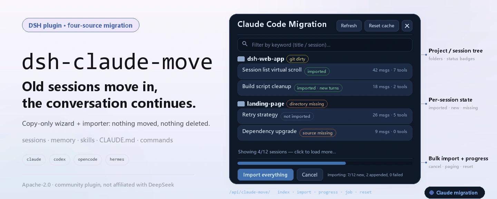
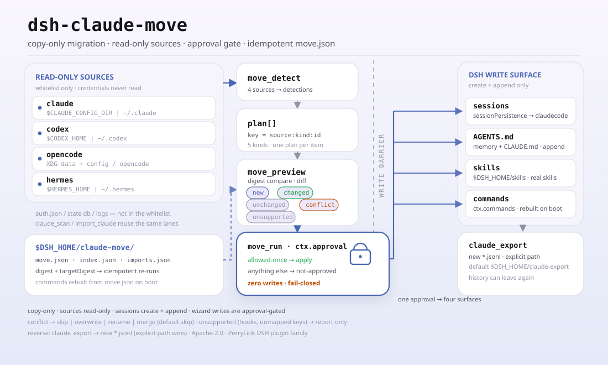

<div align="center">

<picture>
  <source media="(prefers-color-scheme: dark)" srcset="docs/assets/dsh-claude-move-hero-en-dark.webp">
  
</picture>

# dsh-claude-move

**Leve seu histórico do Claude Code, Codex, OpenCode e Hermes para o DeepSeek Harness — as sessões continuam retomáveis, as memórias vêm junto, habilidades e comandos seguem funcionando.**

Um assistente de migração de quatro fontes mais um importador de sessões: só cópia, nada é movido ou apagado, e toda escrita passa antes por aprovação; instale uma vez e continue o contexto do projeto antigo.

[Instalar](#instalação-em-três-passos) · [Configuração](#configuração) · [FAQ](#faq) · [简体中文](README.md) · [English](README.en.md) · [Español](README.es.md) · [Português](README.pt.md) · [हिन्दी](README.hi.md)

[](LICENSE)
[](#compatibilidade)
[](https://www.npmjs.com/package/dsh-claude-move)
[](https://github.com/PerryLink/dsh-claude-move/actions/workflows/test.yml)
[](#compatibilidade)

[](https://github.com/PerryLink/dsh-claude-move/stargazers)
[](https://www.npmjs.com/package/dsh-claude-move)
[](https://dshfind.com/plugins/PerryLink/dsh-claude-move?ref=badge)
[](https://securityscorecards.dev/viewer/?uri=github.com/PerryLink/dsh-claude-move)
[](https://dsh.market/)
[](https://gitee.com/perrylink/dsh-claude-move)

```sh
dsh plugin --profile <name> add dsh-claude-move
```

</div>

<sub>Plugin da comunidade, sem afiliação com a DeepSeek. Repositório canônico: <https://github.com/PerryLink/dsh-claude-move> (o Gitee é um espelho).</sub>

## O que é

Depois de um tempo com o Claude Code, o histórico fica todo em `~/.claude`: transcrições de sessão, memórias, habilidades, `CLAUDE.md` e `settings.json`. O `dsh-claude-move` lê tudo isso e converte em sessões e contexto do DeepSeek Harness que você pode abrir e retomar — o diretório de origem fica somente leitura o tempo todo, e o lado DSH só faz `create` + `append`, então nenhum lado é movido, reescrito ou apagado. Além do Claude Code, Codex, OpenCode e Hermes migram pelo mesmo assistente `/move`.

<picture>
  <source media="(prefers-color-scheme: dark)" srcset="docs/assets/dsh-claude-move-flow-v5-dark.svg">
  
</picture>

## Instalação em três passos

1. **Instale** (escolha um canal):

   ```sh
   # canal git (branch padrão main; equivalente a git+https://github.com/PerryLink/dsh-claude-move.git)
   dsh plugin --profile web add github:PerryLink/dsh-claude-move
   # canal npm (versões publicadas)
   dsh plugin --profile web add dsh-claude-move
   # canal tarball: npm pack neste repo e depois
   dsh plugin --profile web add ./dsh-claude-move-<version>.tgz
   ```

   Sem etapa de build: ESM puro, `index.mjs` e `lib/` são os artefatos publicados; não precisa de `prepare` nem `allowBuilds`.

2. **Configuração mínima** (os padrões já funcionam; sobrescreva só se precisar):

   ```yaml
   - insert:
       - id: claude-move
         name: dsh-claude-move
         config:
           workspaceMode: claudecode
           requireApproval: true
   ```

3. **Verifique se monta**:

   ```sh
   dsh --profile web --dump-config | grep -A4 'id: claude-move'
   ```

   Depois, em qualquer sessão do DSH, execute um comando:

   ```sh
   /claude-import-all      # escanear → copiar todas as sessões do Claude → relatar
   ```

   Não é preciso reiniciar o DSH depois de importar: atualize uma vez a página Web aberta e clique em qualquer sessão importada para continuar.

**Desinstalar**: `dsh plugin --profile web remove dsh-claude-move` (ou remova a linha `claude-move` dos bundles do perfil). As sessões importadas ficam no diretório de dados do DSH; o plugin só grava seu cache (`$DSH_HOME/claude-move/`) e a pasta do espaço de trabalho `claudecode`, e nunca toca nos dados de origem do Claude.

## Capacidades principais

O `dsh-claude-move` transforma «trocar de ferramenta» em «mover o contexto»: sessões, memórias, habilidades, instruções e comandos de barra antigos vêm junto, e a migração pode ser repetida e revertida:

- **Descoberta automática** — `claude_scan` localiza a raiz de dados do Claude (`$CLAUDE_CONFIG_DIR`, com fallback `~/.claude`) e indexa cada projeto/sessão, memória, habilidade, `CLAUDE.md` global e `settings.json`, com cache incremental e varredura em paralelo (`scanConcurrency`).
- **Importação com fidelidade total** — `import_claude` converte transcrições em sessões DSH equilibradas e retomáveis (`turn/start → step/start → user/message → assistant/message → tool/call → tool/result → step/end → turn/end`), repara chamadas de ferramenta interrompidas e importa por streaming, em blocos, transcrições maiores que `maxTranscriptBytes`.
- **Um único espaço `claudecode`** — cada sessão importada cai num espaço de trabalho dedicado (padrão `$DSH_HOME/claudecode`); `workspaceMode: 'per-project'` recupera o agrupamento de um espaço por projeto.
- **Somente cópia e incremental** — nada é movido, reescrito ou apagado em nenhum dos lados; reexecutar acrescenta apenas os turnos novos (`force: true` salva uma cópia completa extra com um id novo, mantendo a anterior).
- **Contexto pessoal sempre fresco** — memórias injetadas como seção de prompt ao vivo, habilidades do Claude registradas como habilidades DSH reais (globais + de projeto), `CLAUDE.md` global e de projeto injetados cedo.
- **Assistente de migração de quatro fontes** — `/move` mais `move_detect` / `move_preview` / `move_run` migram Claude Code, Codex, OpenCode e Hermes, com porta de aprovação e idempotência (`move.json`).
- **Painel Web e comandos** — `/claude-import-all`, `/resume-claude`, `/claude-move-reset`, `/claude-export`, e um painel flutuante de migração.
- **Exportação bidirecional** — `claude_export` (ou `/claude-export <sessionId>`) grava uma sessão DSH de volta como transcrição JSONL retomável do Claude Code (turnos `user`/`assistant`/`tool`, pareamento `thinking` + `tool_use`/`tool_result`, mapeamento de `cwd` na medida do possível), para que o histórico possa sair do DSH de novo.

### O que é migrado

```text
~/.claude (somente leitura)
 ├─ projects/*/*.jsonl  ──→  sessões DSH retomáveis, agrupadas em um espaço "claudecode" (padrão)
 ├─ projects/*/memory/  ──→  seção de memória ao vivo do system-prompt (relida a cada requisição)
 ├─ skills/**           ──→  habilidades DSH reais
 └─ CLAUDE.md + settings ──→  seção de prompt antecipada + sugestões de configuração (nunca aplicadas sozinhas)
```

| No Claude Code | Chega ao DSH como |
|---|---|
| Transcrições de sessão (`projects/*/*.jsonl`) | Sessões DSH equilibradas e retomáveis — mapeamento de fidelidade total `user`/`assistant`/`tool`/`thinking` com reparo de chamadas interrompidas — agrupadas em um espaço **`claudecode`** ou um por projeto |
| Arquivos de memória (`projects/*/memory/*.md`) | Uma seção de contexto ao vivo do system-prompt, relida a cada requisição (`feedback > project > reference > user`) |
| Habilidades (`~/.claude/skills/**`) | Habilidades DSH reais (nomes kebab-case, sufixos em colisão, máximo de 30 por padrão; `README.md`/`MEMORY.md` e arquivos sem descrição são pulados) |
| `CLAUDE.md` (global + por projeto) | Uma seção de prompt antecipada; o arquivo do projeto vence |
| `settings.json` | Sugestões de configuração do DSH com uma lista explícita de chaves não mapeáveis |
| Estado do projeto (diretório, branch git e contagem de alterações) | Mostrado no índice da varredura, nos selos do painel Web e no handoff do `/resume-claude` |

## Assistente de migração de quatro fontes

```text
/move              # assistente de uma passada: detectar → visualizar → executar → relatar (as quatro fontes)
move_detect        # escanear Claude Code / Codex / OpenCode / Hermes
move_preview       # plano por item: new | unchanged | changed | conflict (com diff) | unsupported
move_run           # executar atrás da porta de aprovação; resolução de conflitos:
                   #   skip | overwrite | rename | merge  (padrão skip — nunca adivinha)
```

- **Fontes** — Claude Code (`~/.claude`), Codex (`~/.codex`), OpenCode (raízes de dados + configuração), Hermes (raízes de habilidades/memória); cada fonte tem seu parser e seu mapper.
- **Mapeamento** — memórias/instruções → seções gerenciadas somente-adição no `AGENTS.md` global do DSH (uma seção marcada por item); habilidades → habilidades DSH reais (pacotes `SKILL.md` copiados na íntegra, outros formatos convertidos); comandos de barra → comandos DSH registrados (reconstruídos a partir do `move.json` após um reinício); sessões → sessões DSH retomáveis (os mesmos importadores da fase 1).
- **Idempotente** — cada plano aplicado é registrado em `$DSH_HOME/claude-move/move.json` (`digest` / `targetDigest` / `appliedAt`); reexecuções pulam itens inalterados e `force` os reaplica.
- **Com porta de aprovação** — qualquer execução que fosse gravar pergunta antes ao `ctx.approval`; qualquer coisa que não seja `allowed-once` significa zero gravações.

## Uso

Chame as ferramentas em qualquer sessão com o plugin montado:

```text
claude_scan                          # varredura completa (cache incremental)
claude_scan { path: "~/.claude/projects/<slug>" }   # varredura parcial
claude_scan { refresh: true }        # ignorar cache e reescanear tudo
claude_scan { projectsLimit: 10, sessionsLimit: 5, fields: "brief" }  # saída enxuta

import_claude { path: "~/.claude/projects/<slug>/<sessionId>.jsonl" }  # uma sessão
import_claude { path: "~/.claude/projects" }        # diretório (recursivo)
import_claude { path: "all" }                       # tudo
# Repita quando quiser: arquivos inalterados são pulados e transcrições que crescem só acrescentam os turnos novos.
# Arquivos acima de maxTranscriptBytes são importados por streaming em blocos (sem teto de memória).
import_claude { path: "...", force: true }          # cópia completa nova (a anterior é mantida)

claude_export { sessionId: "<dsh-session-id>" }     # gravar uma sessão DSH de volta em JSONL do Claude
claude_export { sessionId: "...", path: "~/.claude/projects/<slug>/<id>.jsonl" }  # destino explícito
```

Comandos (acionados pelo usuário, sem turno de modelo):

```text
/claude-import-all                # de uma passada: escanear → importar tudo → relatar → injetar na sessão atual
/resume-claude latest             # continuar a sessão do Claude mais recente
/resume-claude <sessionId>        # por id de sessão de origem ou id import-<src>
/resume-claude <keyword>          # casar títulos; várias correspondências são listadas, nunca adivinhadas
/claude-move-reset                # reiniciar o cache do plugin (marcadores + mapa de importação); as sessões importadas são mantidas
/claude-export <sessionId> [path] # exportar uma sessão DSH como transcrição JSONL retomável do Claude
```

### Ferramentas e superfícies

| Superfície | Tipo | Notas |
|---|---|---|
| `claude_scan` | ferramenta | Índice estruturado de projetos/sessões/memórias/habilidades/configurações |
| `import_claude` | ferramenta | Importa uma sessão, um diretório ou `all` (incremental; `force` para uma cópia nova) |
| `claude_export` | ferramenta | Exporta uma sessão DSH para uma transcrição JSONL de Claude retomável |
| `move_detect` / `move_preview` / `move_run` | ferramentas | Assistente de quatro fontes: varredura, plano por item com diffs, execução após aprovação |
| `/claude-import-all` | comando | Escanear → importar tudo → relatar |
| `/resume-claude` | comando | Continuar uma sessão do Claude (latest, id ou palavra-chave) |
| `/claude-move-reset` | comando | Reiniciar o cache do plugin (as sessões importadas são mantidas) |
| `/claude-export` | comando | Exportar uma sessão DSH para uma transcrição JSONL de Claude retomável |
| `/move` | comando | Assistente de quatro fontes de uma passada |
| Painel Web de migração | cliente | Painel flutuante com progresso, cancelamento, paginação e abertura de sessão |

Painel Web: um painel flutuante de migração com a árvore de projetos/sessões, selos de status (não importada / importada / importada com turnos novos / fonte ausente / diretório ausente / git com alterações), filtro por palavra-chave, renderização paginada, «Importar e continuar» + «Abrir sessão» + «Atualizar lista de sessões» por sessão, importação em lote com barra de progresso ao vivo e cancelamento, e um botão de reinício de cache. Os textos seguem o idioma do navegador (zh/en). Servido pelas rotas JSON próprias do plugin `/api/claude-move/*` sobre a costura pública `ctx.webServer`.

### Depois de importar

**Você não precisa reiniciar o DSH.** As importações são persistidas de forma durável pelo serviço público `sessionPersistence` no momento em que terminam:

- As listas do lado servidor (RPCs `session.list` / `workspace.list`, a CLI, qualquer carregamento novo de página) mostram as sessões importadas sob o **espaço de trabalho `claudecode`** imediatamente.
- O painel atualiza sozinho a lista de sessões da página já aberta e oferece um botão **Abrir sessão** por sessão importada.
- As sessões importadas podem ser abertas, lidas e retomadas na hora — `/resume-claude`, ou clique na sessão na lista. Reexecutar a importação a qualquer momento sincroniza apenas os turnos novos nas mesmas sessões.

### Exemplos

Estes são os pontos de entrada reais do plugin; instale uma vez e chame um.

**Exemplo detalhado** — comando `import_claude`, entrada:

```json
{ "path": "test/fixtures/simple.jsonl" }
```

Saída:

```text
已导入 1 轮对话（2 条消息、0 次工具调用）→ 会话 import-sess-simple-001。
```

*Observed from `README.md:138 (Usage); test/fixtures/simple.jsonl:1-2; index.mjs:1708 (renderImport)`*

**Ramo de falha** — entrada:

```text
resolveImportTarget('', '/home/user/.claude')  // empty path
```

Saída:

```text
Error: path 必填：单个 .jsonl、目录、"~/.claude/projects" 或 "all"
```

*Observed from `plugins/dsh-claude-move/index.mjs:744-746; plugins/dsh-claude-move/test/import.test.mjs:158-161; plugins/dsh-claude-move/README.md:132-145`*

**Exemplos curtos**: `import_claude` · `claude_export`

## Configuração

Tudo opcional e sobrescrevível no cordis.yml. Uma sobrescrita por id substitui a linha inteira — repita todas as chaves de que precisa.

Chaves mais usadas:

| Chave | Padrão | Significado |
|---|---|---|
| `claudeHome` | `$CLAUDE_CONFIG_DIR` ou `~/.claude` | Raiz de dados do Claude |
| `workspaceMode` | `claudecode` | `claudecode` (um espaço dedicado) · `per-project` (um por cwd de origem) |
| `enableMemory` | `true` | Injetar memórias como seção de prompt ao vivo |
| `enableSkills` | `true` | Registrar habilidades do Claude como habilidades DSH |
| `enableInstructions` | `true` | Injetar `CLAUDE.md` global + de projeto |
| `maxTranscriptBytes` | `67108864` | Limite de importação por streaming (em blocos acima disso) |
| `requireApproval` | `true` | Gravações do assistente pedem `ctx.approval` (somente allowed-once) |
| `enableWebPanel` | `true` | Registrar as rotas do painel `/api/claude-move/*` |

<details>
<summary>Tabela de configuração completa (31 chaves)</summary>

| Chave | Padrão | Significado |
|---|---|---|
| `claudeHome` | `$CLAUDE_CONFIG_DIR` ou `~/.claude` | Raiz de dados do Claude |
| `workspaceMode` | `claudecode` | `claudecode` (um espaço dedicado) · `per-project` (um por cwd de origem) |
| `claudecodeDir` | `$DSH_HOME/claudecode` | A pasta do espaço `claudecode` (a única pasta que o plugin cria) |
| `scanGit` | `true` | Nível de sondagem git: `true` (completo) · `'branch'` (zero chamadas git) · `false` |
| `gitTimeoutMs` | `5000` | Timeout do subprocesso git |
| `scanConcurrency` | `8` | Teto de varredura de projetos em paralelo |
| `maxTranscriptBytes` | `67108864` | Limite de importação por streaming (em blocos acima disso) |
| `excludeProjects` | `[]` | Substrings de slug a pular |
| `enableMemory` | `true` | Injetar memórias como seção de prompt ao vivo |
| `memoryMaxBytes` | `8192` | Teto da seção de memória |
| `memoryScope` | `current-project` | `current-project` · `all` (o atual primeiro) |
| `enableSkills` | `true` | Registrar habilidades do Claude como habilidades DSH |
| `maxSkills` | `30` | Teto de quantidade de habilidades |
| `extraSkillDirs` | `[]` | Diretórios de habilidades extras |
| `enableInstructions` | `true` | Injetar `CLAUDE.md` global + de projeto |
| `resumeMaxChars` | `2048` | Teto de caracteres do resumo de handoff |
| `resumeMode` | `inject` | `inject` (resumo de handoff) · `agents` (ctx.agents.resume) |
| `enableWebPanel` | `true` | Registrar as rotas do painel `/api/claude-move/*` |
| `importConcurrency` | `4` | Leitura + conversão em paralelo por lote |
| `enableMove` | `true` | Registrar o assistente de quatro fontes (`/move`, as três ferramentas move, reconstrução de comandos) |
| `requireApproval` | `true` | Gravações do assistente pedem `ctx.approval` (somente allowed-once) |
| `sources` | `[claude, codex, opencode, hermes]` | Fontes cobertas pelo assistente (as quatro ativas por padrão) |
| `codexHome` | `$CODEX_HOME` ou `~/.codex` | Raiz de dados do Codex |
| `opencodeDataHome` | diretório de dados XDG da plataforma/opencode | Raiz de dados do OpenCode |
| `opencodeConfigHome` | diretório de configuração XDG da plataforma/opencode | Raiz de configuração do OpenCode |
| `hermesHome` | `$HERMES_HOME` ou `~/.hermes` | Raiz de dados do Hermes |
| `skillsDir` | `$DSH_HOME/skills` | Destino de habilidades do assistente (raiz oficial de habilidades do usuário, descoberta pelo DSH) |
| `agentsMdPath` | `$DSH_HOME/AGENTS.md` | Destino de memórias/instruções do assistente (arquivo de instruções global do DSH) |
| `moveWorkspaceMode` | `per-source` | Agrupamento de espaços das importações do assistente: `per-source` · `single` |
| `enableExport` | `true` | Registrar a ferramenta `claude_export` e o comando `/claude-export` |
| `exportDir` | `$DSH_HOME/claude-export` | Pasta de exportação padrão (o `path` explícito sempre vence) |

</details>

Exemplo de sobrescrita no patch do seu perfil:

```yaml
- insert:
    - id: claude-move
      name: dsh-claude-move
      config:
        workspaceMode: per-project
        memoryScope: all
        resumeMode: agents
        sources: [claude, codex]
```

## FAQ

<details>
<summary>Ele modifica, move ou apaga os dados de origem?</summary>

Não. Os arquivos de origem do Claude/Codex/OpenCode/Hermes são estritamente somente leitura; os logs de sessão do DSH só fazem `create` + `append`, nunca reescrevem eventos históricos. `force: true` também não sobrescreve: salva uma cópia completa extra com um id novo (`import-<src>-<n>`) e mantém a anterior. O assistente só acrescenta a, ou cria, `AGENTS.md`, habilidades e comandos; conflitos usam `skip` por padrão.

</details>

<details>
<summary>Preciso reiniciar o DSH depois de importar?</summary>

Não. As importações são persistidas de forma durável pelo serviço público `sessionPersistence` no momento em que terminam, então as listas do lado servidor (`session.list` / `workspace.list`, a CLI, um carregamento novo de página) as mostram imediatamente. Uma página Web já aberta só precisa que sua lista de sessões seja atualizada uma vez (o botão «Atualizar lista de sessões» do painel ou F5); o agrupamento de espaços é atualizado ao vivo via `domain/changed`. O frame `host/session-added` só é emitido para sessões live, então uma importação a frio não aparece sozinha — é comportamento de UI, não problema de dados.

</details>

<details>
<summary>O assistente de migração pode gravar arquivos sem permissão?</summary>

Não. Qualquer `move_run` que fosse gravar pergunta antes ao `ctx.approval`; qualquer coisa que não seja `allowed-once` significa zero gravações (fail-closed), e uma plataforma sem costura de aprovação precisa definir explicitamente `requireApproval: false` para executar. Cada plano aplicado é registrado em `$DSH_HOME/claude-move/move.json`, e reexecuções pulam itens inalterados.

</details>

<details>
<summary>E as transcrições grandes e o custo de desempenho?</summary>

A varredura roda em paralelo até `scanConcurrency` (padrão 8) com cache incremental; uma transcrição acima de `maxTranscriptBytes` (padrão 64 MiB) é importada por streaming em blocos sem teto de memória. A fase de leitura + conversão da importação em lote é limitada por `importConcurrency` (padrão 4), e a fase de gravação é serial na ordem dos nomes de arquivo por determinismo. Para economizar o custo da sondagem git, ponha `scanGit` em `'branch'` (zero chamadas git) ou `false`.

</details>

## Limites de segurança

- **Arquivos de origem são somente leitura; logs do DSH são somente-adição** (somente `create` + `append`).
- **Transcrições externas são entrada não confiável** — nada do que contêm é executado; conteúdo system/developer/thinking nunca entra no handoff de retomada.
- **Somente serviços públicos** — `sessionPersistence` / `workspaceRegistry` / `tools` / `commands` / `systemPrompt` / `skills` / `webServer`; sem mudanças no motor nem na UI.
- **Segredos reportados apenas por posição** (file:line:kind); registros `permission`/`permission-mode`/`queue-operation` são contados, não importados.
- **Gravações do assistente têm porta de aprovação** — qualquer coisa que não seja `allowed-once` significa zero gravações.

## Permissões e dados

- **Permissões**: o manifesto de workshop declara `filesystem:read` e `filesystem:write`.
- **Lê** `~/.claude` (transcrições, memórias, habilidades, `CLAUDE.md`, `settings.json`) — estritamente somente leitura — e os diretórios de projeto para os quais importa.
- **Grava** logs de sessão do DSH pelo serviço público `sessionPersistence` (somente create + append, nunca delete/rewrite/archive), registros do registro de espaços de trabalho, seu cache em `$DSH_HOME/claude-move/`, a pasta do espaço `claudecode` e arquivos `.jsonl` exportados em `$DSH_HOME/claude-export/` (ou um caminho de destino explícito).
- **Nunca** modifica os arquivos de origem do Claude, toca em dados de outros aplicativos nem acessa a rede. **Não lê nem transmite credenciais**.

## Limitações conhecidas

- Os títulos vêm de `custom-title`/`ai-title`/primeiro prompt; registros `summary` do Claude são reportados mas não mapeados para nós de compactação do DSH (sintetizar uma transação de compactação válida falsificaria seu intervalo de seq e sua mensagem de checkpoint).
- Blocos `thinking` são mantidos como conteúdo `reasoning`, mas nunca entram no handoff de retomada.
- Chamadas de ferramenta interrompidas são reparadas com um resultado de erro sintético (nunca descartadas) e reportadas como `repaired.synthesized`.
- Registros de classe permissão são contados, não importados; sugestões de presets de permissão do DSH são geradas nos relatórios.
- Em hosts sem superfície de streaming `fs.streamText`, transcrições maiores que `maxTranscriptBytes` falham em voz alta em vez de importar parcialmente.
- Em `workspaceMode: 'per-project'`, sessões cujo diretório de origem foi apagado ainda importam, mas o attach ao espaço falha (ficam sem agrupamento; `workspace.attached: false` mais um `reason`). O espaço padrão `claudecode` não depende do diretório de origem.
- Se uma transcrição foi truncada ou reiniciada no local (menos turnos que a importação registrada), a reimportação a pula e reporta `sourceShrunk`; use `force: true` para uma cópia completa nova.
- O painel Web é um painel flutuante sem build, movido pelas rotas JSON próprias do plugin; não usa o sistema interno de slots de UI do shell.

## Experiência do modelo

- A superfície voltada ao modelo são as descrições/schemas das ferramentas e suas saídas: `claude_scan` devolve o índice estruturado, `import_claude` devolve resumos por arquivo com as posições dos avisos, e `claude_export` devolve o resumo de exportação (caminho de destino + contagens de turnos/mensagens/ferramentas). Resultados de ferramentas são registrados como eventos `tool/result`, então tudo é reconstruível.
- Sem texto oculto voltado ao modelo; as seções de memória/`CLAUDE.md` são registradas em `ctx.systemPrompt` (montagem de prompt, reconstruível a partir do log de sessão).

## Compatibilidade

- Aponta para `dsh 0.1.6-alpha.2` (perfil web, formato de sessão V3); `engines.dsh` e as dependências peer seguem o `package.json` (atualmente `>=0.1.6-0 <0.2.0 || >=0.2.0-0 <0.3.0 || >=0.2.2-0 <0.3.0`); a linha 0.2.1 é estaticamente compatível (sem verificação em tempo de execução registrada). Verificado em 2026-09-18 (porta de tipos checkJs + 287 asserções, 38 suítes). O botão «abrir sessão» do painel agora renderiza desabilitado com um title explicativo quando o host não expõe `sessions.open()`, em vez de desaparecer. Node `^22.19 || >=24.9`.
- `0.1.2-rc.1` (adaptado em 2026-09-04): o envelope de sessão mantém seu campo ignorable apenas para compatibilidade de leitura de logs armazenados - Session.append ainda não consegue estampá-lo, então o comportamento da porta não muda.
- 0.4.0 traz um shim de runtime `sessionPersistence` de dupla linha de base, detectado por forma de API (nunca por versão): a API antiga (`create`/`append`/`readFrom`, `list()` devolvendo cabeçalhos) e a costura handle (`create` devolvendo um `SessionHandle`, `list()`/`stat()` devolvendo snapshots) funcionam ambas. A costura handle é publicada na linha alpha (`@deepseek-ai/dsh-session-persistence` / `-jsonl` `0.1.5-rc.2`), então o workflow de compat a cobre. No caminho handle cada append é seguido de `flush()` (barreira de durabilidade) e um `close()` pareado (propriedade de escritor único); cabeçalhos são estampados com a versão de formato atual do backend mais um `isSeeded` explícito; fontes de modelo assistant ausentes caem no provider; e desde 0.4.5 eventos `assistant/message` sintetizados carregam `stream: []` quando a versão de formato do backend é >= 2 — o `Session.fromRestore` do V3 afirma `Array.isArray(data.stream)`, então sem isso um log era gravado e legível mas não podia ser retomado. A limpeza da varredura de importações se recusa a rodar quando o `header.id` de um elemento listado não pode ser resolvido, então `imports.json` nunca é esvaziado em silêncio.
- Última verificação com uma instalação tarball nova: varredura real, importação em lote real (reimportação idempotente), attach ao espaço de trabalho e artefatos de persistência confirmados; macOS/Linux cobertos pela matriz de CI. Logs importados usam formato de sessão V3 e não podem ser lidos por `dsh <= 0.1.2-rc.1` (atualizar é unidirecional; reimportar da transcrição de origem é o plano B).

### Matriz de compatibilidade (apenas costuras públicas)

| Superfície | Uso | Fallback quando ausente |
|---|---|---|
| Serviços host (`tools` / `sessionPersistence` / `workspaceRegistry` / `commands` / `systemPrompt` / `skills` / `webServer`) | exigidos onde indicado | serviços opcionais se registram de forma reativa; a falta de `fs` falha em voz alta |
| `sessionPersistence` dupla linha de base: antiga `listSnapshots` / `readFrom` / `append` vs handle `open` / `stat` / `list()` de snapshots | detectado em runtime (forma de API, nunca versão) | a guarda de resolução de `header.id` aborta a varredura em voz alta em vez de esvaziar `imports.json` em silêncio |
| `fs` com `streamText` / `ctx.jobs` / `ctx.agents.resume` | detectados por característica | leitura de arquivo inteiro com rejeição em voz alta / mapa de jobs próprio / injeção de handoff |
| Serviços do shell cliente (`sessions.refresh/open`, `workspaces.refresh`) | detectados por característica ao aplicar o painel | recarregamento de página completa |
| Capacidades mais novas da plataforma nunca são requisitos duros — o plugin continua inicializável na linha suportada mais antiga (`0.1.2-rc.1`). | | |

## Solução de problemas

- A linha não surte efeito: `dsh --profile <p> --dump-config` deve imprimir `# == dsh-claude-move`; rode de novo `dsh plugin --profile <p> add ...`.
- A Web inicia mas trava em silêncio: perfis novos inicializados por `dsh plugin add` contêm apenas `dsh-base` — adicione `@deepseek-ai/dsh-web-app` a `dsh.profile.bundles`. Instalar no perfil `web` existente não precisa de nada.
- Rotas do painel dão 404: só são servidas quando `enableWebPanel: true` e há um servidor web composto; verifique o log de inicialização por fibers FAILED.
- A importação falha com "transcript 过大": aumente `maxTranscriptBytes` ou importe esse arquivo separadamente.
- A importação deu certo mas a barra lateral não mostra sessão nova: a página já estava aberta — clique uma vez no botão de atualizar do painel (ou recarregue a página). Nunca é preciso reiniciar o DSH.
- Logs: falhas de inicialização são impressas no console do `dsh`; o plugin registra erros com prefixo `[claude-move]` para problemas de espaço de trabalho/mapa de importação.

## Ecossistema e qualidade

- [Espelho do Gitee](https://gitee.com/perrylink/dsh-claude-move) (espelho sincronizado; o GitHub é o canônico)
- [Página do plugin no dshfind](https://dshfind.com/plugins/PerryLink/dsh-claude-move) (instalações e ranking)
- [Relatório do OpenSSF Scorecard](https://securityscorecards.dev/viewer/?uri=github.com/PerryLink/dsh-claude-move) (movido por [.github/workflows/scorecard.yml](.github/workflows/scorecard.yml))
- [Relatório de verificação do dsh-plugin-doctor](https://github.com/PerryLink/dsh-plugin-doctor#verified-徽章)
- [DSH Market](https://dsh.market/) (listado)
- **Canal da loja 1024**: `npm i -g dsh1024` uma vez e depois `dsh1024 plugin --profile web add dsh-claude-move` (conta para o ranking de instalações do [deepseek1024.com](https://deepseek1024.com))
- [Base de conhecimento do ecossistema](https://perrylink.github.io/dsh-plugin-guide/) — dados medidos, não marketing: guia de desenvolvimento de plugins · dados de seleção · critérios de manutenção

## Atribuição de código aberto

Este projeto é licenciado sob a Apache License 2.0; os seguintes componentes com licença MIT mantêm suas próprias licenças (texto completo em [THIRD_PARTY_NOTICES.md](THIRD_PARTY_NOTICES.md)):

- Núcleo de conversão vendorizado de [Nwflower/dsh-chat-import](https://github.com/Nwflower/dsh-chat-import) (MIT).
- Convenções de descoberta e modelo de segurança de [Demogorgon314/dsh-resume-plugin](https://github.com/Demogorgon314/dsh-resume-plugin) (MIT).
- Padrões de injeção de memória/habilidades e de parsing de frontmatter de [YYTbit/dsh-plugin-claude-bridge](https://github.com/YYTbit/dsh-plugin-claude-bridge) (MIT).

## Desenvolvimento

```sh
npm install   # dependências peer: @deepseek-ai/dsh-tools, @deepseek-ai/cordis, schemastery
npm test      # node --test "test/**/*.test.mjs"
npm run typecheck      # porta de tipos checkJs (tsconfig.check.json)
npm run check:ci       # porta de tipos da linha publicada (tsconfig.check.ci.json)
npm run check:readmes  # consistência dos READMEs em cinco idiomas
npm run verify:artifacts    # arquivos publicados presentes + index.mjs importável
npm run verify:self-contained  # as specs de dependências resolvem pelo registry
npm pack      # o tarball publicado
```

Sem etapa de build: ESM puro, `index.mjs` e `lib/` são os artefatos publicados. O CI roda a suíte completa em Node 22 no Linux/macOS/Windows via GitHub Actions ([test.yml](.github/workflows/test.yml)). As imagens do README são geradas programaticamente por [`scripts/gen-readme-assets.py`](scripts/gen-readme-assets.py) (Python + Pillow) e podem ser reexecutadas sem risco.

Topics: `dsh`, `dsh-plugin`, `deepseek-harness`, `deepseek`, `cordis`, `claude-code`, `migration`, `session-import`, `resume`

## Família e agradecimentos

Este projeto faz parte da família de plugins do DeepSeek Harness da [PerryLink](https://github.com/PerryLink) (todos Apache-2.0). Se ele for útil, **uma estrela ajuda a próxima pessoa a encontrá-lo** — nada fica bloqueado atrás dela.

- [@PerryLink](https://github.com/PerryLink) — criador e mantenedor: o pipeline de importação, o assistente de migração de quatro fontes, o painel Web, a documentação, o CI/CD e as releases.
- [@OLDnana1](https://github.com/OLDnana1) — análise de causa raiz da corrupção de chamadas de ferramenta interrompidas que fazia as sessões importadas retornarem HTTP 400 permanentemente ao retomar.
- [@GooodWei](https://github.com/GooodWei) — identificou que o `README.md` (e qualquer `.md` sem descrição) era registrado por engano como habilidade, o que quebrava o carregamento de habilidades do DSH.

<details>
<summary>Expandir todos os plugins</summary>

| Plugin | Estado |
|---|---|
| **[dsh-aqua-input-check](https://github.com/PerryLink/dsh-aqua-input-check)** |  |
| **[dsh-archive-check](https://github.com/PerryLink/dsh-archive-check)** |  |
| **[dsh-auto-review](https://github.com/PerryLink/dsh-auto-review)** |  |
| **[dsh-autotier](https://github.com/PerryLink/dsh-autotier)** | 🧊 CONGELADO — ver o README do repo |
| **[dsh-bid-ca-precheck](https://github.com/PerryLink/dsh-bid-ca-precheck)** |  |
| **[dsh-bid-qual-check](https://github.com/PerryLink/dsh-bid-qual-check)** |  |
| **[dsh-cert-mcp](https://github.com/PerryLink/dsh-cert-mcp)** | 🧊 CONGELADO — ver o README do repo |
| **[dsh-checkpoint-rewind](https://github.com/PerryLink/dsh-checkpoint-rewind)** |  |
| **[dsh-click](https://github.com/PerryLink/dsh-click)** |  |
| **[dsh-composer-history](https://github.com/PerryLink/dsh-composer-history)** |  |
| **[dsh-contract-stance](https://github.com/PerryLink/dsh-contract-stance)** |  |
| **[dsh-customs-doc-check](https://github.com/PerryLink/dsh-customs-doc-check)** |  |
| **[dsh-data-quality](https://github.com/PerryLink/dsh-data-quality)** | 🧊 CONGELADO — ver o README do repo |
| **[dsh-demurrage-ledger](https://github.com/PerryLink/dsh-demurrage-ledger)** |  |
| **[dsh-doublecheck](https://github.com/PerryLink/dsh-doublecheck)** |  |
| **[dsh-drill-script-check](https://github.com/PerryLink/dsh-drill-script-check)** |  |
| **[dsh-eia-guide-check](https://github.com/PerryLink/dsh-eia-guide-check)** |  |
| **[dsh-emergency-plan](https://github.com/PerryLink/dsh-emergency-plan)** |  |
| **[dsh-essay-rubric-check](https://github.com/PerryLink/dsh-essay-rubric-check)** |  |
| **[dsh-evidence-check](https://github.com/PerryLink/dsh-evidence-check)** |  |
| **[dsh-export-ctl-check](https://github.com/PerryLink/dsh-export-ctl-check)** |  |
| **[dsh-fast](https://github.com/PerryLink/dsh-fast)** |  |
| **[dsh-fmea-table-check](https://github.com/PerryLink/dsh-fmea-table-check)** |  |
| **[dsh-forecast-penalty](https://github.com/PerryLink/dsh-forecast-penalty)** |  |
| **[dsh-fund-research](https://github.com/PerryLink/dsh-fund-research)** |  |
| **[dsh-github](https://github.com/PerryLink/dsh-github)** |  |
| **[dsh-gongwen-flow-check](https://github.com/PerryLink/dsh-gongwen-flow-check)** |  |
| **[dsh-gongwen-word-check](https://github.com/PerryLink/dsh-gongwen-word-check)** |  |
| **[dsh-guard-plan-qc](https://github.com/PerryLink/dsh-guard-plan-qc)** |  |
| **[dsh-hazchem-check](https://github.com/PerryLink/dsh-hazchem-check)** |  |
| **[dsh-hazplan-check](https://github.com/PerryLink/dsh-hazplan-check)** |  |
| **[dsh-hidden-risk-map](https://github.com/PerryLink/dsh-hidden-risk-map)** |  |
| **[dsh-hs-classify](https://github.com/PerryLink/dsh-hs-classify)** |  |
| **[dsh-icd-rule-check](https://github.com/PerryLink/dsh-icd-rule-check)** |  |
| **[dsh-industry-research](https://github.com/PerryLink/dsh-industry-research)** |  |
| **[dsh-lawcite-adapter](https://github.com/PerryLink/dsh-lawcite-adapter)** |  |
| **[dsh-laya](https://github.com/PerryLink/dsh-laya)** |  |
| **[dsh-lc-doc-check](https://github.com/PerryLink/dsh-lc-doc-check)** |  |
| **[dsh-learning-gap-check](https://github.com/PerryLink/dsh-learning-gap-check)** |  |
| **[dsh-library](https://github.com/PerryLink/dsh-library)** |  |
| **[dsh-local-ai](https://github.com/PerryLink/dsh-local-ai)** |  |
| **[dsh-lsp-actions](https://github.com/PerryLink/dsh-lsp-actions)** |  |
| **[dsh-mask](https://github.com/PerryLink/dsh-mask)** |  |
| **[dsh-mcp-panel](https://github.com/PerryLink/dsh-mcp-panel)** |  |
| **[dsh-medrec-qc](https://github.com/PerryLink/dsh-medrec-qc)** |  |
| **[dsh-memento](https://github.com/PerryLink/dsh-memento)** | 🧊 CONGELADO — ver o README do repo |
| **[dsh-nsfc-form-check](https://github.com/PerryLink/dsh-nsfc-form-check)** |  |
| **[dsh-nurse-record-check](https://github.com/PerryLink/dsh-nurse-record-check)** |  |
| **[dsh-observe](https://github.com/PerryLink/dsh-observe)** |  |
| **[dsh-origin-rvc-check](https://github.com/PerryLink/dsh-origin-rvc-check)** |  |
| **[dsh-ota-review-check](https://github.com/PerryLink/dsh-ota-review-check)** |  |
| **[dsh-output-styles](https://github.com/PerryLink/dsh-output-styles)** |  |
| **[dsh-paper-doc-adapter](https://github.com/PerryLink/dsh-paper-doc-adapter)** |  |
| **[dsh-permission-rules](https://github.com/PerryLink/dsh-permission-rules)** |  |
| **[dsh-permit-report-check](https://github.com/PerryLink/dsh-permit-report-check)** |  |
| **[dsh-pipeline-check](https://github.com/PerryLink/dsh-pipeline-check)** |  |
| **[dsh-pleading-draft](https://github.com/PerryLink/dsh-pleading-draft)** |  |
| **[dsh-plugin-doctor](https://github.com/PerryLink/dsh-plugin-doctor)** | 🚫 APOSENTADO (repo arquivado) |
| **[dsh-plugin-guide](https://github.com/PerryLink/dsh-plugin-guide)** |  |
| **[dsh-plugin-kit](https://github.com/PerryLink/dsh-plugin-kit)** | 🚫 APOSENTADO (repo arquivado) |
| **[dsh-plugin-upgrade](https://github.com/PerryLink/dsh-plugin-upgrade)** | 🚫 APOSENTADO (repo arquivado) |
| **[dsh-policy-brief-draft](https://github.com/PerryLink/dsh-policy-brief-draft)** |  |
| **[dsh-power-loss-split](https://github.com/PerryLink/dsh-power-loss-split)** |  |
| **[dsh-power-ticket-check](https://github.com/PerryLink/dsh-power-ticket-check)** |  |
| **[dsh-ppap-check](https://github.com/PerryLink/dsh-ppap-check)** |  |
| **[dsh-protest-deadline](https://github.com/PerryLink/dsh-protest-deadline)** |  |
| **[dsh-railway-window](https://github.com/PerryLink/dsh-railway-window)** |  |
| **[dsh-repair-order-qc](https://github.com/PerryLink/dsh-repair-order-qc)** |  |
| **[dsh-research-report](https://github.com/PerryLink/dsh-research-report)** |  |
| **[dsh-review-reply-check](https://github.com/PerryLink/dsh-review-reply-check)** |  |
| **[dsh-rulefile-check](https://github.com/PerryLink/dsh-rulefile-check)** |  |
| **[dsh-safety-brief-check](https://github.com/PerryLink/dsh-safety-brief-check)** |  |
| **[dsh-score](https://github.com/PerryLink/dsh-score)** | 🧊 CONGELADO — ver o README do repo |
| **[dsh-session-sync](https://github.com/PerryLink/dsh-session-sync)** |  |
| **[dsh-site-log-check](https://github.com/PerryLink/dsh-site-log-check)** |  |
| **[dsh-skill-pack-security](https://github.com/PerryLink/dsh-skill-pack-security)** |  |
| **[dsh-soe-decision-check](https://github.com/PerryLink/dsh-soe-decision-check)** |  |
| **[dsh-soilwater-check](https://github.com/PerryLink/dsh-soilwater-check)** |  |
| **[dsh-sop-sync-check](https://github.com/PerryLink/dsh-sop-sync-check)** |  |
| **[dsh-spc-gbt-adapter](https://github.com/PerryLink/dsh-spc-gbt-adapter)** |  |
| **[dsh-talk](https://github.com/PerryLink/dsh-talk)** |  |
| **[dsh-tender-extract](https://github.com/PerryLink/dsh-tender-extract)** |  |
| **[dsh-tender-matrix](https://github.com/PerryLink/dsh-tender-matrix)** |  |
| **[dsh-test-drive](https://github.com/PerryLink/dsh-test-drive)** |  |
| **[dsh-ticktick](https://github.com/PerryLink/dsh-ticktick)** | 🚫 APOSENTADO (repo arquivado) |
| **[dsh-translate](https://github.com/PerryLink/dsh-translate)** |  |
| **[dsh-warranty-calc](https://github.com/PerryLink/dsh-warranty-calc)** |  |
| **[dsh-budget](https://github.com/PerryLink/dsh-budget)** | 🧊 CONGELADO — ver o README do repo |
| **[dsh-claude-move](https://github.com/PerryLink/dsh-claude-move)** | 🧊 CONGELADO — ver o README do repo |
| **[dsh-defend](https://github.com/PerryLink/dsh-defend)** | 🧊 CONGELADO — ver o README do repo |
| **[dsh-draw](https://github.com/PerryLink/dsh-draw)** | 🧊 CONGELADO — ver o README do repo |
| **[dsh-reach](https://github.com/PerryLink/dsh-reach)** | 🧊 CONGELADO — ver o README do repo |
| **[dsh-background-agents](https://github.com/PerryLink/dsh-background-agents)** | 🚫 APOSENTADO (repo arquivado) |
| **[dsh-session-pin](https://github.com/PerryLink/dsh-session-pin)** | 🚫 APOSENTADO (repo arquivado) |
| **[dsh-team-rooms](https://github.com/PerryLink/dsh-team-rooms)** | 🚫 APOSENTADO (repo arquivado) |

</details>

## Licença

[LICENSE](LICENSE) (Apache License 2.0) © 2026 dsh-claude-move contributors

<p align="center"><sub>Apache-2.0 · Plugin da comunidade, sem afiliação com a DeepSeek.</sub></p>
